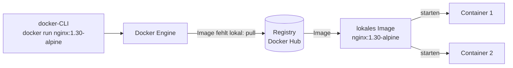

# Lab 1.1: Warum Container?

**Leitfragen:**

<details>
<summary>Warum läuft eine Anwendung auf dem Entwicklerrechner und auf dem Server manchmal unterschiedlich?</summary>

Weil die Umgebung abweicht: andere Python- oder Java-Version, fehlende Bibliothek, anderes Betriebssystem, andere Einstellungen. Der Code ist gleich, das Drumherum nicht.

</details>

<details>
<summary>Was müsste in einem Paket stecken, damit eine Anwendung überall gleich startet?</summary>

Der Code, die Laufzeit (z. B. Python), alle Bibliotheken, die nötigen Systemdateien und der Startbefehl. Genau das enthält ein Container-Image.

</details>

<details>
<summary>Warum startet eine virtuelle Maschine langsamer als ein normales Programm?</summary>

Eine virtuelle Maschine bootet ein komplettes eigenes Betriebssystem. Ein Container ist dagegen nur ein abgeschirmter Prozess auf dem vorhandenen Betriebssystem und startet in Sekunden.

</details>

- Ein Container verpackt eine Anwendung mit allem, was sie braucht, und läuft dadurch auf jedem Rechner mit Container-Engine gleich.
- Kubernetes (ab Modul 2) verwaltet Container; deshalb beginnt der Kurs mit ihnen.

## Begriffe

| Begriff | Bedeutung |
| --- | --- |
| Container | laufende, abgeschirmte Anwendung mit eigenem Dateisystem, eigener Netzwerkadresse und eigenen Prozessen; teilt sich den Kernel mit dem Rechner |
| Image | unveränderliche Vorlage für Container: Dateien plus Startbefehl; wie eine Installations-CD, aus der beliebig viele Container entstehen |
| Kernel | Kern des Betriebssystems, der Prozesse, Speicher und Hardware verwaltet |
| virtuelle Maschine (VM) | komplett nachgebauter Rechner mit eigenem Betriebssystem, betrieben von einem Hypervisor |
| Hypervisor | Software, die mehrere VMs auf einem physischen Rechner ausführt (z. B. Hyper-V, VMware) |
| Registry | Server, der Images speichert und verteilt; die bekannteste ist Docker Hub |
| Tag | Versionsbezeichnung eines Images hinter dem Doppelpunkt, z. B. `nginx:1.30-alpine` |
| Docker Engine | Hintergrunddienst (Daemon), der Images lädt und Container startet |
| Docker-CLI | Kommandozeilenprogramm `docker`, das Befehle an die Docker Engine schickt |
| Port-Freigabe | Weiterleitung eines Ports des eigenen Rechners in den Container, z. B. `-p 8080:80` |

## Container auf einen Blick


_Quelle: The Kubernetes Authors, „Overview" (https://kubernetes.io/docs/concepts/overview/), CC BY 4.0, abgerufen am 17.11.2026._

### Definition eines Containers

Ein Container ist ein Prozess, den das Betriebssystem vom Rest abschirmt: eigenes Dateisystem aus einem Image, eigene Netzwerkadresse, begrenzte Ressourcen. Er bringt seine Bibliotheken mit, nutzt aber den Kernel des Rechners.

### Schiffscontainer als Vergleich

Vor dem Normcontainer wurde jede Ladung einzeln verstaut; seit es die genormte Kiste gibt, verladen Kran, Schiff und Lkw alles gleich, egal was darin ist. Ein Software-Container ist diese Normkiste für Programme: Laptop, Testserver und Cloud starten ihn auf dieselbe Weise, egal ob Python, Java oder Datenbank darin steckt.

### Geschichte der Container

| Jahr | Schritt |
| --- | --- |
| 1979 | `chroot` in Version 7 Unix: ein Prozess sieht nur einen Teil des Dateisystems ([Wikipedia: chroot](https://en.wikipedia.org/wiki/Chroot)) |
| 2008 | LXC (Linux Containers): erste vollständige Container-Lösung im Linux-Kernel ([Wikipedia: LXC](https://en.wikipedia.org/wiki/LXC)) |
| 2013 | Docker, vorgestellt auf der PyCon im März 2013: Images bauen, teilen und starten mit einem einfachen Befehl ([Wikipedia: Docker](https://en.wikipedia.org/wiki/Docker_%28software%29)) |
| 2015 | Open Container Initiative (OCI), gegründet am 22.06.2015: offener Standard für Image-Format und Runtime ([opencontainers.org](https://opencontainers.org/about/overview/)) |

### Verbreitung von Docker 2025

In der Stack Overflow Developer Survey 2025 nutzen 71,1 % aller Befragten Docker; es ist damit das meistgenutzte Werkzeug der Kategorie ([survey.stackoverflow.co/2025](https://survey.stackoverflow.co/2025/technology), abgerufen am 17.11.2026).

### Bekannte Beispiele und Einsatzfälle

Bekannt sind die Docker Official Images `nginx`, `postgres`, `redis` und `python` auf Docker Hub; Dev Containers in VS Code ([containers.dev](https://containers.dev/)); CI-Pipelines wie GitHub Actions, die Jobs in Containern ausführen.

- Entwicklung: Datenbank oder Webserver per Einzeiler starten, ohne Installation.
- Auslieferung: dasselbe Image läuft in Test und Produktion.
- Betrieb: viele kleine Dienste (Microservices) auf wenigen Servern, verwaltet von Kubernetes.

## Container und virtuelle Maschine

| | Virtuelle Maschine | Container |
| --- | --- | --- |
| enthält | komplettes Betriebssystem + Anwendung | Anwendung + Bibliotheken, kein eigener Kernel |
| Größe | Gigabytes | meist 10–500 Megabytes |
| Start | Minuten (OS bootet) | Sekunden (Prozess startet) |
| Abschottung | stark (eigener Kernel) | gut, aber gemeinsamer Kernel |
| läuft auf | Hypervisor | Container-Runtime auf einem Betriebssystem |
| typisch für | verschiedene Betriebssysteme, harte Trennung | viele gleichartige Dienste, schnelle Auslieferung |

Linux-Container brauchen einen Linux-Kernel. Unter macOS und Windows startet Docker Desktop deshalb im Hintergrund eine kleine Linux-VM (unter Windows über WSL 2), in der alle Container laufen.

## Eigenschaften von Containern

| Eigenschaft | Bedeutung |
| --- | --- |
| Portabilität | dasselbe Image läuft auf dem Laptop, im eigenen Rechenzentrum (on-premises) und in der Cloud |
| Konsistenz | Entwicklung, Test und Produktion starten dasselbe Image; „Works on my machine" (läuft nur auf meinem Rechner) fällt weg |
| schneller Start | Sekunden, weil kein Betriebssystem bootet, nur ein Prozess aus einem fertigen Image startet |
| Effizienz | kein eigener Kernel: weniger Speicher und CPU als eine VM, mehr Anwendungen pro Server |
| Isolierung | eigene Prozesse, eigenes Dateisystem, eigene Netzwerkadresse; mehrere Container auf einem Rechner stören sich nicht |
| Skalierbarkeit | aus einem Image entstehen beliebig viele gleiche Container, die parallel Last abfangen; Grundlage für Kubernetes |
| Sicherheit | abgeschottetes Dateisystem und eingeschränkte Rechte; wegen des gemeinsamen Kernels schwächer getrennt als eine VM (Härtung in Lab 10.3) |

## Image, Container und Registry


_Quelle: Docker Inc., „What is Docker?" (https://docs.docker.com/get-started/docker-overview/), abgerufen am 17.11.2026._



- Das **Image** ist die Vorlage, der **Container** die laufende Instanz; aus einem Image entstehen beliebig viele Container.
- `docker run` lädt ein fehlendes Image automatisch aus der Registry (`pull`) und startet daraus einen Container.
- Ohne Registry-Angabe gilt Docker Hub: `nginx:1.30-alpine` heißt vollständig `docker.io/library/nginx:1.30-alpine`.
- Ohne Tag ergänzt Docker `:latest`; im Kurs stehen Tags immer dabei, damit klar ist, welche Version läuft.

## Docker Desktop, containerd und Podman

| Werkzeug | Was es ist | Rolle im Kurs |
| --- | --- | --- |
| Docker Desktop | Desktop-App für macOS/Windows/Linux: Docker Engine, CLI, grafische Oberfläche und ein lokales Kubernetes | Hauptwerkzeug |
| Docker Engine | der Dienst `dockerd`, der Container verwaltet; unter Linux auch ohne Desktop-App | steckt in Docker Desktop |
| containerd | schlanke Container-Runtime (CNCF-Projekt); arbeitet unter der Docker Engine und auf den meisten Kubernetes-Nodes | begegnet wieder in Lab 2.3 |
| Podman | Alternative von Red Hat ohne Hintergrunddienst; Befehle fast gleich (`podman run …`) | nicht im Kurs, Images sind kompatibel |

Alle vier halten sich an den OCI-Standard: Ein mit Docker gebautes Image läuft auch unter containerd, Podman und Kubernetes.

## Ein Container mit Port-Freigabe

```bash
docker run -d --name web -p 8080:80 nginx:1.30-alpine
#          │  │          │           └─ Image:Tag
#          │  │          └─ Port 8080 des Rechners -> Port 80 im Container
#          │  └─ Name des Containers (sonst vergibt Docker einen Zufallsnamen)
#          └─ "detached": im Hintergrund laufen lassen, Terminal bleibt frei
```

Der Webserver nginx lauscht im Container auf Port 80. Von außen ist er erst durch `-p 8080:80` erreichbar: `http://localhost:8080` landet im Container.

| Befehl | Wirkung |
| --- | --- |
| `docker ps` | laufende Container mit Image, Status, Ports und Name |
| `docker images` | lokal gespeicherte Images mit Tag und Größe |
| `docker pull nginx:1.30-alpine` | Image nur laden, ohne Container zu starten (z. B. vorab, bevor das Netz knapp wird) |
| `docker rm -f web` | Container stoppen und entfernen (Lebenszyklus in Lab 1.2) |

## Typische Fehler

| Symptom | Ursache | Lösung |
| --- | --- | --- |
| `Cannot connect to the Docker daemon` | Docker Desktop läuft nicht | Docker Desktop starten, auf `Engine running` warten |
| `Bind for 0.0.0.0:8080 failed: port is already allocated` | ein anderer Container oder Dienst nutzt Port 8080 | anderen Port wählen (`-p 8090:80`) oder alten Container entfernen |
| `Conflict. The container name "/web" is already in use` | Container mit dem Namen existiert noch | `docker rm -f web` (entfernt den Container) |
| `toomanyrequests: You have reached your pull rate limit` | Docker-Hub-Limit der gemeinsamen IP | `docker login` ([Setup](../../00-setup-and-installation.md#docker-hub-limit-und-docker-login)) |
| Browser zeigt nichts unter `localhost:80` | Port-Freigabe vergessen oder falscher Port | `docker ps` zeigt in der Spalte `PORTS` die Freigabe, z. B. `0.0.0.0:8080->80/tcp` |

## Fazit

- Container = Anwendung plus Abhängigkeiten als abgeschirmter Prozess; teilt den Kernel, startet in Sekunden.
- Image ist die Vorlage, Container die laufende Instanz, die Registry verteilt Images.
- Docker Desktop bringt Engine, CLI und lokales Kubernetes mit; OCI macht Images zwischen Docker, containerd, Podman und Kubernetes austauschbar.

In der Übung läuft der erste eigene Container: `hello-world`, danach ein nginx-Webserver im Browser.
