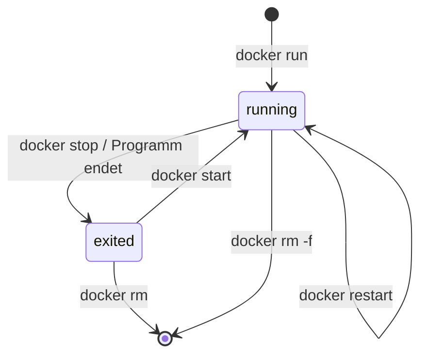
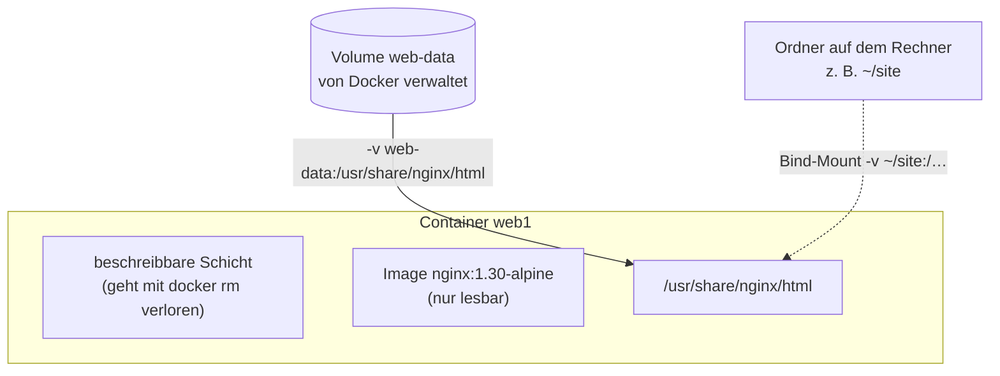

# Lab 1.2: Container bedienen

**Leitfragen:**

<details>
<summary>Wie lässt sich ein Programm beobachten, das im Hintergrund läuft?</summary>

Über seine Ausgaben (Logs) und indem man „hineinschaut": bei Containern mit `docker logs` und `docker exec`, das einen Befehl im laufenden Container ausführt.

</details>

<details>
<summary>Was soll mit Daten passieren, wenn ein Programm gelöscht und neu installiert wird?</summary>

Die Daten sollen bleiben. Bei Containern gehen Änderungen im Container mit ihm verloren; Daten, die bleiben sollen, gehören in ein Volume außerhalb des Containers.

</details>

- Ein Container durchläuft einen Lebenszyklus: erstellt, läuft, gestoppt, entfernt. Fünf Befehle steuern ihn.
- Logs, `exec` und Volumes sind die Werkzeuge, die später in Kubernetes unter fast gleichen Namen wiederkommen.

## Begriffe

| Begriff | Bedeutung |
| --- | --- |
| Lebenszyklus | die Zustände eines Containers von `created` über `running` und `exited` bis zum Entfernen |
| Log | alles, was das Programm im Container auf die Standardausgabe schreibt; Docker speichert es |
| `exec` | führt einen zusätzlichen Befehl in einem laufenden Container aus, z. B. eine Shell |
| Shell | Kommandozeile im Container, in Alpine-Images `sh` |
| Container-Dateisystem | Dateien des Images plus eine beschreibbare Schicht für Änderungen; die Schicht verschwindet mit dem Container |
| Volume | von Docker verwalteter Speicherbereich außerhalb des Containers; überlebt das Löschen des Containers |
| Bind-Mount | ein Ordner des eigenen Rechners, der im Container sichtbar gemacht wird |
| Mount-Pfad | Ordner im Container, an dem ein Volume oder Bind-Mount erscheint |
| Hauptprozess | das Programm, das der Container beim Start ausführt; endet es, endet der Container |
| Signal | Nachricht des Betriebssystems an ein Programm: `SIGTERM` = „bitte beenden", `SIGKILL` = sofort abbrechen |

## Lebenszyklus eines Containers



| Befehl | Wirkung |
| --- | --- |
| `docker run -d --name web -p 8081:80 nginx:1.30-alpine` | Container aus Image erstellen und starten |
| `docker ps` / `docker ps -a` | laufende / alle Container (auch gestoppte) anzeigen |
| `docker stop web` | Programm sauber beenden: `SIGTERM`, nach 10 s `SIGKILL` |
| `docker kill web` | sofort hart beenden (`SIGKILL`); nur, wenn `stop` nicht reagiert |
| `docker start web` | gestoppten Container wieder starten; Änderungen darin sind noch da |
| `docker restart web` | stoppen und starten in einem Schritt |
| `docker rm web` / `docker rm -f web` | gestoppten / laufenden Container entfernen |

`stop` und `start` behalten den Container samt Änderungen. Erst `rm` löscht ihn, und ein neuer `docker run` beginnt wieder beim unveränderten Image. `stop` gibt dem Programm Zeit, Dateien zu schließen und offene Anfragen zu beenden; `kill` nicht.

Ein Container läuft genau so lange wie sein Hauptprozess. nginx läuft dauerhaft, ein einzelner Befehl endet sofort:

```bash
docker run --rm busybox:1.37 echo "Hallo aus dem Container"   # gibt den Text aus, Container endet (exited)
docker run -it --rm busybox:1.37 sh                            # interaktive Shell in einem neuen Container; exit beendet ihn
```

`--rm` entfernt den Container nach dem Ende automatisch. `busybox` ist ein sehr kleines Image (wenige MB) mit den wichtigsten Linux-Befehlen.

## Ports, Logs und exec


_Quelle: Docker Inc., „What is a container?" (https://docs.docker.com/get-started/docker-concepts/the-basics/what-is-a-container/), abgerufen am 17.11.2026._

Der Dialog in Docker Desktop zeigt dieselben Optionen wie `docker run`: Name (`--name`), Port (`-p`), Volume (`-v`) und Umgebungsvariable (`-e`).

```bash
docker run -d --name web1 -p 8081:80 nginx:1.30-alpine   # zwei Container aus demselben Image,
docker run -d --name web2 -p 8082:80 nginx:1.30-alpine   # je eigener Name und eigener Port

docker logs web1                 # bisherige Ausgaben (bei nginx: jede Anfrage)
docker logs -f --tail 5 web1     # letzte 5 Zeilen, danach live mitlesen (Strg+C beendet)

docker exec web1 ls /usr/share/nginx/html          # ein Befehl im Container
docker exec -it web1 sh                            # interaktive Shell; exit beendet sie
```

- `-p <Rechner-Port>:<Container-Port>`: Beide Container lauschen intern auf Port 80, nach außen auf 8081 und 8082.
- `docker exec web1 sh -c '<Befehlszeile>'` startet im Container eine Shell, die genau diese Zeile ausführt; so funktionieren auch Umleitungen wie `>` im Container.
- `-it` verbindet Tastatur und Terminal mit dem Container (interaktiv, mit Terminal). Ohne `-it` läuft der Befehl, gibt seine Ausgabe zurück und endet.
- Nur unter Windows/Git Bash: `MSYS_NO_PATHCONV=1` muss gesetzt sein ([Setup](../../00-setup-and-installation.md#kurs-shell-bash)), sonst wird `/usr/share/…` umgeschrieben.


_Quelle: Docker Inc., „What is a container?" (https://docs.docker.com/get-started/docker-concepts/the-basics/what-is-a-container/), abgerufen am 17.11.2026._

In Docker Desktop zeigt ein Klick auf einen Container dieselben Informationen: **Logs**, **Exec** (Shell) und **Files** (Dateisystem).

## Dateien kopieren, Details und Verbrauch anzeigen

`docker cp` kopiert Dateien zwischen Rechner und Container, in beide Richtungen. Beispiel: Konfiguration von nginx holen, ändern, zurückspielen:

```bash
docker cp web1:/etc/nginx/conf.d/default.conf .              # Container -> Rechner (aktueller Ordner)
# default.conf im Editor ändern
docker cp default.conf web1:/etc/nginx/conf.d/default.conf   # Rechner -> Container
docker restart web1                                          # nginx liest seine Konfiguration beim Start
```

Die kopierte Datei liegt in der beschreibbaren Schicht und ist nach `docker rm` weg. Dauerhafte Konfiguration gehört in ein Bind-Mount, ein Volume oder ins Image (Lab 1.3).

| Befehl | Wirkung |
| --- | --- |
| `docker inspect web1` | alle Details als JSON: Image, Umgebungsvariablen, Ports, Mounts, Netzwerk, Zustand |
| `docker inspect -f '{{.State.Status}}' web1` | nur ein Feld ausgeben, hier `running` oder `exited` |
| `docker stats` | CPU, Speicher und Netzwerk je laufendem Container, live (`Strg+C` beendet) |
| `docker stats --no-stream` | dieselben Werte einmal ausgeben |

Docker Desktop zeigt dieselben Angaben in den Reitern **Inspect** und **Stats** eines Containers.

## Daten im Container, im Volume und im Bind-Mount

Jeder Container bekommt über den Dateien des Images eine eigene beschreibbare Schicht. Was ein Programm im Container ändert, landet dort und verschwindet mit `docker rm`.



| | Volume | Bind-Mount |
| --- | --- | --- |
| Angabe bei `docker run` | `-v web-data:/usr/share/nginx/html` (Name vorn) | `-v /pfad/auf/dem/rechner:/usr/share/nginx/html` (Pfad vorn) |
| liegt | im Speicher von Docker (bei Docker Desktop in der Linux-VM) | im gewählten Ordner des Rechners |
| verwaltet mit | `docker volume ls`, `docker volume rm` | Dateimanager, Editor |
| erstes Einbinden | ein leeres Volume übernimmt die Dateien des Images an diesem Pfad | der Ordner überdeckt die Dateien des Images |
| typisch für | Datenbanken, Daten der Anwendung | Quellcode in der Entwicklung, Konfigurationsdateien |

```bash
docker volume create web-data                       # Volume anlegen (docker run legt es sonst automatisch an)
docker run -d --name web1 -p 8081:80 \
  -v web-data:/usr/share/nginx/html nginx:1.30-alpine
docker volume ls                                    # vorhandene Volumes
docker volume rm web-data                           # Volume löschen (nur, wenn kein Container es nutzt)
```

Kubernetes kennt dasselbe Prinzip: Container sind flüchtig, Daten liegen in Volumes (vertieft in Modul 7).

## Typische Fehler

| Symptom | Ursache | Lösung |
| --- | --- | --- |
| `docker logs web1` bleibt leer | noch keine Anfrage an nginx | Seite im Browser aufrufen, Befehl wiederholen |
| `the input device is not a TTY` | Git-Bash-Fenster ohne echtes Terminal | `winpty docker exec -it web1 sh` oder Terminal in VS Code nutzen |
| `ls: C:/Program Files/Git/usr/share/nginx/html: No such file or directory` | Git Bash wandelt den Pfad um | `export MSYS_NO_PATHCONV=1` ([Setup](../../00-setup-and-installation.md#kurs-shell-bash)) |
| `bash: not found` bei `docker exec -it web1 bash` | Alpine-Images haben keine bash | `sh` statt `bash` |
| Änderung nach `docker rm` und neuem `docker run` weg | Änderung lag in der beschreibbaren Schicht | Daten in ein Volume legen |
| Container nach `docker restart` sofort `exited` | per `docker cp` eingespielte Konfiguration fehlerhaft | `docker logs web1` lesen, korrigierte Datei erneut kopieren (`docker cp` geht auch bei gestopptem Container), `docker start web1` |
| `volume is in use` bei `docker volume rm` | ein Container (auch gestoppt) nutzt das Volume | Container zuerst mit `docker rm -f` entfernen |

## Fazit

- `run`, `stop`, `start`, `rm` steuern den Lebenszyklus; `ps -a` zeigt auch gestoppte Container. Ein Container lebt so lange wie sein Hauptprozess.
- `logs`, `exec`, `inspect` und `stats` machen einen Container im Hintergrund beobachtbar; `cp` kopiert Dateien hinein und heraus.
- Änderungen im Container sind flüchtig; Volumes (von Docker verwaltet) und Bind-Mounts (Ordner des Rechners) halten Daten außerhalb.

In der Übung wird eine Änderung im Container zuerst verloren gehen und mit einem Volume danach erhalten bleiben.
