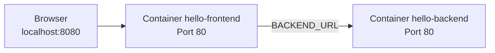

# Lab 1.3: Images bauen

**Leitfragen:**

<details>
<summary>Welche Schritte sind nötig, um eine Python-Web-App auf einem frischen Server zu starten?</summary>

Betriebssystem mit Python bereitstellen, Arbeitsordner anlegen, Abhängigkeiten installieren (`pip install`), Code kopieren, Einstellungen setzen, Programm starten. Ein Dockerfile schreibt genau diese Schritte einmal auf.

</details>

<details>
<summary>Woran soll später erkennbar sein, welche Version gerade läuft?</summary>

Am Namen des Images mit Versions-Tag (`hello-frontend:v2`) und an der Anwendung selbst, die ihre Version anzeigt. Ein Tag wie `latest` sagt darüber nichts.

</details>

- Ein Dockerfile ist das Rezept für ein Image: Zeile für Zeile, von oben nach unten.
- In diesem Lab entstehen die drei Images der Hello-App, mit denen der ganze Kurs arbeitet.

## Begriffe

| Begriff | Bedeutung |
| --- | --- |
| Dockerfile | Textdatei mit den Bauanweisungen für ein Image; heißt genau `Dockerfile` |
| Basisimage | fertiges Image, auf dem das eigene aufbaut (`FROM python:3.14-alpine`) |
| Anweisung | eine Zeile im Dockerfile, beginnt mit einem Schlüsselwort wie `COPY` oder `RUN` |
| Layer (Schicht) | Dateiänderung, die eine Anweisung erzeugt; ein Image ist ein Stapel solcher Schichten |
| Build-Cache | gespeicherte Schichten früherer Builds; unveränderte Schritte werden übersprungen |
| Build-Kontext | Ordner, dessen Dateien `docker build` an die Engine schickt; Quelle für `COPY` |
| `.dockerignore` | Liste von Dateien, die nicht in den Build-Kontext gelangen |
| Umgebungsvariable | benannter Wert, den ein Programm beim Start liest, z. B. `APP_COLOR=lightblue` |
| `host.docker.internal` | Name, unter dem ein Container bei Docker Desktop den eigenen Rechner erreicht |

## Die Hello-App

Die Hello-App besteht aus zwei kleinen Python-Webanwendungen (Flask) im Ordner `project/playground/`:

| Dienst | Ordner | Antwort | wichtige Umgebungsvariablen |
| --- | --- | --- | --- |
| Backend | `playground/backend/` | JSON mit Name, IP, Uhrzeit und Version | `APP_VERSION`, `PORT` |
| Frontend | `playground/frontend/` | HTML-Seite „Hello-App v1" in der Farbe `APP_COLOR`, mit eigener IP und der Antwort des Backends | `APP_VERSION`, `APP_COLOR`, `BACKEND_URL`, `PORT` |



Jeder Ordner enthält `app.py` (Code), `requirements.txt` (Python-Pakete) und `.dockerignore`; das Dockerfile entsteht in diesem Lab.

## Dockerfile-Anweisungen

| Anweisung | Wirkung | Beispiel |
| --- | --- | --- |
| `FROM` | Basisimage festlegen; immer die erste Anweisung | `FROM python:3.14-alpine` |
| `WORKDIR` | Arbeitsordner im Image anlegen und wechseln | `WORKDIR /app` |
| `COPY` | Dateien aus dem Build-Kontext ins Image kopieren | `COPY app.py .` |
| `RUN` | Befehl beim Bauen ausführen, Ergebnis wird Teil des Images | `RUN pip install --no-cache-dir -r requirements.txt` |
| `ENV` | Umgebungsvariable mit Standardwert setzen | `ENV APP_VERSION=v1` |
| `EXPOSE` | dokumentiert den Port der Anwendung (öffnet ihn nicht) | `EXPOSE 80` |
| `USER` | Benutzer, unter dem das Programm läuft (Standard: root) | `USER 10001` (genutzt in Lab 10.3) |
| `CMD` | Startbefehl des Containers, in JSON-Schreibweise | `CMD ["python", "app.py"]` |

`RUN` läuft beim **Bauen** (einmal), `CMD` beim **Starten** (bei jedem Container).

Weitere Anweisungen, die in fremden Dockerfiles häufig vorkommen (die Hello-App braucht sie nicht):

| Anweisung | Wirkung | Beispiel |
| --- | --- | --- |
| `ARG` | Build-Argument: Variable nur während des Bauens, Wert per `docker build --build-arg` | `ARG PYTHON_VERSION=3.14` |
| `ENTRYPOINT` | festes Startprogramm; `CMD` liefert dann nur noch die Standard-Argumente | `ENTRYPOINT ["python", "app.py"]` |
| `ADD` | wie `COPY`, lädt zusätzlich URLs herunter und entpackt lokale `.tar`-Archive; ohne diesen Bedarf `COPY` nehmen | `ADD app.tar.gz /app/` |
| `VOLUME` | markiert einen Ordner für Daten; ohne `-v` legt Docker bei jedem Start ein anonymes Volume dafür an | `VOLUME /data` |
| `LABEL` | Metadaten wie Herkunft oder Version; sichtbar mit `docker inspect` | `LABEL org.opencontainers.image.source="https://github.com/…"` |
| `HEALTHCHECK` | Docker prüft regelmäßig, ob die App antwortet; `docker ps` zeigt `(healthy)`. Kubernetes ignoriert die Anweisung und nutzt Probes (Lab 8.1) | `HEALTHCHECK CMD wget -qO- http://localhost/healthz \|\| exit 1` |

Details zu `ENTRYPOINT`, `ARG` und mehrstufigen Builds in der [Vertiefung](#vertiefung) am Ende.

## Das Dockerfile des Backends

```dockerfile
# Basisimage: Python 3.14 auf Alpine Linux (klein, aktuell unterstützt)
FROM python:3.14-alpine

# Arbeitsordner im Image; alle folgenden Pfade beziehen sich darauf
WORKDIR /app

# Erst nur die Abhängigkeiten kopieren und installieren: diese Schicht bleibt
# im Cache, solange sich requirements.txt nicht ändert
COPY requirements.txt .
RUN pip install --no-cache-dir -r requirements.txt

# Danach den Code kopieren (ändert sich oft)
COPY app.py .

# Standardwerte, beim Start überschreibbar (docker run -e …)
ENV APP_VERSION=v1 \
    PORT=80

# Dokumentiert den Port, auf dem die App lauscht
EXPOSE 80

# Startbefehl des Containers
CMD ["python", "app.py"]
```

Speicherort: `project/playground/backend/Dockerfile`. Das Frontend-Dockerfile ist gleich aufgebaut und setzt zusätzlich `APP_COLOR=lightblue`.

## Bauen, taggen, starten

```bash
cd playground/backend
docker build -t hello-backend:v1 .      # -t Name:Tag, "." = aktueller Ordner als Build-Kontext
cd ../..
docker images --filter "reference=hello-*"
```

- `hello-backend` ist der Name, `v1` die Version. Ein neuer Stand bekommt einen neuen Tag (`v2`), alte Tags bleiben erhalten und lassen sich jederzeit wieder starten.
- `latest` ist nur der Standard-Tag, keine Garantie für „neueste Version"; im Kurs trägt jedes Image einen festen Tag. Kubernetes behandelt `latest` zudem anders als feste Tags (Lab 3.1).
- `APP_VERSION` gehört fest ins Image; Farbe und Backend-Adresse lassen sich beim Start mit `-e` überschreiben.

```bash
docker run -d --name backend  -p 8081:80 hello-backend:v1
docker run -d --name frontend -p 8080:80 \
  -e BACKEND_URL=http://host.docker.internal:8081 hello-frontend:v1
```

Das Frontend ruft das Backend über `host.docker.internal:8081` auf: Dieser Name zeigt bei Docker Desktop aus jedem Container auf den eigenen Rechner, und dort leitet `-p 8081:80` weiter zum Backend-Container. `localhost` würde im Frontend-Container auf den Container selbst zeigen. Quelle: [Docker Desktop Networking](https://docs.docker.com/desktop/features/networking/networking-how-tos/), abgerufen am 17.11.2026.

## Layer und Build-Cache


_Quelle: Docker Inc., „Understanding the image layers" (https://docs.docker.com/get-started/docker-concepts/building-images/understanding-image-layers/), abgerufen am 17.11.2026._

Jede Anweisung, die Dateien verändert (`COPY`, `RUN`), legt eine Schicht auf das Basisimage. Beim nächsten Build prüft Docker von oben nach unten, ob sich eine Anweisung oder ihre Dateien geändert haben:


_Quelle: Docker Inc., „Docker build cache" (https://docs.docker.com/build/cache/), abgerufen am 17.11.2026._

- Bis zur ersten Änderung kommen alle Schritte aus dem Cache (`CACHED` in der Ausgabe), ab dort wird alles neu gebaut.
- Deshalb steht `COPY requirements.txt` + `pip install` **vor** `COPY app.py`: Eine Codeänderung baut nur die letzte Schicht neu, die Paketinstallation bleibt im Cache.
- Frontend `v2` unterscheidet sich nur in der `ENV`-Zeile; der Build dauert eine Sekunde, weil alle Schichten aus dem Cache kommen.

```bash
docker history hello-backend:v1     # Schichten des Images, die neueste oben
```

Die Ausgabe listet je Schicht die Anweisung, die sie erzeugt hat (Spalte `CREATED BY`), und ihre Größe (`SIZE`). `ENV`, `EXPOSE` und `CMD` ändern nur Metadaten und zeigen `0B`; die `RUN`-Zeile mit `pip install` ist die größte eigene Schicht. Die unteren Zeilen stammen aus dem Basisimage.

## Schlanke Basisimages

| Basisimage | ungefähre Größe | enthält |
| --- | --- | --- |
| `python:3.14` | ca. 1 GB | Debian mit Compiler und vielen Werkzeugen |
| `python:3.14-slim` | ca. 120–150 MB | Debian, nur das Nötigste |
| `python:3.14-alpine` | ca. 45–60 MB | Alpine Linux, sehr klein; nutzt `sh` statt `bash` |
| `scratch` | 0 MB | leeres Image ohne Betriebssystem; nur für Programme, die als einzelne Datei laufen (z. B. in Go kompiliert), siehe [Vertiefung](#mehrstufiger-build-multi-stage) |

Kleinere Images laden schneller und enthalten weniger Software, die Sicherheitslücken haben kann. In Kubernetes zählt das doppelt: Jeder Node lädt das Image selbst, und bei vielen Kopien und häufigen Updates entscheidet die Größe mit darüber, wie schnell neue Container starten. Ältere Python-Versionen wie 3.9 bekommen seit Oktober 2025 keine Sicherheitsupdates mehr ([python.org/downloads](https://www.python.org/downloads/)); im Kurs gilt 3.14. Größen Stand: 11/2026.

## .dockerignore

```text
__pycache__/
*.pyc
.venv/
.env
Dockerfile
.dockerignore
```

Was hier steht, landet nicht im Build-Kontext: keine lokalen Python-Caches, keine virtuelle Umgebung, keine `.env` mit Geheimnissen. Die Datei liegt bereits in `playground/backend/` und `playground/frontend/`.

## Typische Fehler

| Symptom | Ursache | Lösung |
| --- | --- | --- |
| `failed to read dockerfile: open Dockerfile: no such file or directory` | falscher Ordner oder Datei heißt anders (`dockerfile`, `Dockerfile.txt`) | `cd playground/backend`, Dateiname exakt `Dockerfile` |
| `COPY failed: "/requirements.txt": not found` | Build-Kontext stimmt nicht (Punkt vergessen oder falscher Ordner) | im App-Ordner mit `.` am Ende bauen |
| `unknown instruction: TODO:` | TODO-Zeile ohne `#` | jede `# TODO:`-Zeile ganz durch die Anweisung ersetzen |
| Container beendet sich sofort, `docker logs` zeigt `can't open file` | `CMD` falsch oder `app.py` nicht kopiert | `CMD ["python", "app.py"]`, `COPY app.py .` prüfen |
| Seite zeigt „Backend nicht erreichbar (http://localhost:8081)" | `BACKEND_URL` nicht gesetzt | Frontend mit `-e BACKEND_URL=http://host.docker.internal:8081` starten |
| Frontend `v2` zeigt noch v1 | alter Container läuft weiter | `docker rm -f frontend`, dann mit `hello-frontend:v2` starten |

## Fazit

- Ein Dockerfile beschreibt Schritt für Schritt, wie aus einem Basisimage ein eigenes Image wird; `RUN` beim Bauen, `CMD` beim Starten.
- Reihenfolge zählt: Seltenes oben, Häufiges unten, dann greift der Build-Cache.
- Jede Version bekommt einen eigenen Tag (`v1`, `v2`); Einstellungen wie Farbe und Backend-Adresse kommen beim Start von außen.

In der Übung entstehen aus zwei Startern die Images `hello-backend:v1`, `hello-frontend:v1` und `hello-frontend:v2`.

## Vertiefung

### ENTRYPOINT und CMD zusammen

`ENTRYPOINT` legt das Programm fest, `CMD` die Argumente, die ohne eigene Angabe gelten. Kleines Beispiel-Image `gruss:v1`:

```dockerfile
FROM busybox:1.37
ENTRYPOINT ["echo", "Hallo"]   # festes Programm mit erstem Argument
CMD ["Welt"]                   # Standard-Argument, beim Start ersetzbar
```

| Aufruf | im Container ausgeführt |
| --- | --- |
| `docker run --rm gruss:v1` | `echo Hallo Welt` |
| `docker run --rm gruss:v1 Kubernetes` | `echo Hallo Kubernetes` (Argumente hinter dem Image ersetzen `CMD`) |
| `docker run --rm --entrypoint date gruss:v1` | `date` (`--entrypoint` ersetzt `ENTRYPOINT`, `CMD` entfällt) |

- Die JSON-Schreibweise `["…", "…"]` startet das Programm direkt als Hauptprozess; so erreicht das `SIGTERM` von `docker stop` (Lab 1.2) das Programm. Die Schreibweise ohne Klammern (`CMD python app.py`) startet zuerst eine Shell.
- In Kubernetes heißen die beiden Felder `command` (ersetzt `ENTRYPOINT`) und `args` (ersetzt `CMD`); genutzt ab Lab 3.2.

### ARG und --build-arg

```dockerfile
ARG PYTHON_VERSION=3.14                  # Build-Argument mit Standardwert
FROM python:${PYTHON_VERSION}-alpine     # Basisimage hängt vom Argument ab
```

```bash
docker build --build-arg PYTHON_VERSION=3.13 -t hello-backend:py313 .
```

`ARG` gilt nur beim Bauen, `ENV` auch im laufenden Container. Passwörter gehören nicht in `ARG`: Die Werte bleiben in `docker history` sichtbar. Für Geheimnisse beim Bauen gibt es `RUN --mount=type=secret` ([Docker-Doku: Build secrets](https://docs.docker.com/build/building/secrets/)).

### Mehrstufiger Build (Multi-Stage)

Ein Dockerfile kann mehrere `FROM` enthalten. Die erste Stufe enthält Compiler und Werkzeuge, die letzte nur das fertige Programm:

```dockerfile
# Stufe 1: mit Go-Compiler bauen (mehrere hundert MB)
FROM golang:1.27-alpine AS build
WORKDIR /src
COPY . .                                   # Quellcode samt go.mod
RUN CGO_ENABLED=0 go build -o /out/app .   # eine einzelne, statische Programmdatei

# Stufe 2: nur das Programm, kein Betriebssystem (wenige MB)
FROM scratch
COPY --from=build /out/app /app            # Datei aus Stufe 1 übernehmen
ENTRYPOINT ["/app"]
```

Nur die letzte Stufe wird zum Image; Compiler und Quellcode bleiben draußen. Das Ergebnis ist klein und enthält kaum Angriffsfläche. Quelle: [Docker-Doku: Multi-stage builds](https://docs.docker.com/build/building/multi-stage/), abgerufen am 17.11.2026.
