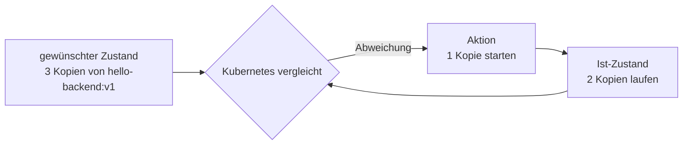

# Lab 2.1: Warum Kubernetes?

**Leitfragen:**

Zehn Container auf drei Servern, ein Server fällt nachts aus: was muss passieren und wer macht es?

Die Container des ausgefallenen Servers müssen auf den beiden anderen neu starten, und Anfragen dürfen nur noch dort ankommen. Ohne Werkzeug macht das die Rufbereitschaft von Hand; Kubernetes erledigt es automatisch.

Wie spielt man ein Update ein, ohne dass Nutzer es merken?

Schrittweise: neue Kopien starten, erst wenn sie bereit sind alte abschalten, bei Problemen zurück. Kubernetes nennt das Rolling Update.

- Docker startet Container auf einem Rechner. Für viele Container auf vielen Servern braucht es einen Orchestrator, der sie verteilt, überwacht und ersetzt.
- Kubernetes ist dieser Orchestrator und seit Jahren der Standard dafür.

## Begriffe

| Begriff | Bedeutung |
| --- | --- |
| Orchestrierung | automatisches Verteilen, Starten, Überwachen und Ersetzen vieler Container auf vielen Servern; wie ein Dirigent, der nicht selbst spielt, aber das Orchester steuert |
| Cluster | Gruppe von Servern, die Kubernetes gemeinsam verwaltet |
| Node | ein Server (physisch oder virtuell) im Cluster |
| gewünschter Zustand | Beschreibung, was laufen soll („3 Kopien von hello-backend:v1"); Kubernetes vergleicht ihn ständig mit dem Ist-Zustand |
| Replika | eine von mehreren gleichen Kopien einer Anwendung |
| Self-Healing | fällt eine Kopie aus, startet Kubernetes selbstständig eine neue |
| Skalieren | Anzahl der Kopien erhöhen oder senken |
| Rolling Update | Kopien nacheinander auf eine neue Version umstellen, ohne Ausfall |
| CNCF | Cloud Native Computing Foundation: Stiftung unter dem Dach der Linux Foundation, der Kubernetes gehört |

## Viele Container auf vielen Servern

Viele Anwendungen bestehen heute aus Microservices: kleinen, spezialisierten Diensten (Anmeldung, Warenkorb, Suche), jeder in eigenen Containern und meist in mehreren Kopien. So entstehen schnell Hunderte Container. Diese von Hand oder mit Skripten zu verwalten ist fehleranfällig und führt zu Ausfällen, Engpässen und ungleich verteilter Last.

Mit Docker allein startet jeder Container auf genau dem Rechner, auf dem `docker run` läuft. Im Betrieb kommen Fragen hinzu, die kein einzelner `docker run` beantwortet:

| Aufgabe | ohne Orchestrator | mit Kubernetes |
| --- | --- | --- |
| Server fällt aus | Container von Hand woanders starten | Ersatz startet automatisch auf einem anderen Node |
| Container stürzt ab | Skript oder Rufbereitschaft | Neustart durch Kubernetes |
| mehr Last | Server suchen, Container per Hand dazu | Anzahl der Replikas ändern |
| neue Version | Container stoppen, neuen starten, Ausfall | Rolling Update, Rückkehr per Befehl |
| Adresse der Anwendung | IP jedes Containers merken | eine feste Adresse vor allen Kopien |

## Kubernetes auf einen Blick

_Quelle: The Kubernetes Authors, „Running Multiple Instances of Your App" (https://kubernetes.io/docs/tutorials/kubernetes-basics/scale/scale-intro/), CC BY 4.0, abgerufen am 17.11.2026._

Das Bild zeigt das Grundprinzip: Vier Kopien einer Anwendung laufen auf drei Nodes; eine gemeinsame Adresse verteilt die Anfragen. Die Begriffe im Bild (Deployment, Service) folgen in Modul 4 und 5.

### Definition von Kubernetes

Kubernetes ist eine Open-Source-Plattform, die Container auf einem Cluster von Servern betreibt: Es startet sie nach einer Beschreibung des gewünschten Zustands, verteilt sie auf die Nodes, ersetzt ausgefallene Kopien, skaliert und rollt neue Versionen aus. Der Name ist griechisch für „Steuermann"; die Abkürzung **K8s** steht für K, acht Buchstaben, s.

### Hafenleitstelle als Vergleich

Container aus Lab 1.1 sind die Normkisten; Kubernetes ist die Hafenleitstelle. Die Leitstelle belädt die Schiffe nicht selbst, sondern entscheidet, welche Kiste auf welches Schiff kommt, bemerkt verlorene Kisten und lässt Ersatz verladen.

### Geschichte von Kubernetes

| Datum | Schritt |
| --- | --- |
| seit Mitte der 2000er | Google betreibt intern das System **Borg**, das alle Google-Dienste in Containern auf riesigen Clustern verteilt ([Borg-Blogpost](https://kubernetes.io/blog/2015/04/borg-predecessor-to-kubernetes/)) |
| 06.06.2014 | erster Commit von Kubernetes auf GitHub; Google-Ingenieure übertragen die Ideen von Borg in ein offenes Projekt |
| 21.07.2015 | Version 1.0; Google übergibt Kubernetes an die neu gegründete CNCF |
| seit 2015 | drei Releases pro Jahr; heute arbeiten Tausende Beitragende aus vielen Firmen mit |

Quelle: [10 Years of Kubernetes](https://kubernetes.io/blog/2024/06/06/10-years-of-kubernetes/), The Kubernetes Authors, abgerufen am 17.11.2026.

### Releases und unterstützte Versionen

- Etwa alle vier Monate erscheint eine neue Minor-Version, jede wird rund 14 Monate gepflegt.
- Unterstützt sind 1.37 (aktuell, 26.08.2026), 1.36 und 1.35; 1.34 und älter sind End-of-Life. Der Kurs arbeitet mit 1.36 oder 1.37.
- Quelle: [kubernetes.io/releases](https://kubernetes.io/releases/), Stand: 11/2026.

### Verbreitung von Kubernetes 2025

_Quelle: CNCF, „Annual Cloud Native Survey 2025" (https://www.cncf.io/announcements/2026/01/20/kubernetes-established-as-the-de-facto-operating-system-for-ai-as-production-use-hits-82-in-2025-cncf-annual-cloud-native-survey/), veröffentlicht am 20.01.2026, abgerufen am 17.11.2026._

82 % der Organisationen, die Container nutzen, betreiben Kubernetes in Produktion (2023: 66 %).

### Bekannte Nutzer und Einsatzfälle

- Alle großen Clouds bieten Kubernetes als Dienst an: Azure Kubernetes Service (AKS), Amazon EKS, Google Kubernetes Engine (GKE).
- Fallstudien von Spotify, Adidas, CERN und vielen weiteren: [cncf.io/case-studies](https://www.cncf.io/case-studies/) (z. B. [Spotify](https://www.cncf.io/case-studies/spotify/)).
- Einsatzfälle: Web-Anwendungen und APIs, Microservices, Batch-Jobs, interne Plattformen für Entwicklungsteams, zunehmend KI-Modelle (Inferenz).

## Funktionen von Kubernetes

| Funktion | Bedeutung | im Kurs |
| --- | --- | --- |
| Self-Healing | startet abgestürzte Container neu, ersetzt Kopien auf ausgefallenen Nodes, schickt Anfragen nur an bereite Kopien | Lab 4.1, 8.1 |
| horizontale Skalierung | mehr oder weniger Kopien per Befehl oder automatisch nach CPU-Last | Lab 4.2, 8.3 |
| vertikale Skalierung | einer Kopie mehr CPU und Arbeitsspeicher geben | Lab 8.2 |
| Service Discovery und Lastverteilung | Dienste finden sich über feste Namen und Adressen; Anfragen werden auf alle Kopien verteilt | Modul 5 |
| automatische Rollouts und Rollbacks | neue Version schrittweise ausrollen, bei Problemen zurück zur alten | Lab 4.3 |
| Konfiguration und Secrets | Einstellungen und Passwörter getrennt vom Image verwalten und ändern, ohne neu zu bauen | Lab 6.1, 6.2 |
| Storage-Orchestrierung | Speicher (lokal, Cloud, Netzwerk) automatisch an Container anbinden | Modul 7 |
| Batch-Aufgaben | einmalige und zeitgesteuerte Aufgaben (Jobs, CronJobs) neben Diensten | Lab 7.3 |
| automatisches Verteilen auf Nodes (Bin Packing) | Container nach benötigter CPU und Speicher so auf Nodes setzen, dass die Server gut ausgelastet sind | Lab 2.3, 8.2 |
| Zugriffskontrolle | Anmeldung und Rechte je Person und Programm, Trennung über Namespaces | Modul 10 |
| Erweiterbarkeit | neue Objektarten und Funktionen nachrüsten, ohne Kubernetes selbst zu ändern | Lab 5.3 |

Quelle: [Kubernetes Overview, „What Kubernetes can do for you"](https://kubernetes.io/docs/concepts/overview/), The Kubernetes Authors, abgerufen am 17.11.2026.

## Alternativen und wann Kubernetes zu groß ist

| Alternative | Kurz | passt, wenn … |
| --- | --- | --- |
| Docker Compose | mehrere Container auf **einem** Rechner per YAML-Datei | eine Anwendung, ein Server, Entwicklung |
| Docker Swarm | in Docker eingebaute, einfache Orchestrierung | kleine Cluster, wenig Lernaufwand |
| HashiCorp Nomad | schlanker Orchestrator für Container und andere Programme | gemischte Workloads, bestehende HashiCorp-Umgebung |
| verwaltete Container-Dienste (Azure Container Apps, AWS ECS/Fargate, Google Cloud Run) | Cloud betreibt die Orchestrierung unsichtbar | wenige Dienste, kein eigenes Plattform-Team |

Kubernetes ist zu groß, wenn eine einzelne Anwendung auf einem Server läuft, kein Team den Betrieb übernehmen kann oder ein verwalteter Dienst die Anforderungen schon erfüllt. Es lohnt sich bei vielen Diensten, mehreren Teams, Hochverfügbarkeit und häufigen Releases.

## Regelkreis aus Soll- und Ist-Zustand

Kubernetes arbeitet in einer Schleife: gewünschten Zustand lesen, Ist-Zustand beobachten, Unterschied beseitigen. Dieses Prinzip trägt durch den ganzen Kurs; Lab 2.3 zeigt, welche Komponenten die Schleife ausführen.

## Fazit

- Orchestrierung = viele Container auf vielen Servern automatisch verteilen, überwachen, ersetzen, skalieren und aktualisieren.
- Kubernetes stammt aus Googles Borg, ist seit 2015 bei der CNCF und heute der Standard (82 % der Container-Nutzer in Produktion).
- Kubernetes stellt einen beschriebenen gewünschten Zustand her und hält ihn; für eine einzelne kleine Anwendung reicht oft Docker Compose oder ein verwalteter Dienst.

In der Demo wird eine von drei Kopien gelöscht, und Kubernetes ersetzt sie sofort durch eine neue mit anderem Namen und anderer IP.
