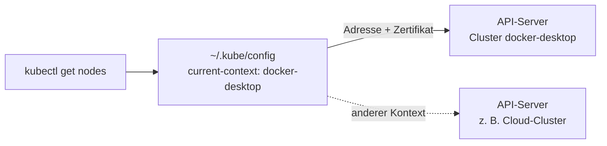

# Lab 2.2: Lokales Cluster starten

**Leitfragen:**

<details>
<summary>Wie kann ein Cluster aus mehreren Servern auf einem einzigen Laptop entstehen?</summary>

Indem die „Server" selbst nur Container oder kleine VMs sind. Docker Desktop, minikube und kind starten die Kubernetes-Komponenten in Containern auf dem Laptop; für Kubernetes sieht das wie ein echter Node aus.

</details>

<details>
<summary>Woher weiß ein Kommandozeilen-Tool, mit welchem Server es sprechen soll?</summary>

Aus einer Konfigurationsdatei mit Adresse, Zugangsdaten und einem ausgewählten Eintrag. Bei Kubernetes ist das die kubeconfig `~/.kube/config` mit ihrem aktuellen Kontext.

</details>

- Zum Lernen reicht ein Cluster mit einem Node auf dem eigenen Rechner; die Befehle sind dieselben wie in der Cloud.
- `kubectl` spricht mit dem Cluster; welcher das ist, steht in der kubeconfig.

## Begriffe

| Begriff | Bedeutung |
| --- | --- |
| lokales Cluster | Kubernetes auf dem eigenen Rechner, meist mit einem Node; zum Lernen und Testen |
| verwaltetes Cluster | Kubernetes, das ein Cloud-Anbieter betreibt (AKS, EKS, GKE); nur die Anwendungen sind eigene Aufgabe |
| `kubectl` | Kommandozeilen-Werkzeug, das Befehle als HTTPS-Anfragen an das Cluster schickt |
| API-Server | Eingang des Clusters, an den alle Anfragen gehen (Details in Lab 2.3) |
| kubeconfig | Datei `~/.kube/config` mit Clustern, Zugangsdaten und Kontexten |
| Kontext | benannte Kombination aus Cluster und Benutzer (und optional Namespace); der aktuelle Kontext bestimmt, wohin `kubectl` spricht |
| Provisioner | Art, wie Docker Desktop das Cluster aufbaut: **Kubeadm** (ein Node) oder **kind** (mehrere Nodes) |
| Status `Ready` | der Node ist gesund und kann Container ausführen |

## Optionen für ein Übungscluster

| Werkzeug | Aufbau | Stärken | Schwächen |
| --- | --- | --- | --- |
| **Docker Desktop, Kubeadm** (Kurs) | ein Node `docker-desktop` in der Docker-VM | ein Klick, selbst gebaute Images sofort nutzbar, `LoadBalancer` auf `localhost` | Version von Docker Desktop festgelegt; Lizenz für große Firmen |
| Docker Desktop, kind | mehrere Nodes als Container | Version wählbar, realistischer | braucht containerd-Image-Store |
| minikube | ein oder mehrere Nodes in Container oder VM | viele Add-ons, Version wählbar | Images per `minikube image load` laden |
| kind | Nodes als Container („Kubernetes in Docker") | schnell, beliebt in CI-Pipelines | Images per `kind load docker-image` laden |
| k3d / Rancher Desktop | k3s, ein schlankes Kubernetes, in Containern | sehr leicht | weicht in Details vom Standard ab |
| AKS, EKS, GKE | verwaltete Cluster in der Cloud | produktionsreif, mehrere echte Server | kostet Geld, braucht Cloud-Konto |

Für den Kurs gilt Docker Desktop mit Provisioner **Kubeadm**; minikube und kind sind der Fallback ([Setup](../../00-setup-and-installation.md#fallback-minikube-oder-kind)).


_Quelle: The Kubernetes Authors, „Using Minikube to Create a Cluster" (https://kubernetes.io/docs/tutorials/kubernetes-basics/create-cluster/cluster-intro/), CC BY 4.0, abgerufen am 17.11.2026._

Ein Cluster besteht aus einer Steuerzentrale (Control Plane) und Nodes, die die Container ausführen. Auf einem Laptop mit Docker Desktop fällt beides in den einen Node `docker-desktop`. Die Grafik ist älter und nennt Docker als Runtime auf den Nodes; heute steht dort meist containerd (Lab 2.3).

## kubectl, kubeconfig und Kontext



Die kubeconfig hat drei Listen und einen Zeiger (gekürzt, Zertifikate ausgeblendet):

```yaml
apiVersion: v1
kind: Config
clusters:                          # WOHIN: Adresse des API-Servers
- name: docker-desktop
  cluster:
    server: https://kubernetes.docker.internal:6443   # Docker Desktop; der Name zeigt auf 127.0.0.1
    certificate-authority-data: DATA+OMITTED
users:                             # WER: Zugangsdaten (hier ein Zertifikat)
- name: docker-desktop
  user:
    client-certificate-data: DATA+OMITTED
    client-key-data: DATA+OMITTED
contexts:                          # Paar aus Cluster + User (+ optional Namespace)
- name: docker-desktop
  context:
    cluster: docker-desktop
    user: docker-desktop
current-context: docker-desktop    # dieser Kontext gilt für jeden kubectl-Befehl
```

| Befehl | Wirkung |
| --- | --- |
| `kubectl config get-contexts` | alle Kontexte; `*` markiert den aktuellen |
| `kubectl config current-context` | nur den Namen des aktuellen Kontexts |
| `kubectl config use-context docker-desktop` | auf einen anderen Kontext wechseln |
| `kubectl config view --minify` | kubeconfig nur für den aktuellen Kontext, Geheimnisse ausgeblendet |

`kubectl get nodes` listet die Nodes des Clusters mit Status; `-o wide` (breit) ergänzt Spalten wie IP, Betriebssystem und Container-Runtime.

Die kubeconfig enthält Zugangsdaten: nicht teilen, nicht in Repositories ablegen. Wer mehrere Cluster nutzt (lokal und Firma), prüft vor jedem ändernden Befehl den Kontext.

## Version von Client und Cluster

```bash
kubectl version
```

```text
Client Version: v1.37.x        # kubectl auf dem Rechner
Kustomize Version: v5.x.x      # eingebautes Zusatzwerkzeug, für den Kurs nicht wichtig
Server Version: v1.37.x        # Kubernetes im Cluster
```

`kubectl` darf höchstens eine Minor-Version vom Cluster abweichen. Docker Desktop installiert ein passendes `kubectl`; ein älteres aus einer anderen Installation kann es überdecken (`which kubectl`). Kubernetes 1.35–1.37 sind unterstützt, Stand: 11/2026 ([kubernetes.io/releases](https://kubernetes.io/releases/)).

## Cluster anhalten, zurücksetzen und entfernen

Ein lokales Cluster belegt Arbeitsspeicher und CPU, auch wenn nichts darin läuft.

| Ziel | Docker Desktop (Kubeadm) | minikube | kind |
| --- | --- | --- | --- |
| Zustand prüfen | Statusleiste `Kubernetes running`, `kubectl get nodes` | `minikube status` | `kubectl get nodes` |
| vorübergehend anhalten | Docker Desktop beenden; beim nächsten Start läuft das Cluster wieder | `minikube stop` | – (Cluster löschen und neu erstellen) |
| leeren Ausgangszustand herstellen | **Kubernetes** > **Reset cluster** | `minikube delete`, dann `minikube start` | `kind delete cluster --name kurs`, dann neu erstellen |
| ganz entfernen | **Kubernetes** > **Stop**: entfernt die Cluster-Container und den Befehl `kubectl` von Docker Desktop | `minikube delete` | `kind delete cluster --name kurs` |

Ein Update von Docker Desktop hebt das Cluster nicht automatisch auf eine neue Kubernetes-Version; erst **Reset cluster** erstellt es mit der neuen Version, und dabei gehen alle Objekte darin verloren. Bedienung Stand: 11/2026, Quelle: [Explore the Kubernetes view](https://docs.docker.com/desktop/use-desktop/kubernetes/), abgerufen am 17.11.2026.

## Typische Fehler

| Symptom | Ursache | Lösung |
| --- | --- | --- |
| `The connection to the server localhost:8080 was refused` | keine kubeconfig oder leerer Kontext | Kubernetes in Docker Desktop erstellen; `kubectl config use-context docker-desktop` |
| `Unable to connect to the server: dial tcp 127.0.0.1:6443: connect: connection refused` | Cluster gestoppt oder Docker Desktop beendet | Docker Desktop starten, Statusleiste `Kubernetes running` abwarten |
| Node `NotReady` | Cluster startet noch | 1–2 Minuten warten; sonst **Kubernetes > Reset cluster** |
| falsches Cluster antwortet (anderer Node-Name) | anderer Kontext aktiv, z. B. aus der Firma | `kubectl config get-contexts`, dann `use-context docker-desktop` |
| `WARNING: version difference between client (1.3x) and server (1.3y) exceeds the supported minor version skew` | altes `kubectl` im Suchpfad | `which kubectl`, das kubectl von Docker Desktop nutzen |

## Fazit

- Docker Desktop (Kubeadm) liefert ein Ein-Node-Cluster `docker-desktop`, das selbst gebaute Images direkt nutzt; minikube und kind sind Alternativen.
- `kubectl` spricht per HTTPS mit dem API-Server; Adresse und Zugangsdaten stehen in `~/.kube/config`.
- Der aktuelle Kontext entscheidet, welches Cluster antwortet: `kubectl config get-contexts` zeigt ihn.

In der Übung entsteht das eigene Cluster, und `kubectl get nodes` meldet den Node `docker-desktop` als `Ready`.
