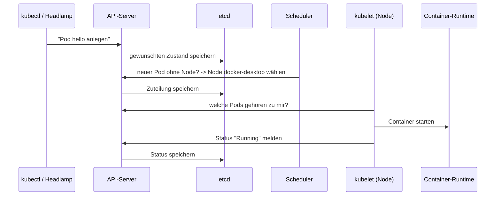
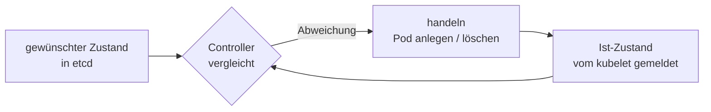

# Lab 2.3: Architektur eines Clusters

**Leitfragen:**

<details>
<summary>Wer entscheidet in einem Team mit zehn Servern, auf welchem Server ein neues Programm startet?</summary>

Jemand muss freie CPU und freien Speicher aller Server kennen und danach zuteilen. In Kubernetes macht das eine eigene Komponente, der Scheduler.

</details>

<details>
<summary>Wo muss der gewünschte Zustand gespeichert sein, damit er einen Serverausfall übersteht?</summary>

In einer Datenbank, die selbst ausfallsicher ist und nicht auf einem einzelnen Arbeitsserver liegt. Kubernetes nutzt dafür etcd in der Control Plane, in Produktion meist auf drei oder fünf Servern verteilt.

</details>

- Ein Cluster besteht aus der Control Plane (entscheidet und speichert) und Worker Nodes (führen Container aus).
- Alles läuft über den API-Server: `kubectl`, Headlamp und alle Komponenten sprechen nur mit ihm.

## Begriffe

| Begriff | Bedeutung |
| --- | --- |
| Control Plane | Steuerzentrale des Clusters; früher „Master" genannt |
| Worker Node | Server, auf dem die Container der Anwendungen laufen |
| API-Server (`kube-apiserver`) | einzige Tür ins Cluster; prüft jede Anfrage und speichert Änderungen in etcd |
| etcd | ausfallsichere Schlüssel-Wert-Datenbank mit dem gesamten Cluster-Zustand |
| Scheduler (`kube-scheduler`) | wählt für jeden neuen Pod einen passenden Node |
| Controller-Manager (`kube-controller-manager`) | führt die Regelkreise aus, die Ist- an Soll-Zustand angleichen |
| kubelet | Agent auf jedem Node; startet und überwacht die Container, die diesem Node zugeteilt sind, und startet abgestürzte neu |
| kube-proxy | richtet auf jedem Node die Netzwerkregeln für feste Service-Adressen ein (Modul 5) |
| Container-Runtime | Software, die Container tatsächlich startet; meist containerd, auch CRI-O |
| Pod | kleinste Einheit in Kubernetes: ein oder mehrere Container mit gemeinsamer IP (ausführlich in Lab 3.1) |
| Namespace `kube-system` | Bereich, in dem die Systemkomponenten des Clusters laufen |
| Headlamp | grafische Oberfläche für Kubernetes (Desktop-App), Nachfolger des Kubernetes Dashboard |

## Komponenten eines Clusters


_Quelle: The Kubernetes Authors, „Kubernetes Components" (https://kubernetes.io/docs/concepts/overview/components/), CC BY 4.0, abgerufen am 17.11.2026._

| Teil | Komponente | Aufgabe | Pod im Docker-Desktop-Cluster |
| --- | --- | --- | --- |
| Control Plane | API-Server | nimmt alle Anfragen an, prüft Rechte, schreibt nach etcd | `kube-apiserver-docker-desktop` |
| Control Plane | etcd | speichert gewünschten und aktuellen Zustand | `etcd-docker-desktop` |
| Control Plane | Scheduler | verteilt neue Pods auf Nodes | `kube-scheduler-docker-desktop` |
| Control Plane | Controller-Manager | Regelkreise: z. B. „3 Kopien gewünscht" | `kube-controller-manager-docker-desktop` |
| Control Plane | Cloud-Controller-Manager | spricht mit der Cloud (Load Balancer, Festplatten) | nur in Cloud-Clustern |
| jeder Node | kubelet | startet Container über die Runtime, meldet ihren Zustand | läuft als Programm auf dem Node, nicht als Pod |
| jeder Node | kube-proxy | Netzwerkregeln für Services | `kube-proxy-…` |
| jeder Node | Container-Runtime | startet Container (containerd, CRI-O) | Teil des Nodes |
| Add-on | CoreDNS | Namensauflösung im Cluster (Modul 5) | `coredns-…` (zwei Kopien) |

Im Docker-Desktop-Cluster liegen Control Plane und Worker auf demselben Node `docker-desktop`; dazu kommen Hilfs-Pods von Docker Desktop für Speicher und Netzwerk (`storage-provisioner`, `vpnkit-controller`). Die Systemkomponenten laufen selbst als Pods im Namespace `kube-system`.

Seit Kubernetes 1.24 startet kein Node mehr Container direkt über Docker („dockershim" entfernt); Standard ist containerd 2.x, containerd 1.x wird nur bis Kubernetes 1.35 unterstützt (Stand: 11/2026, [Kubernetes v1.35 Release](https://kubernetes.io/blog/2025/12/17/kubernetes-v1-35-release/)). Docker-Images laufen trotzdem überall, weil alle Runtimes den OCI-Standard lesen (Lab 1.1).

## Alles läuft über den API-Server

Was passiert, wenn ein neuer Pod angelegt wird:



- Keine Komponente spricht direkt mit einer anderen; alle lesen und schreiben über den API-Server.
- Fällt ein Worker Node aus, bleibt der gewünschte Zustand in etcd erhalten; die Controller starten die Pods auf anderen Nodes neu.

## Regelkreis der Controller



Das ist die Schleife aus Lab 2.1, jetzt mit den Komponenten: Der Controller-Manager vergleicht, der Scheduler wählt den Node, das kubelet führt aus.

## Gesundheit und Ressourcentypen prüfen

```bash
kubectl get pods -n kube-system            # -n = in diesem Namespace
kubectl get --raw /livez                   # lebt der API-Server? Antwort: ok
kubectl get --raw '/livez?verbose'         # dieselbe Prüfung mit allen Einzelchecks
kubectl api-resources                      # alle Objekttypen, die dieses Cluster kennt
```

`kubectl api-resources` listet jeden Objekttyp mit Kurzname, API-Version und ob er zu einem Namespace gehört, z. B. `pods` (`po`), `namespaces` (`ns`), `nodes` (`no`). Lab 2.4 erklärt, wie solche Objekte als Datei beschrieben werden.

## Headlamp

Das Kubernetes Dashboard wurde am 21.01.2026 archiviert; sein Nachfolger ist **Headlamp** aus der Kubernetes SIG UI (aktuell 0.46, Stand: 11/2026, [Kubernetes-Blog](https://kubernetes.io/blog/2026/06/01/dashboard-to-headlamp/)). Die Desktop-App nutzt dieselbe kubeconfig und damit dieselben Rechte wie `kubectl`.


_Quelle: The Kubernetes Authors, „From Kubernetes Dashboard to Headlamp" (https://kubernetes.io/blog/2026/06/01/dashboard-to-headlamp/), CC BY 4.0, abgerufen am 17.11.2026._

| `kubectl` | Headlamp |
| --- | --- |
| `kubectl get nodes` | Eintrag **Nodes** in der Navigation (Bereich **Cluster**) |
| `kubectl get pods -n kube-system` | **Workloads** > **Pods**, oben Namespace `kube-system` wählen |
| `kubectl describe pod <name>` | Klick auf den Pod: Details, Events, Container |
| `kubectl logs <name>` | im Pod das Symbol **Logs** |
| Zusammenhänge der Objekte | **Map** zeigt Objekte und ihre Beziehungen als Grafik |

Menünamen Stand: 11/2026, Headlamp 0.46.

## Typische Fehler

| Symptom | Ursache | Lösung |
| --- | --- | --- |
| `No resources found in default namespace.` bei `kubectl get pods` | Systempods liegen in `kube-system` | `-n kube-system` ergänzen |
| `kube-apiserver` fehlt in der Liste | anderer Provisioner oder verwaltetes Cluster: Control Plane ist dort unsichtbar | in Cloud-Clustern normal; im Kurs Kontext `docker-desktop` prüfen |
| Headlamp zeigt „Bad Gateway" oder keinen Cluster | Cluster gestoppt oder Headlamp vor dem Cluster gestartet | Cluster starten, Headlamp neu öffnen |
| Headlamp zeigt nur `default` | Namespace-Filter gesetzt | oben im Feld **Namespaces** den Filter leeren oder `kube-system` wählen |
| Git Bash: `kubectl get --raw /livez` meldet einen Pfad unter `C:/Program Files/Git/…` | Pfad-Umwandlung von Git Bash | `export MSYS_NO_PATHCONV=1` ([Setup](../../00-setup-and-installation.md#kurs-shell-bash)) |

## Fazit

- Control Plane = API-Server, etcd, Scheduler, Controller-Manager; jeder Node = kubelet, kube-proxy, Container-Runtime (meist containerd).
- Alle Komponenten und Werkzeuge sprechen nur mit dem API-Server; der Zustand liegt in etcd.
- Die Systemkomponenten sind selbst Pods in `kube-system`; Headlamp zeigt dasselbe wie `kubectl`, nur grafisch.

In der Übung werden diese Komponenten im eigenen Cluster gefunden, erst mit `kubectl`, dann in Headlamp.
