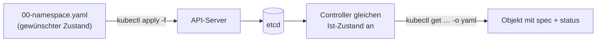

# Lab 2.4: Manifeste und deklaratives Arbeiten

**Leitfragen:**

<details>
<summary>Was ist leichter nachzuvollziehen: eine Liste von Befehlen oder eine Beschreibung des Ziels?</summary>

Die Beschreibung des Ziels: Diese zeigt auf einen Blick, was laufen soll, lässt sich wiederholt anwenden und versionieren. Bei einer Befehlsliste hängt das Ergebnis davon ab, was vorher schon da war.

</details>

<details>
<summary>Wie lassen sich Dinge von zwei Teams auf demselben Server auseinanderhalten?</summary>

Mit getrennten Bereichen, so wie Ordner im Dateisystem: gleiche Namen sind in verschiedenen Bereichen erlaubt, Rechte und Limits gelten je Bereich. In Kubernetes heißen diese Bereiche Namespaces.

</details>

- Kubernetes-Objekte werden als YAML-Datei beschrieben (Manifest) und mit `kubectl apply -f` an das Cluster geschickt.
- Ab diesem Lab liegen alle Objekte der Hello-App im Namespace `hello`.

## Begriffe

| Begriff | Bedeutung |
| --- | --- |
| Objekt | ein Eintrag im Cluster, z. B. ein Namespace oder Pod; Kubernetes speichert ihn in etcd |
| Manifest | YAML-Datei (seltener JSON), die ein oder mehrere Objekte beschreibt; das „Bauvorhaben" |
| imperativ | Befehl sagt, was zu tun ist: „erstelle X" (`kubectl create …`) |
| deklarativ | Datei sagt, wie es sein soll; Kubernetes gleicht an (`kubectl apply -f …`) |
| YAML | Textformat aus `Schlüssel: Wert`, Einrückung mit Leerzeichen und Listen mit `-` |
| `apiVersion`, `kind` | welche API-Version und welcher Objekttyp beschrieben wird |
| `metadata` | Name, Namespace und Etiketten des Objekts |
| `spec` | gewünschter Zustand (schreibt der Mensch) |
| `status` | aktueller Zustand (schreibt Kubernetes) |
| Namespace | benannter Bereich im Cluster, wie ein Ordner; Namen müssen nur innerhalb eines Namespace eindeutig sein |
| Dry-Run | Probelauf: Befehl wird geprüft, aber nichts im Cluster geändert |
| kuberc | Datei `~/.kube/kuberc` mit eigenen Aliasen und Standardoptionen für `kubectl` |
| KYAML | strengere Schreibweise von YAML für Kubernetes; Ausgabe mit `-o kyaml` |

## Imperativ und deklarativ

| | imperativ | deklarativ |
| --- | --- | --- |
| Beispiel | `kubectl create namespace hello` | `kubectl apply -f 00-namespace.yaml` |
| beschreibt | einen Schritt | den Zielzustand |
| zweimal ausführen | Fehler `AlreadyExists` | `unchanged`, kein Fehler |
| Änderung | neuer Befehl, z. B. `kubectl label …` | Datei ändern, erneut `apply` |
| nachvollziehbar | nur über Shell-Verlauf | Datei liegt im Projekt, lässt sich vergleichen und versionieren |
| typisch für | schnelles Ausprobieren, Vorlagen erzeugen | alles, was bleiben soll; ab jetzt im Kurs der Standard |



## YAML in fünf Regeln

```yaml
# Kommentar: alles nach # wird ignoriert
name: hello                 # Schlüssel: Wert (Leerzeichen nach dem Doppelpunkt)
metadata:                   # verschachteltes Objekt ...
  name: hello               # ... durch Einrückung mit 2 Leerzeichen, nie Tabulatoren
items:                      # Liste: jedes Element beginnt mit "- "
  - erster
  - zweiter
---                         # trennt mehrere Objekte in einer Datei
```

Werte wie `yes`, `no`, `on` oder `1.30` deutet YAML als Wahrheitswert oder Zahl; Text, der so aussieht, gehört in Anführungszeichen (`"1.30"`). Die YAML-Erweiterung in VS Code ([Setup](../../00-setup-and-installation.md#vs-code-mit-kubernetes--und-yaml-erweiterung)) markiert falsche Einrückung und unbekannte Felder sofort.

## Aufbau jedes Objekts

Jedes Kubernetes-Manifest hat dieselben vier Felder auf oberster Ebene. Das kleinste Beispiel ist der Namespace der Hello-App, `project/examples/m02-kubernetes-intro/l04-manifests/00-namespace.yaml`. Das Präfix `00-` sorgt dafür, dass `kubectl apply -f <ordner>/` die Datei zuerst anwendet: kubectl liest einen Ordner alphabetisch, und alle anderen Objekte brauchen den Namespace schon.

```yaml
apiVersion: v1          # API-Version des Objekttyps; Namespace gehört zur Kern-API "v1"
kind: Namespace         # Objekttyp, wie in kubectl api-resources (Lab 2.3)
metadata:
  name: hello           # Name; bei Namespaces clusterweit eindeutig
# spec: ...             # gewünschter Zustand; ein Namespace braucht keinen
```

Nach dem Anwenden ergänzt Kubernetes Felder; `kubectl get namespace hello -o yaml` zeigt das gespeicherte Objekt:

```yaml
apiVersion: v1
kind: Namespace
metadata:
  creationTimestamp: "2026-11-17T09:12:03Z"   # von Kubernetes gesetzt
  labels:
    kubernetes.io/metadata.name: hello        # automatisch vergebenes Etikett
  name: hello
  resourceVersion: "4711"                     # interne Versionsnummer, ignorierbar
  uid: 6f1c…                                  # eindeutige ID, ignorierbar
spec:
  finalizers:
  - kubernetes                                # beim Löschen erst Inhalte entfernen
status:
  phase: Active                               # aktueller Zustand: von Kubernetes geschrieben
```


_Quelle: Headlamp README (https://github.com/kubernetes-sigs/headlamp), Apache-2.0, abgerufen am 17.11.2026._

Headlamp zeigt für jedes Objekt dieselbe YAML-Ansicht (Stift-Symbol **Edit**). Änderungen dort wirken sofort, umgehen aber die Datei im Projekt; im Kurs wird deshalb immer die Datei geändert und neu angewendet.

## Manifeste finden, erzeugen und anwenden

| Befehl | Wirkung |
| --- | --- |
| `kubectl explain namespace` | Doku eines Objekttyps im Terminal |
| `kubectl explain pod.spec.containers` | Doku eines Felds, mit Punkten in die Tiefe |
| `kubectl create namespace hello --dry-run=client -o yaml` | Manifest erzeugen, ohne etwas anzulegen |
| `kubectl create namespace hello --dry-run=client -o yaml > playground/k8s/00-namespace.yaml` | dasselbe als Datei speichern (`>` leitet die Ausgabe um) |
| `kubectl apply -f playground/k8s/00-namespace.yaml` | Datei anwenden: anlegen oder angleichen |
| `kubectl apply -f playground/k8s/` | alle Manifeste eines Ordners anwenden |
| `kubectl diff -f playground/k8s/00-namespace.yaml` | zeigen, was `apply` ändern würde |
| `kubectl delete -f playground/k8s/00-namespace.yaml` | die beschriebenen Objekte löschen |
| `kubectl get namespace hello -o yaml` | gespeichertes Objekt als YAML |

`--dry-run=client` prüft nur lokal in `kubectl`; der Probelauf `--dry-run=server` schickt die Anfrage zusätzlich an den API-Server, ohne zu speichern.

## Namespaces als Ordner im Cluster

| Namespace | Inhalt |
| --- | --- |
| `default` | Ziel aller Befehle ohne Namespace-Angabe |
| `kube-system` | Systemkomponenten (Lab 2.3) |
| `kube-public` | öffentlich lesbare Daten, fast leer |
| `kube-node-lease` | Lebenszeichen der Nodes |
| `hello` | Hello-App ab diesem Lab |

```bash
kubectl get pods -n kube-system                           # -n: Namespace für diesen Befehl
kubectl get pods -A                                       # -A: alle Namespaces
kubectl config set-context --current --namespace=hello    # Standard-Namespace im Kontext setzen
kubectl config view --minify | grep namespace:            # prüfen: namespace: hello
```

Der Standard-Namespace wird im aktuellen Kontext der kubeconfig (Lab 2.2) gespeichert; jeder Befehl ohne `-n` gilt danach für `hello`. Pods, Services und Konfigurationen gehören zu einem Namespace, Nodes und Namespaces selbst gelten clusterweit (`NAMESPACED false` in `kubectl api-resources`). Lab 6.3 nutzt Namespaces für Dev und Prod.

## Neu 2025/2026: kuberc und KYAML

### kuberc für eigene Aliase

Beta und standardmäßig aktiv seit Kubernetes 1.34 (27.08.2025). Die Datei `~/.kube/kuberc` (Windows: `%USERPROFILE%\.kube\kuberc`) hält eigene Aliase und Standardoptionen für `kubectl`, getrennt von der kubeconfig und ohne Zugangsdaten. Beispiel: Alias `getw` für `get -o wide`:

```yaml
apiVersion: kubectl.config.k8s.io/v1beta1
kind: Preference
aliases:
- name: getw            # neuer Befehl: kubectl getw ...
  command: get          # führt kubectl get aus
  options:
  - name: output        # mit der Option --output (-o)
    default: wide       # Standardwert wide; ein eigenes -o auf der Kommandozeile gewinnt
```

`kubectl getw nodes` wirkt danach wie `kubectl get nodes -o wide`. Ein Abschnitt `defaults:` setzt Standardoptionen für vorhandene Befehle. Quelle: [Kubectl user preferences (kuberc)](https://kubernetes.io/docs/reference/kubectl/kuberc/), Stand: 11/2026.

### KYAML als eindeutige Ausgabe

Stabil seit Kubernetes 1.37 (26.08.2026). KYAML ist eine strengere Schreibweise von YAML mit `{}` für Objekte, `[]` für Listen und Text immer in Anführungszeichen. Einrückung spielt keine Rolle, `no` wird nie versehentlich zu `false`. Jede KYAML-Datei ist gültiges YAML; Manifeste müssen nicht umgeschrieben werden.

```bash
kubectl get namespace hello -o kyaml
```

```text
---
{
  apiVersion: "v1",
  kind: "Namespace",
  metadata: {
    name: "hello",
    …
  },
  status: {
    phase: "Active",
  },
}
```

Quellen: [Kubernetes v1.37 Release](https://kubernetes.io/blog/2026/08/26/kubernetes-v1-37-release/), [KYAML Reference](https://kubernetes.io/docs/reference/encodings/kyaml/), abgerufen am 17.11.2026.

## Typische Fehler

| Symptom | Ursache | Lösung |
| --- | --- | --- |
| `error converting YAML to JSON: yaml: line 3: mapping values are not allowed in this context` | Einrückung falsch oder Leerzeichen nach `:` fehlt | Einrückung mit 2 Leerzeichen; VS Code markiert die Stelle |
| `found character that cannot start any token` | Tabulator in der Datei | Tabulatoren durch Leerzeichen ersetzen |
| `Error from server (AlreadyExists): namespaces "hello" already exists` | `kubectl create` ein zweites Mal ausgeführt | deklarativ arbeiten: `kubectl apply -f …` |
| `error: the path "playground/k8s/00-namespace.yaml" does not exist` | Terminal steht nicht im Ordner `project/` | `cd` in den Ordner `project/`, `ls playground/k8s` prüfen |
| `No resources found in hello namespace.` | Namespace richtig gesetzt, aber noch leer | erwartet; die Pods folgen in Lab 3.1 |
| `error: unknown command "getw"` | `~/.kube/kuberc` fehlt, falsch eingerückt oder kuberc ist abgeschaltet (`KUBECTL_KUBERC=false`) | Datei und Einrückung prüfen; Variable entfernen |
| `unable to match a printer suitable for the output format "kyaml"` | `kubectl` älter als 1.35 | aktuelles `kubectl` von Docker Desktop nutzen (`which kubectl`) |

## Fazit

- Deklarativ arbeiten: Zielzustand als Manifest, `kubectl apply -f` beliebig oft; `create` nur zum Ausprobieren und für Vorlagen mit `--dry-run=client -o yaml`.
- Jedes Objekt hat `apiVersion`, `kind`, `metadata`, `spec`; `status` schreibt Kubernetes. `kubectl explain` erklärt jedes Feld.
- Namespaces trennen Objekte wie Ordner; der Standard-Namespace steht im Kontext. Neu: `~/.kube/kuberc` für eigene Aliase, `-o kyaml` für eindeutige Ausgabe.

In der Übung entsteht das erste Manifest der Hello-App: der Namespace `hello`, angewendet und als Standard gesetzt.
