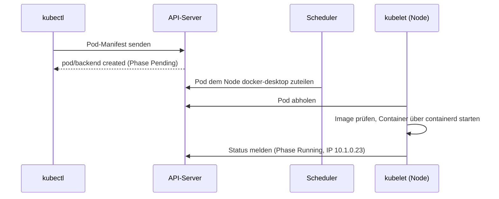
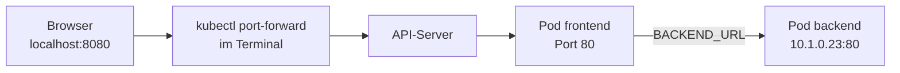

# Lab 3.1: Der erste Pod

**Leitfragen:**

<details>
<summary>Container gibt es schon: warum bräuchte ein Orchestrator eine eigene Einheit darum?</summary>

Manche Prozesse gehören so eng zusammen, dass sie immer gemeinsam starten, dieselbe Netzwerkadresse und dieselben Dateien nutzen sollen. Kubernetes plant deshalb nicht einzelne Container ein, sondern eine Hülle um einen oder mehrere Container: den Pod.

</details>

<details>
<summary>Wie kommt ein Browser auf dem Laptop an ein Programm, das im Cluster läuft?</summary>

Die Adressen im Cluster gelten nur im Cluster-Netz. Zum Testen leitet `kubectl port-forward` einen Port des Laptops zum Pod weiter; dauerhafte Zugänge von außen folgen in Modul 5.

</details>

- Ein Pod ist die kleinste Einheit, die Kubernetes startet: ein oder mehrere Container mit gemeinsamer IP-Adresse.
- Die Hello-App läuft ab jetzt als zwei Pods `backend` und `frontend` im Namespace `hello`.

## Begriffe

| Begriff | Bedeutung |
| --- | --- |
| Pod | Hülle um einen oder mehrere Container, die zusammen auf einem Node laufen; wie eine Wohnung, in der die Container als Mitbewohner Adresse und Vorräte teilen |
| Pod-IP | IP-Adresse, die jeder Pod beim Start bekommt; gilt nur im Cluster-Netz und ändert sich mit jedem neuen Pod |
| `env` | Liste von Umgebungsvariablen im Manifest, wie `docker run -e` aus Modul 1 |
| `imagePullPolicy` | Regel, wann der Node ein Image aus einer Registry lädt: immer, nur wenn es fehlt, oder nie |
| Phase | grober Lebensabschnitt eines Pods: `Pending`, `Running`, `Succeeded`, `Failed`, `Unknown` |
| Event | kurze Meldung des Clusters zu einem Objekt („Pod zugeteilt", „Container gestartet"); `kubectl describe` zeigt sie unten an |
| `kubectl exec` | führt einen Befehl in einem laufenden Container aus, wie `docker exec` |
| `kubectl port-forward` | leitet einen Port des eigenen Rechners durch den API-Server zu einem Pod weiter, solange der Befehl läuft |
| flüchtig | ein Pod wird nie repariert, nur ersetzt; der Ersatz hat einen neuen Namen oder eine neue IP |

## Pod als kleinste Einheit


_Quelle: Kubernetes-Dokumentation, „Viewing Pods and Nodes" (https://kubernetes.io/docs/tutorials/kubernetes-basics/explore/explore-intro/), CC BY 4.0, The Kubernetes Authors, abgerufen am 17.11.2026._

Jeder Kreis im Bild ist ein Pod mit eigener IP-Adresse. Darin laufen ein oder mehrere Container (Würfel) und optional Volumes (Zylinder), also gemeinsam genutzter Speicher.

| | Container (Modul 1) | Pod |
| --- | --- | --- |
| Was ist das? | ein laufender Prozess aus einem Image | Hülle um 1..n Container |
| Netzwerk | eigene IP im Docker-Netz | eine IP für alle Container im Pod; untereinander über `localhost` |
| Wer startet ihn? | `docker run` | Kubernetes, auf einem Node, den der Scheduler wählt |
| Wird verwaltet von | Docker | Kubernetes über den kubelet; die Container-Runtime (containerd) ist austauschbar |

Im Alltag enthält ein Pod meist genau einen Container. Wann ein zweiter Container hineingehört, zeigt Lab 3.2.

## Pod-Manifest des Backends

Ein Pod ist ein Objekt wie der Namespace aus Lab 2.4: `apiVersion`, `kind`, `metadata`, `spec`.

```yaml
# playground/k8s/backend-pod.yaml
apiVersion: v1                       # Pods gehören zur Kern-API (ohne Gruppe)
kind: Pod
metadata:
  name: backend                      # Name des Pods, eindeutig im Namespace
  labels:                            # Namensschilder zum Wiederfinden (Details in Lab 3.3)
    app: hello
    tier: backend
spec:
  containers:                        # Liste der Container im Pod, hier genau einer
    - name: backend                  # Name des Containers (für logs -c, exec -c)
      image: hello-backend:v1        # lokal gebautes Image aus Lab 1.3
      imagePullPolicy: Never         # nur das lokale Image nutzen
      ports:
        - containerPort: 80          # Port, auf dem Flask im Container lauscht
```

| Feld | Bedeutung |
| --- | --- |
| `spec.containers[].name` | Name des Containers innerhalb des Pods |
| `spec.containers[].image` | Image wie bei `docker run` |
| `spec.containers[].ports[].containerPort` | dokumentiert den Port; geöffnet wird er durch das Programm selbst |
| `metadata.labels` | Schlüssel-Wert-Paare, mit denen spätere Objekte Pods finden (Lab 3.3) |

Ein Namespace steht nicht im Manifest: `kubectl apply` legt den Pod im Standard-Namespace des Kontexts an, seit Lab 2.4 also in `hello`.

## Umgebungsvariablen mit env

Das Frontend liest die Adresse des Backends aus `BACKEND_URL`. Im Manifest steht sie unter `env`:

```yaml
    - name: frontend
      image: hello-frontend:v1
      imagePullPolicy: Never
      env:                           # wie docker run -e BACKEND_URL=...
        - name: BACKEND_URL
          value: "http://10.1.0.23"  # Pod-IP des Backends, von Hand eingetragen
```

Werte in `env` sind immer Text; Zahlen und `true` gehören in Anführungszeichen.

## imagePullPolicy und lokale Images

| Wert | Verhalten | Standard, wenn nicht gesetzt |
| --- | --- | --- |
| `Always` | lädt bei jedem Start aus der Registry (prüft den aktuellen Stand) | bei Tag `:latest` oder ohne Tag |
| `IfNotPresent` | lädt nur, wenn das Image auf dem Node fehlt | bei jedem anderen Tag, z. B. `:v1` |
| `Never` | lädt nie; fehlt das Image, startet der Pod nicht | – |

Die Images `hello-*` gibt es in keiner Registry, nur lokal aus Lab 1.3. Der Docker-Desktop-Cluster (Provisioner kubeadm) sieht die lokalen Docker-Images; `Never` stellt sicher, dass er nie versucht, sie von Docker Hub zu laden. Stand: 11/2026, Quelle: [docs.docker.com/desktop/use-desktop/kubernetes](https://docs.docker.com/desktop/use-desktop/kubernetes/).

## Vom Manifest zum laufenden Pod

Ablauf nach `kubectl apply -f backend-pod.yaml` (Komponenten aus Lab 2.3):



| Phase | Bedeutung |
| --- | --- |
| `Pending` | angenommen, aber noch nicht alle Container laufen (kein Node gefunden, Image fehlt, Start läuft) |
| `Running` | dem Node zugeteilt, mindestens ein Container läuft |
| `Succeeded` | alle Container haben sich erfolgreich beendet (typisch für einmalige Aufgaben, Lab 7.3) |
| `Failed` | alle Container beendet, mindestens einer mit Fehler |
| `Unknown` | der Node meldet sich nicht |

Die Spalte `STATUS` von `kubectl get pods` zeigt oft einen genaueren Grund als die Phase, z. B. `ContainerCreating`; die Fehlerbilder folgen in Lab 3.4.

## Pods untersuchen

| Befehl | zeigt |
| --- | --- |
| `kubectl get pods -o wide` | Status, Neustarts, Pod-IP und Node |
| `kubectl describe pod backend` | alle Details, unten die Events |
| `kubectl logs backend` | Ausgabe (stdout/stderr) des Containers |
| `kubectl logs -f frontend` | Ausgabe live mitlesen, Ende mit **Strg+C** |
| `kubectl exec backend -- env` | einen Befehl im Container ausführen |
| `kubectl exec -it frontend -- sh` | Shell im Container öffnen, Ende mit `exit` |
| `kubectl delete pod backend` | Pod löschen |

```text
$ kubectl get pods -o wide
NAME       READY   STATUS    RESTARTS   AGE   IP          NODE             NOMINATED NODE   READINESS GATES
backend    1/1     Running   0          40s   10.1.0.23   docker-desktop   <none>           <none>
frontend   1/1     Running   0          12s   10.1.0.24   docker-desktop   <none>           <none>
```

Wichtig sind `READY` (bereite Container / alle Container), `STATUS`, `RESTARTS` und `IP`; die letzten beiden Spalten sind vorerst ohne Belang. Die IPs im eigenen Cluster weichen ab.

Headlamp (Lab 2.3) zeigt dieselben Informationen unter **Workloads → Pods**; dort öffnet das Terminal-Symbol eine Shell im Container wie `kubectl exec -it`:


_Quelle: Headlamp-README (https://github.com/kubernetes-sigs/headlamp), Apache-2.0, abgerufen am 17.11.2026._

## Port-Forward vom Laptop in den Pod



```bash
kubectl port-forward pod/frontend 8080:80     # lokaler Port 8080 -> Pod-Port 80
```

```text
Forwarding from 127.0.0.1:8080 -> 80
Forwarding from [::1]:8080 -> 80
Handling connection for 8080
```

Der Befehl blockiert das Terminal; die Weiterleitung endet mit **Strg+C** oder wenn der Pod verschwindet. Für Tests reicht das, für Anwender nicht (dafür Services, Modul 5).

## Pods sind flüchtig

- Ein gelöschter oder abgestürzter Pod kommt nicht von selbst zurück; ein neu angelegter Pod gleichen Namens bekommt in der Regel eine neue IP.
- Das Frontend kennt das Backend nur über die fest eingetragene IP. Nach dem Neuanlegen des Backends zeigt die Seite `Backend nicht erreichbar (http://10.1.0.23): ConnectTimeout` (oder `ConnectionError`).
- Die meisten Felder eines laufenden Pods sind unveränderlich, z. B. `env`. Für eine neue `BACKEND_URL` heißt es: Pod löschen, Datei ändern, neu anwenden.

Feste Namen statt IPs liefern Services (Lab 5.1); Pods automatisch ersetzen lassen sich mit ReplicaSets und Deployments (Modul 4).

## Typische Fehler

| Symptom | Ursache | Lösung |
| --- | --- | --- |
| `STATUS` `ErrImageNeverPull` | Image `hello-*` fehlt lokal oder Tippfehler im Tag | `docker images` prüfen, ggf. `bash build-images.sh` (Ordner `project/`) |
| Pod landet im Namespace `default` | Kontext hat keinen Standard-Namespace | `kubectl config set-context --current --namespace=hello` (Lab 2.4) |
| `The Pod "frontend" is invalid: spec: Forbidden: pod updates may not change fields other than ...` | `env` oder `command` eines laufenden Pods geändert | `kubectl delete pod frontend`, dann `kubectl apply -f ...` |
| `unable to listen on port 8080` | Port 8080 auf dem Laptop belegt (z. B. zweites Port-Forward) | anderes Terminal schließen oder `8081:80` nutzen |
| Seite zeigt `Backend nicht erreichbar` | IP in `BACKEND_URL` falsch oder veraltet | aktuelle IP mit `kubectl get pod backend -o wide` holen, Frontend neu anlegen |

## Fazit

- Ein Pod verpackt einen oder mehrere Container mit einer gemeinsamen IP; das Manifest beschreibt Image, Port und `env`.
- `get -o wide`, `describe`, `logs`, `exec` und `port-forward` reichen, um einen Pod zu prüfen und im Browser zu sehen.
- Pods sind flüchtig: neue Pods haben neue IPs; eine von Hand eingetragene Pod-IP ist nur eine Übergangslösung.

In der Übung laufen Backend und Frontend als Pods, und die Hello-Seite erscheint im Browser.
