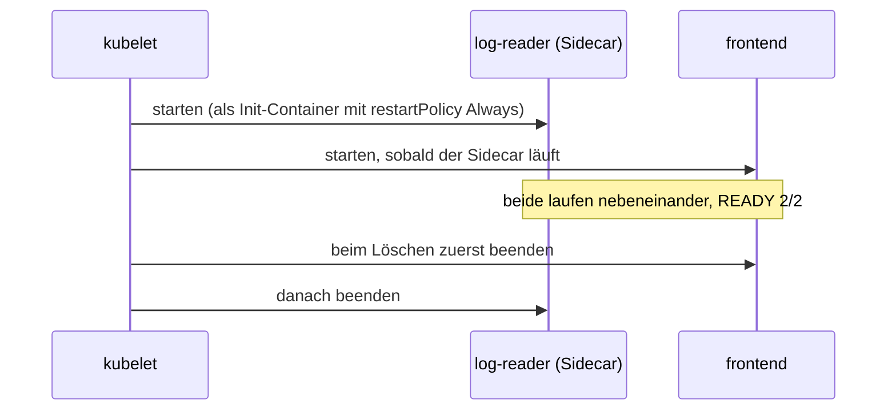
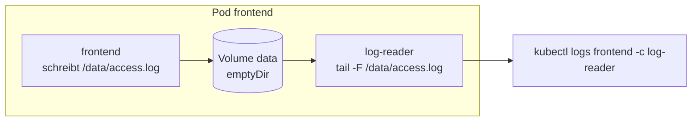

# Lab 3.2: Mehrere Container in einem Pod

**Leitfragen:**

<details>
<summary>Ein Programm schreibt Logs in eine Datei: wie kommen sie heraus, ohne das Programm zu ändern?</summary>

Ein zweiter, kleiner Prozess liest die Datei mit und gibt jede Zeile aus. Dafür muss er dieselben Dateien sehen wie das Programm: ein Hilfscontainer im selben Pod mit einem gemeinsamen Verzeichnis.

</details>

<details>
<summary>Was spricht dagegen, Frontend und Datenbank in denselben Pod zu packen?</summary>

Container eines Pods starten, laufen und sterben gemeinsam. Drei Frontend-Kopien hießen dann drei Datenbanken, und ein Frontend-Update startete die Datenbank neu. Eigenständige Dienste gehören in eigene Pods.

</details>

- Ein zweiter Container gehört nur dann in einen Pod, wenn er der Hauptanwendung hilft und ihren Lebenszyklus teilt.
- Das Frontend der Hello-App bekommt einen Sidecar `log-reader`, der das `access.log` mitliest.

## Begriffe

| Begriff | Bedeutung |
| --- | --- |
| Hauptcontainer | der Container, der die eigentliche Anwendung ausführt, hier `frontend` |
| Hilfscontainer | weiterer Container im Pod, der der Hauptanwendung zuarbeitet (Logs, Daten holen, Proxy) |
| Init-Container | Container, der vor allen anderen startet, eine Aufgabe erledigt und sich beendet; z. B. warten, bis ein anderer Dienst antwortet |
| Sidecar-Container | Hilfscontainer, der die ganze Laufzeit neben dem Hauptcontainer mitläuft, wie ein Beiwagen am Motorrad |
| nativer Sidecar | Init-Container mit `restartPolicy: Always`: startet vor dem Hauptcontainer und läuft danach weiter |
| Volume | Speicherbereich, den Kubernetes an einen Pod hängt; Container sehen ihn als Ordner |
| `emptyDir` | einfachste Volume-Art: ein leerer Ordner, der mit dem Pod entsteht und mit ihm gelöscht wird |
| `volumeMounts` | Feld im Container: welches Volume unter welchem Pfad erscheint |
| `-c <name>` | Option von `kubectl logs` und `exec`, die einen Container im Pod auswählt |

## Wann zwei Container in einen Pod gehören


_Quelle: Kubernetes-Dokumentation, „Pods" (https://kubernetes.io/docs/concepts/workloads/pods/), CC BY 4.0, The Kubernetes Authors, abgerufen am 17.11.2026._

Im Bild holt ein Hilfscontainer (File Puller) Dateien in ein gemeinsames Volume, der Webserver liefert sie aus. Beide teilen IP, Volume und Lebenszyklus.

| In einen Pod | In getrennte Pods |
| --- | --- |
| Hilfsprozess, der ohne die Anwendung sinnlos ist (Log-Leser, Datei-Synchronisierung, lokaler Proxy) | eigenständiger Dienst mit eigener Aufgabe (Datenbank, Backend, Cache) |
| muss dieselben Dateien oder `localhost` nutzen | spricht über das Netz mit anderen |
| skaliert immer 1:1 mit der Anwendung | soll unabhängig skalieren oder aktualisiert werden |

Für die Hello-App heißt das: `backend` und `frontend` bleiben getrennte Pods; der Log-Leser gehört zum Frontend.

## Muster für Hilfscontainer

Hilfscontainer haben je nach Aufgabe eigene Namen. Technisch sind alle drei Sidecars mit denselben Feldern wie unten; der Name beschreibt nur die Rolle (Quelle: [The Distributed System ToolKit: Patterns for Composite Containers](https://kubernetes.io/blog/2015/06/the-distributed-system-toolkit-patterns/)).

| Muster | Aufgabe des Hilfscontainers | Beispiel |
| --- | --- | --- |
| Sidecar | ergänzt die Anwendung um eine Funktion, ohne ihren Code zu ändern | Log-Leser `log-reader` (dieses Lab), Dateien synchronisieren, Zertifikate erneuern |
| Ambassador | Stellvertreter nach außen: die Anwendung spricht nur `localhost` an, der Hilfscontainer leitet an den echten Dienst weiter | lokaler Proxy, der Anfragen auf mehrere Datenbank-Server verteilt oder die Anmeldung bei einem Cloud-Dienst übernimmt |
| Adapter | übersetzt die Ausgabe der Anwendung in das Format, das andere Systeme erwarten | Kennzahlen eines älteren Programms für ein Monitoring-System aufbereiten (Lab 11.3), Logformate vereinheitlichen |

## Init-Container und Sidecar im Vergleich

| | Init-Container | nativer Sidecar | zweiter Eintrag in `containers` |
| --- | --- | --- | --- |
| Feld | `initContainers` | `initContainers` mit `restartPolicy: Always` | `containers` |
| startet | vor allen anderen, nacheinander | vor dem Hauptcontainer | gleichzeitig mit dem Hauptcontainer |
| läuft | bis zum Ende seiner Aufgabe | so lange wie der Pod | so lange wie der Pod |
| typisch | auf Datenbank warten, Schema anlegen, Datei vorbereiten | Logs weiterleiten, Proxy, Daten nachladen | zweite gleichwertige Anwendung (selten sinnvoll) |

Ein klassischer Init-Container, der wartet, bis das Backend antwortet (nur zur Illustration, nicht Teil der Hello-App):

```yaml
spec:
  initContainers:
    - name: wait-for-backend
      image: busybox:1.37
      command: ["sh", "-c", "until wget -q -O- http://10.1.0.23; do echo warte; sleep 2; done"]
  containers:
    - name: frontend               # startet erst, wenn wait-for-backend sich beendet hat
      image: hello-frontend:v1
```

## Native Sidecar-Container

Neu 2025: Sidecar-Container sind seit Kubernetes 1.33 (23.04.2025) stabil (GA). Quelle: [Kubernetes v1.33 Release](https://kubernetes.io/blog/2025/04/23/Kubernetes-v1-33-release/), [Sidecar Containers](https://kubernetes.io/docs/concepts/workloads/pods/sidecar-containers/).

Vorher lief ein Hilfscontainer einfach als zweiter Eintrag in `containers`. Folgen: keine feste Startreihenfolge, und bei einmaligen Aufgaben (Lab 7.3) endete der Pod nie, weil der Hilfscontainer weiterlief. Ein nativer Sidecar löst beides:



Stürzt der Sidecar ab, startet der kubelet ihn neu, ohne den Hauptcontainer anzufassen.


_Quelle: Kubernetes-Dokumentation, „Logging Architecture" (https://kubernetes.io/docs/concepts/cluster-administration/logging/), CC BY 4.0, The Kubernetes Authors, abgerufen am 17.11.2026._

Das Bild zeigt genau das Muster dieses Labs: ein Streaming-Container gibt die Datei-Logs der Anwendung auf stdout aus; damit erreicht `kubectl logs` sie (und später ein zentrales Logging, Lab 11.3).

## Gemeinsames Verzeichnis mit emptyDir

Container im selben Pod teilen die IP, aber nicht automatisch Dateien. Ein Volume macht einen Ordner für mehrere Container sichtbar. Hier genügt `emptyDir`; die übrigen Volume-Arten folgen in Lab 7.1.



## Frontend-Pod mit Sidecar log-reader

```yaml
# playground/k8s/frontend-pod.yaml
apiVersion: v1
kind: Pod
metadata:
  name: frontend
  labels:
    app: hello
    tier: frontend
spec:
  initContainers:
    - name: log-reader
      image: busybox:1.37            # kleines Image mit sh, touch und tail
      restartPolicy: Always          # macht aus dem Init-Container einen Sidecar
      command: ["sh", "-c", "touch /data/access.log && tail -F /data/access.log"]
      volumeMounts:
        - name: data                 # Volume "data" ...
          mountPath: /data           # ... im Sidecar unter /data
  containers:
    - name: frontend
      image: hello-frontend:v1
      imagePullPolicy: Never
      ports:
        - containerPort: 80
      env:
        - name: BACKEND_URL
          value: "http://10.1.0.23"  # eigene Backend-IP aus Lab 3.1
      volumeMounts:
        - name: data                 # dasselbe Volume im Frontend:
          mountPath: /data           # hier schreibt es access.log
  volumes:
    - name: data
      emptyDir: {}                   # leerer Ordner, lebt so lange wie der Pod
```

- `touch` legt die Datei an, falls das Frontend noch nichts geschrieben hat; `tail -F` gibt danach jede neue Zeile aus.
- Das Frontend schreibt bei jedem Seitenaufruf eine Zeile `<Zeit> <Pod> <IP> <Version>` nach `/data/access.log`.
- `busybox:1.37` kommt von Docker Hub; der Node lädt es beim ersten Start (Standard `IfNotPresent`).

## Logs eines bestimmten Containers

```bash
kubectl get pod frontend                      # READY 2/2: Sidecar und Frontend laufen
kubectl logs frontend                         # ohne -c: der erste Container in containers
kubectl logs -f frontend -c log-reader        # Ausgabe des Sidecars live
```

```text
NAME       READY   STATUS    RESTARTS   AGE
frontend   2/2     Running   0          20s
```

`kubectl logs frontend` meldet zuerst `Defaulted container "frontend" out of: frontend, log-reader (init)` und zeigt dann die Ausgabe des Frontends. `kubectl describe pod frontend` listet den Sidecar unter `Init Containers` mit `Restart Policy: Always`.

## Typische Fehler

| Symptom | Ursache | Lösung |
| --- | --- | --- |
| `pod updates may not change fields other than ...` | Container zu laufendem Pod hinzugefügt | Pod löschen, dann neu anwenden |
| `spec.initContainers[0].volumeMounts[0].name: Not found: "data"` | Volume unter `volumes` fehlt oder heißt anders | Namen in `volumes` und `volumeMounts` angleichen |
| `READY 1/2`, Sidecar startet immer wieder | Tippfehler im `command`, z. B. falscher Pfad | `kubectl logs frontend -c log-reader` lesen, Befehl korrigieren |
| Sidecar-Log bleibt leer | Seite seit dem Start nicht aufgerufen, oder `mountPath` im Frontend fehlt | Port-Forward starten, Seite neu laden; `volumeMounts` in beiden Containern prüfen |
| `STATUS Init:ErrImagePull` | `busybox:1.37` nicht ladbar (Netz, Docker-Hub-Limit) | `docker pull busybox:1.37`, ggf. `docker login`; Pod neu anlegen |

## Fazit

- Hilfscontainer gehören in den Pod der Anwendung, eigenständige Dienste in eigene Pods.
- Ein nativer Sidecar ist ein Init-Container mit `restartPolicy: Always`: startet zuerst, läuft mit, endet zuletzt.
- `emptyDir` gibt Containern eines Pods einen gemeinsamen Ordner; `kubectl logs -c` wählt den Container.

In der Übung bekommt der Frontend-Pod den Sidecar `log-reader`, und jeder Seitenaufruf erscheint in dessen Log.
