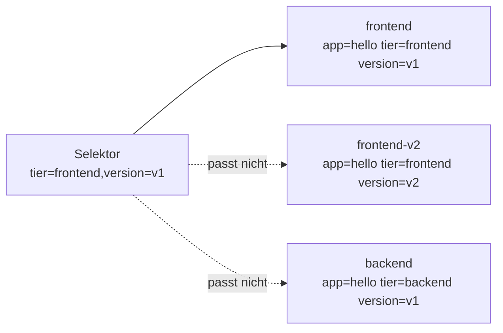

# Lab 3.3: Labels und Selektoren

**Leitfragen:**

<details>
<summary>Hunderte Pods im Cluster: wie findet man alle, die zum selben Produkt gehören?</summary>

Namen allein reichen nicht, sie folgen keinem festen Schema. Jedes Objekt bekommt Schilder aus Schlüssel und Wert (Labels) wie `app=hello`, und eine Abfrage filtert danach.

</details>

<details>
<summary>Woran soll ein späteres Objekt erkennen, für welche Pods es zuständig ist?</summary>

Nicht an Namen oder IPs, denn die wechseln. Ein Selektor beschreibt, welche Labels ein Pod tragen muss; jeder passende Pod gehört dazu. So arbeiten ReplicaSets, Deployments und Services (Modul 4 und 5).

</details>

- Labels sind frei wählbare Schlüssel-Wert-Paare an jedem Objekt; Selektoren wählen Objekte über ihre Labels aus.
- Die Hello-App nutzt ab jetzt die Labels `app`, `tier` und `version`.

## Begriffe

| Begriff | Bedeutung |
| --- | --- |
| Label | Schlüssel-Wert-Paar in `metadata.labels`, z. B. `tier: frontend`; wie ein Etikett auf einem Ordner |
| Selektor | Bedingung über Labels, z. B. `tier=frontend`; liefert alle Objekte, deren Labels passen |
| Gleichheits-Selektor | prüft auf gleich oder ungleich: `=`, `==`, `!=` |
| Mengen-Selektor | prüft gegen eine Liste oder auf Vorhandensein: `in`, `notin`, `key`, `!key` |
| Annotation | Schlüssel-Wert-Paar in `metadata.annotations` für Notizen und Werkzeuge; nicht zum Auswählen |
| empfohlene Labels | einheitliche Schlüssel mit Präfix `app.kubernetes.io/`, die viele Werkzeuge verstehen |

## Labels als Schlüssel-Wert-Paare


_Quelle: Kubernetes-Dokumentation, „Using a Service to Expose Your App" (https://kubernetes.io/docs/tutorials/kubernetes-basics/expose/expose-intro/), CC BY 4.0, The Kubernetes Authors, abgerufen am 17.11.2026._

Im Bild tragen vier Pods ein Label `app: A` oder `app: B`. Der Selektor `app=A` erfasst genau die drei Pods mit `app: A`, egal wie sie heißen und welche IP sie haben. Service, Deployment und ReplicaSet im Bild folgen in Modul 4 und 5; alle nutzen diesen Mechanismus.

```yaml
metadata:
  name: frontend
  labels:
    app: hello                     # Anwendung
    tier: frontend                 # Schicht
    version: v1                    # laufende Version
```

| Regel | Beispiel |
| --- | --- |
| Schlüssel: optionales Präfix (Domain) + `/` + Name, Name höchstens 63 Zeichen | `tier`, `app.kubernetes.io/name` |
| Wert: höchstens 63 Zeichen, Buchstaben, Ziffern, `-`, `_`, `.` | `v1`, `frontend` |
| Werte sind Text; Zahlen in Anführungszeichen | `replica: "3"` |
| Labels dürfen sich an laufenden Pods ändern (anders als `env`) | `kubectl label pod frontend version=v1` |
| Labels hängen an Objekten (Pod, Deployment, Service …), nicht an einzelnen Containern | `metadata.labels` des Pods; Container unterscheiden sich über `name` |

## Labels der Hello-App

| Label | Werte | wofür |
| --- | --- | --- |
| `app` | `hello` | alle Teile der Hello-App finden |
| `tier` | `backend`, `frontend` | eine Schicht auswählen; Grundlage aller Selektoren ab Modul 4 |
| `version` | `v1`, `v2` | sehen, welche Version läuft; kein Teil von Selektoren, weil ein Update sonst die eigenen Pods „verliert" (Lab 4.3) |

## Empfohlene Labels

Kubernetes empfiehlt einheitliche Schlüssel, die Werkzeuge wie Headlamp oder Helm auswerten. Quelle: [Recommended Labels](https://kubernetes.io/docs/concepts/overview/working-with-objects/common-labels/), Stand: 11/2026.

| Schlüssel | Bedeutung | Beispiel |
| --- | --- | --- |
| `app.kubernetes.io/name` | Name der Anwendung | `hello` |
| `app.kubernetes.io/instance` | konkrete Installation | `hello-prod` |
| `app.kubernetes.io/version` | Version der Anwendung | `v1` |
| `app.kubernetes.io/component` | Rolle in der Architektur | `frontend` |
| `app.kubernetes.io/part-of` | übergeordnetes Produkt | `shop` |
| `app.kubernetes.io/managed-by` | Werkzeug, das das Objekt verwaltet | `Helm` |

Die Hello-App bleibt bei den kurzen Labels `app`, `tier`, `version`; das Helm-Chart in Lab 9.2 setzt die empfohlenen Labels automatisch.

## Selektoren in kubectl



Mehrere Bedingungen, durch Komma getrennt, müssen alle zutreffen (UND).

| Befehl | zeigt |
| --- | --- |
| `kubectl get pods --show-labels` | alle Pods mit allen Labels in einer Spalte |
| `kubectl get pods -L tier,version` | je Label eine eigene Spalte |
| `kubectl get pods -l app=hello` | Pods mit `app=hello` |
| `kubectl get pods -l tier!=frontend` | Pods ohne `tier=frontend` |
| `kubectl get pods -l tier=frontend,version=v1` | Frontend-Pods der Version `v1` |
| `kubectl get pods -l 'version in (v1,v2)'` | Pods mit `version` `v1` oder `v2` |
| `kubectl get pods -l 'stage'` / `-l '!stage'` | Pods mit bzw. ohne Label `stage` |
| `kubectl delete pods -l stage=test` | alle passenden Pods löschen |

Mengen-Selektoren in einfache Anführungszeichen setzen, sonst deutet die Shell Klammern und `!` selbst.

In Manifesten stehen Selektoren als `matchLabels` (Gleichheit) oder `matchExpressions` (Mengen); Lab 4.1 nutzt `matchLabels`.

## Labels und Annotations ändern

```bash
kubectl label pod frontend-v2 stage=test                # Label hinzufügen
kubectl label pod frontend-v2 stage=review --overwrite   # Wert ändern (ohne --overwrite: Fehler)
kubectl label pod frontend-v2 stage-                    # Label entfernen (Minus am Ende)
kubectl annotate pod frontend-v2 description="Testpod für v2"
```

Dauerhaft gehören Labels in die Datei; `kubectl apply` ändert sie am laufenden Pod (`pod/frontend configured`).

| | Label | Annotation |
| --- | --- | --- |
| Zweck | auswählen, gruppieren | beschreiben, Werkzeuge steuern |
| per Selektor filterbar | ja | nein |
| Wert | kurz, max. 63 Zeichen | beliebig lang, auch JSON |
| Beispiel | `tier: frontend` | `description: "Webseite der Hello-App"`, `kubernetes.io/change-cause` (Lab 4.3) |

## Typische Fehler

| Symptom | Ursache | Lösung |
| --- | --- | --- |
| `error: 'stage' already has a value (test), and --overwrite is false` | Label existiert schon | `--overwrite` anhängen |
| `No resources found in hello namespace.` | Tippfehler im Wert (`Frontend` statt `frontend`, Labels unterscheiden Groß/Klein) | `--show-labels` vergleichen |
| `bash: !stage: event not found` | Shell deutet `!` | Selektor in einfache Anführungszeichen setzen |
| `metadata.labels: Invalid value: "Hello App"` | Leerzeichen im Wert | nur Buchstaben, Ziffern, `-`, `_`, `.` |
| `strict decoding error: unknown field "spec.containers[0].labels"` | Labels unter einem Container eingetragen | Labels nach `metadata.labels` des Pods verschieben |
| Label nach `kubectl apply` wieder weg | Label nur per `kubectl label` gesetzt, Datei kennt es nicht | Label in die Datei schreiben |

## Fazit

- Labels machen Objekte auffindbar; Selektoren mit `-l` filtern nach Gleichheit (`=`, `!=`) oder Mengen (`in`, `notin`, Vorhandensein).
- Labels lassen sich an laufenden Pods ändern; Annotations tragen Notizen, die niemand filtert.
- Die Hello-App nutzt `app`, `tier`, `version`; Selektoren späterer Objekte nutzen nur `app` und `tier`.

In der Übung bekommen die Hello-Pods ihre Labels, und eine Abfrage findet genau den Frontend-Pod der Version `v1`.
