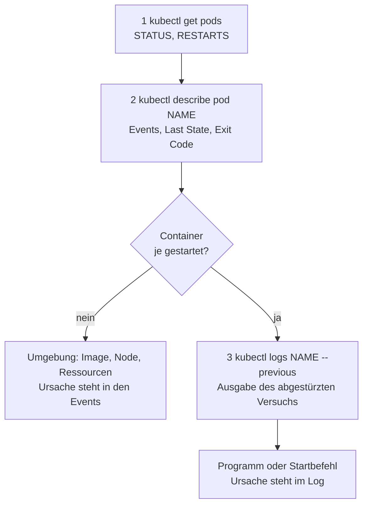

# Lab 3.4: Pod-Fehler lesen

**Leitfragen:**

<details>
<summary>Ein Programm startet und beendet sich sofort wieder: wo sucht man zuerst?</summary>

In der Ausgabe des Programms, und zwar des letzten, schon beendeten Versuchs. Kubernetes hebt sie auf: `kubectl logs --previous` zeigt sie.

</details>

<details>
<summary>Woran ist erkennbar, ob ein Fehler am Programm oder an der Umgebung liegt?</summary>

Startet der Container gar nicht (Image fehlt, kein Platz auf einem Node), liegt es an der Umgebung; die Events in `kubectl describe` nennen den Grund. Startet er und endet mit Fehler, liegt es am Programm oder seinem Startbefehl; die Logs zeigen es.

</details>

- Fast jeder Pod-Fehler lässt sich mit drei Befehlen in fester Reihenfolge eingrenzen: `get`, `describe`, `logs --previous`.
- Vier Zustände decken den Alltag ab: `ErrImageNeverPull`, `ImagePullBackOff`, `CrashLoopBackOff`, `Pending`.

## Begriffe

| Begriff | Bedeutung |
| --- | --- |
| Status-Grund | genauere Angabe in der Spalte `STATUS` von `kubectl get pods`, z. B. `CrashLoopBackOff` statt der Phase `Running` |
| Event | Meldung des Clusters zu einem Objekt mit Typ (`Normal`/`Warning`), Grund und Text; bleibt etwa eine Stunde erhalten |
| Exit-Code | Zahl, mit der sich ein Programm beendet: `0` = Erfolg, alles andere = Fehler |
| Back-off | wachsende Wartezeit zwischen zwei Versuchen (10 s, 20 s, 40 s … bis 5 min), damit ein kaputter Pod den Node nicht dauernd belastet |
| `restartPolicy` | Feld im Pod: ob der kubelet einen beendeten Container im selben Pod neu startet (`Always`, `OnFailure`, `Never`) |
| `CrashLoopBackOff` | Container startet, beendet sich mit Fehler, wird neu gestartet, beendet sich wieder; Kubernetes wartet jeweils länger |
| `ErrImageNeverPull` | Image fehlt auf dem Node, und `imagePullPolicy: Never` verbietet das Laden |
| `ErrImagePull` / `ImagePullBackOff` | Laden aus der Registry ist fehlgeschlagen / Kubernetes wartet bis zum nächsten Versuch |
| `FailedScheduling` | Event des Schedulers: kein Node erfüllt die Anforderungen des Pods; der Pod bleibt `Pending` |
| Resource-Request | im Container unter `resources.requests`: so viel CPU oder Speicher muss auf einem Node frei sein, damit der Pod dort startet (Details in Lab 8.2) |

## Lesereihenfolge bei Pod-Fehlern



| Schritt | Befehl | Worauf achten |
| --- | --- | --- |
| 1 | `kubectl get pods` | `STATUS` und `RESTARTS`; steigt `RESTARTS`, startet der Container immer wieder |
| 2 | `kubectl describe pod <name>` | ganz unten `Events` (Warnungen); im Container-Teil `State`, `Last State`, `Reason`, `Exit Code` |
| 3 | `kubectl logs <name> --previous` | Fehlermeldung des letzten beendeten Versuchs; ohne `--previous` oft leer, weil gerade ein neuer Versuch läuft |

## Typische Pod-Zustände

| `STATUS` | Bedeutung | Ursache steht in | Typische Lösung |
| --- | --- | --- | --- |
| `ErrImageNeverPull` | lokales Image fehlt | Events | Tag prüfen, Image bauen (`bash build-images.sh`) |
| `ErrImagePull`, `ImagePullBackOff` | Laden aus der Registry schlägt fehl | Events | Tippfehler im Namen/Tag, Login, Netz, Docker-Hub-Limit |
| `CrashLoopBackOff` | Container startet und stürzt ab | `logs --previous`, `Last State` | Startbefehl, fehlende Datei, falsche Konfiguration |
| `Pending` | kein Node gefunden oder Start vorbereitet | Events (`FailedScheduling`) | Anforderungen senken, Node mit Platz |
| `ContainerCreating` (bleibt hängen) | Volume oder Netz fehlt | Events | Volume- bzw. Secret-Namen prüfen (Modul 6/7) |
| `OOMKilled` | Speichergrenze überschritten | `Last State` | folgt in Lab 8.2 |

## Image-Fehler

Mit `imagePullPolicy: Never` meldet der kubelet ein fehlendes lokales Image sofort, ohne Registry:

```text
Events:
  Type     Reason             Age              From     Message
  ----     ------             ----             ----     -------
  Warning  ErrImageNeverPull  3s (x3 over 20s) kubelet  Container image "hello-frontend:v9" is not present with pull policy of Never
```

Bei öffentlichen Images führt ein Tippfehler zu `ErrImagePull` und danach `ImagePullBackOff`, z. B. `ngnix` statt `nginx`:

```text
  Warning  Failed   5s  kubelet  Failed to pull image "ngnix:1.30-alpine": ... pull access denied, repository does not exist or may require authorization ...
  Normal   BackOff  4s  kubelet  Back-off pulling image "ngnix:1.30-alpine"
```

## CrashLoopBackOff

Der Container startet, also findet sich die Ursache im Programm-Log. Weil der kubelet sofort einen neuen Versuch startet, liefert erst `--previous` die Ausgabe des abgestürzten Laufs:

```text
$ kubectl get pod fehler-crash
NAME           READY   STATUS             RESTARTS      AGE
fehler-crash   0/1     CrashLoopBackOff   3 (25s ago)   80s

$ kubectl logs fehler-crash --previous
python: can't open file '/app/server.py': [Errno 2] No such file or directory
```

In `describe` steht dazu `Last State: Terminated`, `Reason: Error`, `Exit Code: 2`. Das Feld `command` im Manifest ersetzt den Startbefehl (`CMD`) aus dem Dockerfile (Lab 1.3); ein falscher Dateiname darin reicht für diesen Fehler.

## Neustart-Regel restartPolicy

Den abgestürzten Container startet der kubelet auf dem Node neu, nach der Regel `spec.restartPolicy` des Pods (Quelle: [Pod Lifecycle, Container restart policy](https://kubernetes.io/docs/concepts/workloads/pods/pod-lifecycle/#restart-policy), Stand: 11/2026):

| `restartPolicy` | Container wird neu gestartet, wenn er sich … | typisch für |
| --- | --- | --- |
| `Always` (Standard) | beendet, egal ob mit Erfolg oder Fehler | Dauerläufer wie Web-Apps; Pods aus Deployments (Modul 4) |
| `OnFailure` | mit Fehler beendet (Exit-Code ungleich 0) | einmalige Aufgaben, die bei Fehler wiederholt werden sollen (Jobs, Lab 7.3) |
| `Never` | nie; der Pod endet als `Succeeded` oder `Failed` | einmalige Test-Pods |

- Der Neustart passiert im selben Pod: Name und IP bleiben, `RESTARTS` zählt hoch, die Wartezeit dazwischen wächst (Back-off). `CrashLoopBackOff` ist also `Always` bei einem Container, der immer wieder abstürzt.
- Einen gelöschten Pod ersetzt der kubelet nicht; das übernehmen Controller wie das ReplicaSet (Lab 4.1).

## Pending durch fehlende Ressourcen

Ein Pod, der mehr CPU reserviert, als ein Node hat, findet keinen Platz:

```text
  Warning  FailedScheduling  10s  default-scheduler  0/1 nodes are available: 1 Insufficient cpu. preemption: 0/1 nodes are available: 1 No preemption victims found for incoming pod.
```

`0/1 nodes are available` heißt: der eine Node (`docker-desktop`) passt nicht. Der Pod wartet, bis ein passender Node auftaucht; er stürzt nicht ab und hat keine Logs.

## Events mit kubectl events

`describe` zeigt die Events eines Objekts; `kubectl events` listet sie für den ganzen Namespace, zeitlich sortiert:

| Befehl | zeigt |
| --- | --- |
| `kubectl events` | alle Events im Namespace, älteste zuerst |
| `kubectl events --types=Warning` | nur Warnungen |
| `kubectl events --for pod/fehler-pending` | Events eines Objekts |
| `kubectl events -w` | neue Events live, Ende mit **Strg+C** |

## Logs in Headlamp

Headlamp (Lab 2.3) zeigt unter **Workloads → Pods** den Status, unten im Pod die Events und über das Log-Symbol die Ausgabe. Der Schalter **Show previous** entspricht `kubectl logs --previous`:


_Quelle: Headlamp-README (https://github.com/kubernetes-sigs/headlamp), Apache-2.0, abgerufen am 17.11.2026._

## Korrigieren und neu anlegen

| Änderung | Weg |
| --- | --- |
| Image-Tag (`image`) | Datei ändern, `kubectl apply -f`; das Image darf sich am laufenden Pod ändern |
| `command`, `env`, `resources`, Volumes | Pod löschen, Datei ändern, neu anwenden |

## Typische Fehler

| Symptom | Ursache | Lösung |
| --- | --- | --- |
| `kubectl logs` gibt nichts aus | Container läuft gerade neu an oder ist nie gestartet | `--previous` nutzen; bei `Pending`/Image-Fehlern gibt es keine Logs, dann Events lesen |
| `previous terminated container "..." not found` | Container ist noch nie beendet worden | ohne `--previous` aufrufen oder Events lesen |
| `Events: <none>` bei altem Fehler | Events werden nach etwa einer Stunde gelöscht | Pod neu anlegen und sofort beobachten |
| `pod updates may not change fields other than ...` | `command` oder `resources` an laufendem Pod geändert | Pod löschen, neu anwenden |
| Pod nach Korrektur weiter im Back-off | Wartezeit läuft noch | einige Sekunden warten oder Pod löschen und neu anlegen |

## Fazit

- Reihenfolge `get` → `describe` (Events) → `logs --previous`: erst Zustand, dann Grund, dann Programmausgabe.
- Image- und Platzprobleme stehen in den Events; Programmfehler im Log des letzten Versuchs.
- `kubectl events` zeigt alle Meldungen des Namespace auf einen Blick.

In der Übung laufen drei absichtlich kaputte Pods, deren Ursache mit dieser Reihenfolge gefunden und behoben wird.
