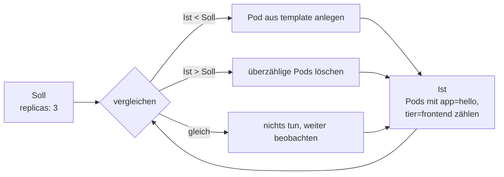

# Lab 4.1: ReplicaSets und Self-Healing

**Leitfragen:**

<details>
<summary>Ein Pod stürzt nachts ab: wer startet ihn neu?</summary>

Stürzt nur der Container ab, startet ihn der kubelet im selben Pod neu (Spalte `RESTARTS`, Lab 3.4). Verschwindet der ganze Pod, etwa weil er gelöscht wurde oder sein Node ausfällt, holt ihn niemand zurück. Dafür braucht es ein Objekt, das ständig nachzählt und fehlende Pods ersetzt.

</details>

<details>
<summary>Was passiert, wenn jemand von Hand einen vierten Pod mit denselben Labels startet?</summary>

Ein ReplicaSet zählt alle Pods, die zu seinem Selektor passen (Lab 3.3), nicht nur die selbst erzeugten. Bei vier statt drei passenden Pods löscht es einen, meist den neuesten.

</details>

- Ein Controller vergleicht ständig Soll und Ist und gleicht ab; das ReplicaSet ist der Controller für „genau N Pods".
- Das Frontend läuft ab jetzt als ReplicaSet `frontend` mit drei Pods; das Backend bleibt bis Lab 4.2 ein einzelner Pod.

## Begriffe

| Begriff | Bedeutung |
| --- | --- |
| Controller | Programm im Controller-Manager (Lab 2.3), das für eine Objektart Soll und Ist vergleicht und Unterschiede ausgleicht; wie ein Thermostat |
| Regelkreis | die Schleife „beobachten, vergleichen, handeln", die ein Controller endlos wiederholt |
| ReplicaSet | Objekt, das dafür sorgt, dass immer eine feste Zahl gleicher Pods läuft |
| `replicas` | Soll-Anzahl der Pods |
| `selector` | Label-Bedingung, an der das ReplicaSet „seine" Pods erkennt |
| `template` | Bauplan für neue Pods: Labels und `spec` wie in einem Pod-Manifest |
| Self-Healing | fehlende Pods werden automatisch ersetzt, ohne dass jemand eingreift |
| skalieren | die Soll-Anzahl ändern, z. B. von 3 auf 5 Pods |
| Owner Reference | Vermerk im Pod, welches Objekt ihn verwaltet; `describe` zeigt ihn als `Controlled By` |

## Controller und Regelkreis



Jeder Eingriff von außen (Pod löschen, Node fällt aus) ändert nur das Ist; der Controller stellt das Soll wieder her. Das Soll ändert nur, wer das ReplicaSet ändert.

## ReplicaSet: Anzahl, Selector, Template


_Quelle: Kubernetes-Dokumentation, „Using a Service to Expose Your App" (https://kubernetes.io/docs/tutorials/kubernetes-basics/expose/expose-intro/), CC BY 4.0, The Kubernetes Authors, abgerufen am 17.11.2026._

Rechts im Bild (aus Lab 3.3) umschließt das ReplicaSet `rs` die drei Pods mit `app: A`; der Pod mit `app: B` gehört nicht dazu.

```yaml
# playground/k8s/frontend-replicaset.yaml
apiVersion: apps/v1                  # ReplicaSets gehören zur API-Gruppe "apps"
kind: ReplicaSet
metadata:
  name: frontend
  labels:
    app: hello
    tier: frontend
spec:
  replicas: 3                        # Soll: drei laufende Pods
  selector:                          # welche Pods zählt das ReplicaSet?
    matchLabels:                     # alle mit genau diesen Labels (ohne version)
      app: hello
      tier: frontend
  template:                          # Bauplan für jeden neuen Pod
    metadata:
      labels:                        # müssen zum Selector passen
        app: hello
        tier: frontend
        version: v1
    spec:                            # wie spec eines Pods
      containers:
        - name: frontend
          image: hello-frontend:v1
          imagePullPolicy: Never
          ports:
            - containerPort: 80
          env:
            - name: BACKEND_URL
              value: "http://10.1.0.23"   # Backend-IP, von Hand (bis Lab 4.2)
```

| Feld | Hinweis |
| --- | --- |
| `apiVersion: apps/v1` | Workload-Objekte wie ReplicaSet und Deployment liegen in der Gruppe `apps` |
| `selector.matchLabels` | Gleichheits-Selektor aus Lab 3.3; passt er nicht zu `template.metadata.labels`, lehnt die API das Objekt ab |
| `template.spec` | genau das, was im Pod-Manifest unter `spec` steht; der Sidecar aus Lab 3.2 ist hier weggelassen, damit das Template kurz bleibt |
| Pod-Namen | `<ReplicaSet-Name>-<5 Zeichen>`, z. B. `frontend-x2kqp` |

## Self-Healing beobachten

Wird ein Pod gelöscht, legt das ReplicaSet sofort einen neuen an, mit neuem Namen und neuer IP:

```text
$ kubectl get pods -l tier=frontend -w
NAME             READY   STATUS              RESTARTS   AGE
frontend-7mh4d   1/1     Running             0          2m
frontend-p9wzl   1/1     Running             0          2m
frontend-x2kqp   1/1     Running             0          2m
frontend-x2kqp   1/1     Terminating         0          2m
frontend-c5r8n   0/1     Pending             0          0s
frontend-c5r8n   0/1     ContainerCreating   0          0s
frontend-c5r8n   1/1     Running             0          1s
```

`kubectl get rs` zeigt Soll (`DESIRED`), vorhandene (`CURRENT`) und bereite Pods (`READY`):

```text
NAME       DESIRED   CURRENT   READY   AGE
frontend   3         3         3       2m
```

## ReplicaSet skalieren

| Weg | Befehl | Hält bis |
| --- | --- | --- |
| imperativ | `kubectl scale rs frontend --replicas=5` | zum nächsten `kubectl apply` der Datei |
| deklarativ | `replicas: 5` in der Datei, dann `kubectl apply -f ...` | dauerhaft, die Datei ist die Wahrheit |

Ein `kubectl apply` mit `replicas: 3` nach einem `scale` auf 5 setzt das Soll zurück auf 3; zwei Pods werden gelöscht.

## Fremde Pods mit passenden Labels

Das ReplicaSet übernimmt jeden Pod ohne eigenen Controller, dessen Labels zum Selektor passen, und trägt sich als Owner ein (`Controlled By: ReplicaSet/frontend`). Deshalb:

- Vor dem Anlegen des ReplicaSets den Einzel-Pod `frontend` aus Modul 3 löschen, sonst zählt er als einer der drei.
- Ein von Hand gestarteter Pod mit `app=hello,tier=frontend` ist ein überzähliger Pod und wird gelöscht.

## Grenzen des ReplicaSets

Ändert sich das `template` (z. B. ein neues Image), behalten bereits laufende Pods ihre alte Version; nur neue Pods bekommen das neue Template. Updates übernimmt das Deployment (Lab 4.2, 4.3).

## Typische Fehler

| Symptom | Ursache | Lösung |
| --- | --- | --- |
| `selector does not match template labels` | Labels in `selector` und `template.metadata.labels` verschieden | gleiche Werte für `app` und `tier` eintragen |
| nur zwei neue Pods statt drei | alter Pod `frontend` mit passenden Labels wurde übernommen | `kubectl delete pod frontend`; das ReplicaSet legt den dritten an |
| Pods `ErrImageNeverPull` | Image-Tag im Template falsch | Template korrigieren, Pods löschen (`kubectl delete pods -l tier=frontend`) |
| nach `apply` wieder 3 statt 5 Pods | Datei enthält `replicas: 3` | Wert in der Datei ändern |
| `kubectl delete pod` hilft nicht, Pod kommt zurück | Pod gehört einem ReplicaSet | das ReplicaSet löschen oder auf 0 skalieren |

## Fazit

- Controller gleichen Soll und Ist in einem Regelkreis ab; das ReplicaSet hält `replicas` Pods am Leben.
- Selector und Template-Labels müssen zusammenpassen; gezählt wird jeder passende Pod.
- `kubectl scale` ändert das Soll sofort, die Datei bei jedem `apply`.

In der Übung läuft das Frontend als ReplicaSet, und gelöschte Pods kommen mit neuer IP zurück.
