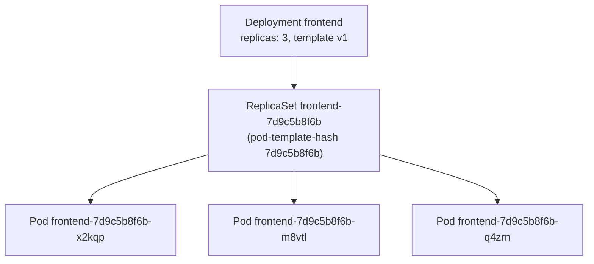

# Lab 4.2: Deployments

**Leitfragen:**

<details>
<summary>Was fehlt einem ReplicaSet, wenn eine neue Version ausgerollt werden soll?</summary>

Ein ReplicaSet tauscht laufende Pods nicht aus; ein neues Image im Template gilt nur für neu entstehende Pods (Lab 4.1). Es fehlt ein Objekt darüber, das für die neue Version ein zweites ReplicaSet anlegt und die Pods schrittweise umschichtet: das Deployment.

</details>

<details>
<summary>Wie viele Kopien eines Frontends braucht es, damit ein Ausfall nicht auffällt?</summary>

Mindestens zwei, im Alltag meist drei: Fällt eine Kopie aus, beantworten die anderen die Anfragen, bis der Ersatz läuft. Mit nur einer Kopie entsteht bis zum Neustart eine Lücke. In echten Clustern liegen die Kopien zusätzlich auf verschiedenen Nodes.

</details>

- Ein Deployment verwaltet ReplicaSets, ein ReplicaSet verwaltet Pods; im Alltag legt man nur das Deployment an.
- Backend und Frontend der Hello-App laufen ab jetzt als Deployments mit je drei Pods.

## Begriffe

| Begriff | Bedeutung |
| --- | --- |
| Deployment | Objekt für zustandslose Anwendungen: legt ReplicaSets an, skaliert und tauscht Versionen schrittweise aus |
| zustandslos | eine Anwendung, die keine Daten in sich speichert; jede Kopie ist gleichwertig austauschbar |
| Replik | eine der gleichen Kopien (Pods) einer Anwendung |
| `pod-template-hash` | Label, das das Deployment an ReplicaSet und Pods hängt; ein Kurzwert aus dem Template, damit sich Versionen nicht vermischen |
| `kubectl scale` | ändert `replicas` eines Deployments oder ReplicaSets sofort |
| `kubectl create deployment --dry-run=client -o yaml` | erzeugt ein Deployment-Manifest als Vorlage, ohne etwas anzulegen (Prinzip aus Lab 2.4) |

## Deployment, ReplicaSet und Pod



| Ebene | Aufgabe | Name |
| --- | --- | --- |
| Deployment | Version und Anzahl verwalten, Updates steuern (Lab 4.3) | `frontend` |
| ReplicaSet | genau N Pods einer Version am Leben halten | `frontend-<hash>` |
| Pod | einen Container (oder mehrere) ausführen | `frontend-<hash>-<5 Zeichen>` |

Am Namen eines Pods ist ablesbar, zu welchem ReplicaSet und Deployment er gehört.

## Warum im Alltag Deployments

| | ReplicaSet direkt | Deployment |
| --- | --- | --- |
| Anzahl halten, Self-Healing | ja | ja (über sein ReplicaSet) |
| neue Version ausrollen | nein, alte Pods bleiben | ja, schrittweise (Lab 4.3) |
| zur alten Version zurück | nein | ja, `kubectl rollout undo` (Lab 4.3) |
| Versionshistorie | nein | ja, alte ReplicaSets bleiben als Revisionen |

ReplicaSets direkt anzulegen ist deshalb die Ausnahme; die Kubernetes-Dokumentation empfiehlt Deployments. Quelle: [ReplicaSet](https://kubernetes.io/docs/concepts/workloads/controllers/replicaset/), Stand: 11/2026.

## Vorlage mit kubectl create deployment

```bash
kubectl create deployment backend --image=hello-backend:v1 --port=80 --dry-run=client -o yaml
```

```yaml
apiVersion: apps/v1
kind: Deployment
metadata:
  labels:
    app: backend
  name: backend
spec:
  replicas: 1
  selector:
    matchLabels:
      app: backend
  strategy: {}
  template:
    metadata:
      labels:
        app: backend
    spec:
      containers:
      - image: hello-backend:v1
        name: hello-backend
        ports:
        - containerPort: 80
        resources: {}
status: {}
```

Ältere kubectl-Versionen schreiben zusätzlich `creationTimestamp: null`. Anpassungen für die Hello-App:

| Stelle | Vorlage | Hello-App |
| --- | --- | --- |
| Labels in `metadata`, `selector`, `template` | `app: backend` | `app: hello`, `tier: backend` (im Template zusätzlich `version: v1`) |
| Containername | `hello-backend` | `backend` |
| `imagePullPolicy` | fehlt | `Never` |
| `replicas` | `1` | `3` |
| `strategy: {}`, `resources: {}`, `status: {}` | leer | löschen (Strategie in Lab 4.3, Ressourcen in Lab 8.2) |

Die Einrückung der Vorlage (`- image:` direkt unter `containers:`) ist gültiges YAML; beide Schreibweisen funktionieren.

## Manifest des Frontend-Deployments

```yaml
# playground/k8s/frontend-deployment.yaml
apiVersion: apps/v1
kind: Deployment                     # einziger Unterschied im Kopf zum ReplicaSet
metadata:
  name: frontend
  labels:
    app: hello
    tier: frontend
spec:
  replicas: 3
  selector:
    matchLabels:                     # app + tier, nie version
      app: hello
      tier: frontend
  template:
    metadata:
      labels:
        app: hello
        tier: frontend
        version: v1
    spec:
      containers:
        - name: frontend
          image: hello-frontend:v1
          imagePullPolicy: Never
          ports:
            - containerPort: 80
          env:
            - name: BACKEND_URL
              value: "http://backend"   # fester Name statt Pod-IP
```

`http://backend` ersetzt die von Hand gepflegte Pod-IP; drei Backend-Pods haben ohnehin drei IPs. Den Namen `backend` gibt es im Cluster erst mit dem Service aus Lab 5.1. Bis dahin zeigt die Seite `Backend nicht erreichbar (http://backend): ConnectionError`.

## Deployments skalieren

 

_Quelle: Kubernetes-Dokumentation, „Running Multiple Instances of Your App" (https://kubernetes.io/docs/tutorials/kubernetes-basics/scale/scale-intro/), CC BY 4.0, The Kubernetes Authors, abgerufen am 17.11.2026._

Links ein Deployment mit einem Pod, rechts dasselbe Deployment nach dem Skalieren auf vier Pods. Im Kurs-Cluster gibt es nur den Node `docker-desktop`, alle Pods landen dort.

```bash
kubectl scale deployment frontend --replicas=3
kubectl scale deployment/backend deployment/frontend --replicas=3   # mehrere auf einmal
kubectl get deployments
```

```text
NAME       READY   UP-TO-DATE   AVAILABLE   AGE
backend    3/3     3            3           2m
frontend   3/3     3            3           2m
```

| Spalte | Bedeutung |
| --- | --- |
| `READY` | bereite Pods / Soll |
| `UP-TO-DATE` | Pods mit dem aktuellen Template (wichtig in Lab 4.3) |
| `AVAILABLE` | Pods, die Anfragen annehmen können |

Wie beim ReplicaSet gilt: Ein späteres `kubectl apply` setzt `replicas` auf den Wert in der Datei.

## Deployments in Headlamp


_Quelle: Headlamp-README (https://github.com/kubernetes-sigs/headlamp), Apache-2.0, abgerufen am 17.11.2026._

**Workloads** zeigt Deployments und ReplicaSets nebeneinander; der Name `headlamp-5678cffdb7` folgt demselben Muster `<Deployment>-<hash>` wie bei der Hello-App.

## Typische Fehler

| Symptom | Ursache | Lösung |
| --- | --- | --- |
| `selector does not match template labels` | Vorlage nur teilweise angepasst | `app`/`tier` in `metadata`, `selector` und `template` angleichen |
| `field is immutable` beim `apply` | `selector` eines bestehenden Deployments geändert | Deployment löschen und neu anlegen; Selektoren später nie ändern |
| `READY 0/3`, Pods `ErrImageNeverPull` | beim Anpassen der Vorlage `image` statt `name` geändert oder Tag vertippt | `image: hello-backend:v1` und `name: backend` prüfen |
| alte ReplicaSet-Pods laufen weiter | ReplicaSet aus Lab 4.1 nicht gelöscht | `kubectl delete rs frontend` |
| Seite: `Backend nicht erreichbar (http://backend)` | Service `backend` existiert noch nicht | erwartet bis Lab 5.1 |

## Fazit

- Deployment → ReplicaSet → Pod: das Deployment ist das Objekt, das im Alltag angelegt und geändert wird.
- `kubectl create deployment … --dry-run=client -o yaml` liefert eine Vorlage, die an Labels, Containername und `imagePullPolicy` angepasst wird.
- `kubectl scale` ändert die Anzahl sofort, dauerhaft gehört sie in die Datei.

In der Übung laufen Backend und Frontend als Deployments mit je drei Pods.
