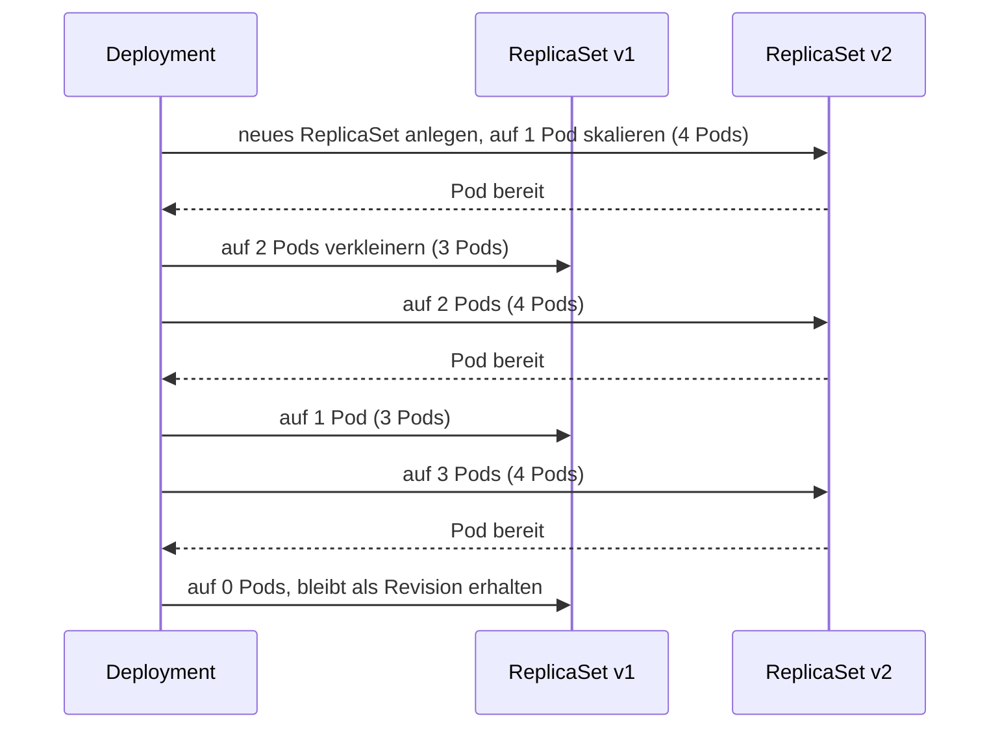

# Lab 4.3: Rollout und Rollback

**Leitfragen:**

<details>
<summary>Wie tauscht man die Reifen eines fahrenden Busses?</summary>

Einen nach dem anderen, mit einem Ersatzrad in Reserve: erst ein neues Rad anbringen, dann ein altes abnehmen. Ein Deployment tauscht Pods genauso: neuen Pod starten, warten bis er bereit ist, alten Pod beenden, bis alle getauscht sind. Der Dienst läuft währenddessen weiter.

</details>

<details>
<summary>Eine neue Version ist kaputt: was ist schneller, reparieren oder zurück?</summary>

Zurück. Die alte Version liegt als altes ReplicaSet noch im Cluster; `kubectl rollout undo` stellt sie in Sekunden wieder her. Repariert wird danach ohne Zeitdruck.

</details>

- Jede Änderung am Pod-Template eines Deployments startet einen Rollout: neue Pods ersetzen alte schrittweise.
- Das Frontend wird von `v1` (hellblau) auf `v2` (hellgrün) aktualisiert; ein kaputtes `v3` wird erkannt und zurückgerollt.

## Begriffe

| Begriff | Bedeutung |
| --- | --- |
| Rollout | Übergang eines Deployments auf ein neues Pod-Template, z. B. ein neues Image |
| Revision | nummerierter Stand des Templates; jede Revision ist ein ReplicaSet des Deployments |
| `RollingUpdate` | Strategie: Pods schrittweise austauschen, alte und neue laufen kurz nebeneinander (Standard) |
| `Recreate` | Strategie: alle alten Pods beenden, dann alle neuen starten; dazwischen ist die Anwendung weg |
| `maxSurge` | wie viele Pods während des Rollouts über `replicas` hinaus laufen dürfen |
| `maxUnavailable` | wie viele Pods während des Rollouts unter `replicas` fehlen dürfen |
| `kubernetes.io/change-cause` | Annotation (Lab 3.3) mit dem Grund der Änderung; erscheint in der Historie |
| Rollback | Rückkehr zu einer früheren Revision mit `kubectl rollout undo` |

## Was einen Rollout auslöst

| Änderung | Rollout? |
| --- | --- |
| `spec.template` (Image, `env`, Template-Labels, Ports) | ja, neue Revision |
| `replicas` (`kubectl scale`) | nein, nur mehr oder weniger Pods derselben Revision |
| `strategy`, Annotations am Deployment | nein |

## Strategien RollingUpdate und Recreate

| | `RollingUpdate` | `Recreate` |
| --- | --- | --- |
| Ablauf | schrittweise, alt und neu gleichzeitig | erst alle alten weg, dann alle neuen |
| Ausfall | keiner, wenn genug Pods bereit bleiben | ja, bis die neuen Pods laufen |
| wann | Standard für zustandslose Web-Anwendungen | wenn zwei Versionen nie gleichzeitig laufen dürfen (z. B. altes und neues Datenbankschema) |

```yaml
# Ausschnitt aus playground/k8s/frontend-deployment.yaml
metadata:
  name: frontend
  annotations:
    kubernetes.io/change-cause: "Update auf v2"   # Grund, erscheint in rollout history
spec:
  replicas: 3
  strategy:
    type: RollingUpdate
    rollingUpdate:
      maxSurge: 1                    # höchstens 4 Pods gleichzeitig
      maxUnavailable: 0              # nie weniger als 3 bereite Pods
```

Ohne Angabe gilt `RollingUpdate` mit je `25 %`. Bei drei Replikas rundet Kubernetes `maxSurge` auf (1) und `maxUnavailable` ab (0); die explizite Angabe macht dasselbe Verhalten sichtbar.

## Ablauf eines Rolling Updates

Mit `maxSurge: 1` und `maxUnavailable: 0` startet immer zuerst ein neuer Pod; erst wenn er bereit ist, endet ein alter:



  

_Quelle: Kubernetes-Dokumentation, „Performing a Rolling Update" (https://kubernetes.io/docs/tutorials/kubernetes-basics/update/update-intro/), CC BY 4.0, The Kubernetes Authors, abgerufen am 17.11.2026._

Die Bilder zeigen die Schritte: violette Pods (neue Version, neue IP) ersetzen nacheinander die grünen. Der eingezeichnete Service verteilt Anfragen nur an bereite Pods (Lab 5.1).

## Rollout beobachten

| Befehl | zeigt |
| --- | --- |
| `kubectl get pods -w` | Pods kommen und gehen, live (zweites Terminal) |
| `kubectl rollout status deployment/frontend` | Fortschritt; endet, wenn der Rollout fertig ist |
| `kubectl get rs` | altes und neues ReplicaSet mit `DESIRED`/`READY` |
| `kubectl rollout history deployment/frontend` | Revisionen mit `CHANGE-CAUSE` |

```text
$ kubectl rollout status deployment/frontend
Waiting for deployment "frontend" rollout to finish: 1 out of 3 new replicas have been updated...
Waiting for deployment "frontend" rollout to finish: 2 out of 3 new replicas have been updated...
Waiting for deployment "frontend" rollout to finish: 1 old replicas are pending termination...
deployment "frontend" successfully rolled out

$ kubectl get rs
NAME                  DESIRED   CURRENT   READY   AGE
frontend-7d9c5b8f6b   0         0         0       20m     # v1, bleibt als Revision 1
frontend-5f6b8c4d7c   3         3         3       40s     # v2
```

`kubectl port-forward` hängt an einem einzelnen Pod und bricht ab, wenn dieser Pod beim Rollout endet. Nach dem Rollout neu starten; ohne Unterbrechung zusehen lässt sich erst über einen Service (Modul 5).

## Fehlgeschlagener Rollout

Ein Image, das es nicht gibt (`hello-frontend:v3`), erzeugt einen neuen Pod mit `ErrImageNeverPull`. Weil `maxUnavailable: 0` gilt, beendet das Deployment keinen alten Pod: `v2` läuft weiter, der Rollout steht.

```text
$ kubectl get pods
NAME                        READY   STATUS              RESTARTS   AGE
frontend-5f6b8c4d7c-9vk2m   1/1     Running             0          5m
frontend-5f6b8c4d7c-h7xqt   1/1     Running             0          5m
frontend-5f6b8c4d7c-t4wpl   1/1     Running             0          5m
frontend-6b7d9f5c8d-r2nzx   0/1     ErrImageNeverPull   0          30s

$ kubectl rollout status deployment/frontend --timeout=30s
Waiting for deployment "frontend" rollout to finish: 1 out of 3 new replicas have been updated...
error: timed out waiting for the condition
```

Ohne `--timeout` wartet `rollout status` bis zur Frist des Deployments (`progressDeadlineSeconds`, Standard 600 s) und meldet dann `exceeded its progress deadline`.

## Rollback mit rollout undo

```bash
kubectl rollout undo deployment/frontend                   # zur vorherigen Revision
kubectl rollout undo deployment/frontend --to-revision=1   # zu einer bestimmten Revision
```

```text
$ kubectl rollout history deployment/frontend
deployment.apps/frontend
REVISION  CHANGE-CAUSE
1         Start mit v1
3         Update auf v3
4         Update auf v2
```

- Ein Rollback ist selbst ein Rollout: das alte ReplicaSet wird wieder hochgefahren und bekommt die nächste Nummer (aus 2 wird 4).
- Danach steht in der Datei noch `v3`. Datei auf `v2` zurücksetzen, sonst rollt das nächste `kubectl apply` wieder `v3` aus.
- Kubernetes hebt standardmäßig 10 alte ReplicaSets auf (`revisionHistoryLimit`).

## Typische Fehler

| Symptom | Ursache | Lösung |
| --- | --- | --- |
| kein neuer Rollout nach `apply` | nur `replicas`, `strategy` oder Annotation geändert | Image oder anderes Template-Feld ändern |
| `CHANGE-CAUSE` zeigt `<none>` | Annotation fehlt oder wurde nach dem Rollout gesetzt | Annotation zusammen mit dem Image ändern |
| Port-Forward meldet `lost connection to pod` | weitergeleiteter Pod wurde beim Rollout beendet | Port-Forward neu starten |
| `rollout status` hängt | neuer Pod wird nie bereit (Image, Absturz) | `kubectl get pods`, `describe` (Lab 3.4), dann `rollout undo` |
| nach Rollback rollt `apply` wieder die kaputte Version | Datei enthält noch `v3` | Image und `change-cause` in der Datei zurücksetzen |

## Fazit

- Änderungen am Template erzeugen eine neue Revision; `RollingUpdate` tauscht Pods ohne Ausfall, `Recreate` mit Pause.
- `maxSurge: 1` und `maxUnavailable: 0` halten während des Updates immer drei bereite Pods.
- `rollout status`, `history` und `undo` beobachten, dokumentieren und kehren zurück; die Datei muss danach zum Cluster passen.

In der Übung wird das Frontend auf `v2` aktualisiert, ein kaputtes `v3` erkannt und zurückgerollt.
