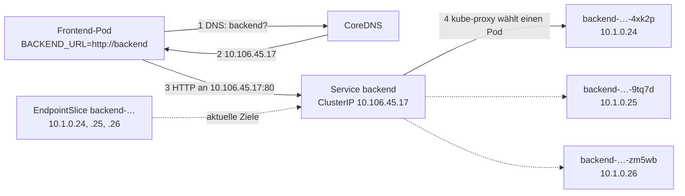

# Lab 5.1: Services und DNS

**Leitfragen:**

<details>
<summary>Das Backend bekommt bei jedem Neustart eine neue IP: wie findet das Frontend es trotzdem?</summary>

Über einen festen Namen statt einer IP. Ein Service gibt einer Gruppe von Pods eine feste Adresse und einen DNS-Namen (`backend`); welche Pods gerade dahinterstehen, pflegt Kubernetes selbst.

</details>

<details>
<summary>Drei Backend-Pods: wer verteilt die Anfragen?</summary>

Nicht das Frontend. Auf jedem Node leitet die Komponente kube-proxy jede Verbindung an die Service-Adresse an einen der bereiten Pods weiter.

</details>

- Pods kommen und gehen, ihre IPs auch (Lab 3.1, Lab 4.1). Ein Service ist die feste Adresse davor.
- Ab diesem Lab erreicht das Frontend das Backend über `http://backend`, und die Seite zeigt Antworten wechselnder Backend-Pods.

## Begriffe

| Begriff | Bedeutung |
| --- | --- |
| Service | Kubernetes-Objekt mit fester IP-Adresse und DNS-Namen für eine Gruppe von Pods; wie die zentrale Telefonnummer einer Hotline, hinter der wechselnde Mitarbeitende abheben |
| ClusterIP | Standardtyp eines Service: eine virtuelle IP, die nur innerhalb des Clusters erreichbar ist |
| Endpoint | eine konkrete Pod-Adresse (IP und Port), an die ein Service weiterleitet |
| EndpointSlice | Liste der aktuellen Endpoints eines Service; der Cluster pflegt sie automatisch anhand des Selectors |
| DNS | Dienst, der Namen in IP-Adressen übersetzt, wie das Telefonbuch; im Cluster übernimmt das CoreDNS im Namespace `kube-system` |
| FQDN | vollständiger DNS-Name, im Cluster `<service>.<namespace>.svc.cluster.local` |
| kube-proxy | Komponente auf jedem Node, die Verbindungen an Service-IPs auf die Pods verteilt |
| `port` / `targetPort` | Port, unter dem der Service erreichbar ist / Port im Container, an den er weiterleitet |
| Test-Pod mit `kubectl run --rm` | kurzlebiger Pod für einen einzelnen Befehl; wird nach dem Ende automatisch gelöscht |

## Wechselnde Pod-IPs und feste Service-Adresse

In Lab 3.1 stand die IP des Backend-Pods von Hand in `BACKEND_URL`. Mit drei Backend-Pods aus einem Deployment funktioniert das nicht mehr: Jeder Pod hat eine eigene IP, und jeder Ersatz-Pod bekommt eine neue.


_Quelle: Wikimedia Commons, „Pod-networking.png" (https://commons.wikimedia.org/wiki/File:Pod-networking.png), Marvin The Paranoid, CC BY-SA 4.0, abgerufen am 17.11.2026._

Im Bild fragt Container B nicht Pod 2 oder Pod 3 direkt, sondern „Service X". Bei der Hello-App heißt dieser Service `backend`; die Antwort kommt von irgendeinem der drei Backend-Pods.

## Service-Manifest des Backends

```yaml
# playground/k8s/backend-service.yaml
apiVersion: v1
kind: Service
metadata:
  name: backend               # wird zum DNS-Namen: http://backend
  labels:
    app: hello
    tier: backend
spec:
  type: ClusterIP             # Standard; darf auch fehlen
  selector:                   # welche Pods dahinterstehen (Labels aus Lab 3.3)
    app: hello
    tier: backend
  ports:
    - port: 80                # Port des Service: http://backend:80
      targetPort: 80          # Port im Container (containerPort des Backends)
      protocol: TCP
```

| Feld | Wirkung |
| --- | --- |
| `metadata.name` | Name des Service und zugleich sein DNS-Name im Namespace |
| `spec.selector` | dieselben Labels wie im Selector des Deployments: `app` + `tier`, nie `version` |
| `spec.ports[].port` | Port, den Clients ansprechen |
| `spec.ports[].targetPort` | Port, auf dem die App im Container lauscht |

```bash
kubectl apply -f playground/k8s/backend-service.yaml
kubectl get service backend
```

```text
NAME      TYPE        CLUSTER-IP     EXTERNAL-IP   PORT(S)   AGE
backend   ClusterIP   10.106.45.17   <none>        80/TCP    8s
```

Die `CLUSTER-IP` bleibt fest, solange der Service existiert, egal wie oft Pods ersetzt werden.

## Vom Selector zur EndpointSlice


_Quelle: Kubernetes-Dokumentation, „Using a Service to Expose Your App" (https://kubernetes.io/docs/tutorials/kubernetes-basics/expose/expose-intro/), CC BY 4.0, The Kubernetes Authors, abgerufen am 17.11.2026._

Der Service sucht laufend alle Pods, deren Labels zum Selector passen, und schreibt ihre IPs in eine EndpointSlice. Die Hello-App sieht danach so aus:



```bash
kubectl get endpointslices -l kubernetes.io/service-name=backend
```

```text
NAME            ADDRESSTYPE   PORTS   ENDPOINTS                     AGE
backend-7xk2p   IPv4          80      10.1.0.24,10.1.0.25,10.1.0.26   12s
```

- Das Label `kubernetes.io/service-name` setzt Kubernetes selbst; es verbindet die EndpointSlice mit ihrem Service.
- Nur Pods, die bereit (`READY 1/1`) sind, stehen in der Liste. Wann ein Pod als bereit gilt, steuern Probes (Lab 8.1).
- `kubectl describe service backend` zeigt dieselben Adressen in der Zeile `Endpoints:`.

**Neu 2025:** Die alte API `Endpoints` ist seit Kubernetes 1.33 veraltet. `kubectl get endpoints` funktioniert noch, gibt aber `Warning: v1 Endpoints is deprecated in v1.33+; use discovery.k8s.io/v1 EndpointSlice` aus. EndpointSlices teilen große Listen in Stücke von höchstens 100 Einträgen und tragen zusätzlich den Zustand jedes Pods (Quelle: [Kubernetes v1.33 Release, 23.04.2025](https://kubernetes.io/blog/2025/04/23/Kubernetes-v1-33-release/), [EndpointSlices](https://kubernetes.io/docs/concepts/services-networking/endpoint-slices/)).

## DNS-Namen im Cluster

Jeder Pod fragt CoreDNS nach Namen. In der Datei `/etc/resolv.conf` des Pods steht eine Suchliste, deshalb reicht im selben Namespace der kurze Name.

| Name | funktioniert von | Beispiel |
| --- | --- | --- |
| `backend` | Pods im selben Namespace `hello` | `http://backend` |
| `backend.hello` | Pods in jedem Namespace | `http://backend.hello` |
| `backend.hello.svc.cluster.local` | überall im Cluster (FQDN) | `http://backend.hello.svc.cluster.local` |

Der Laptop selbst kennt diese Namen nicht; sie gelten nur im Cluster. Zum Testen startet ein kurzlebiger Pod einen einzelnen Befehl:

```bash
kubectl run tmp --rm -it --image=busybox:1.37 --restart=Never -- nslookup backend
```

| Teil | Bedeutung |
| --- | --- |
| `kubectl run tmp` | startet einen Pod namens `tmp` ohne Manifest |
| `--rm -it` | Ausgabe im Terminal zeigen und den Pod danach löschen |
| `--image=busybox:1.37` | kleines Image mit `nslookup` und `wget` |
| `--restart=Never` | einmal ausführen, nicht neu starten |
| `-- nslookup backend` | alles nach `--` ist der Befehl im Container |

```text
Server:		10.96.0.10
Address:	10.96.0.10:53

Name:	backend.hello.svc.cluster.local
Address: 10.106.45.17

pod "tmp" deleted
```

Zusätzliche Zeilen wie `** server can't find backend.cluster.local: NXDOMAIN` sind normal: `nslookup` probiert alle Einträge der Suchliste durch.

## port und targetPort


Bei der Hello-App sind beide Werte 80. Die Werte dürfen sich unterscheiden: Lauscht eine App auf 8080, bleibt der Service unter Port 80 erreichbar und leitet mit `targetPort: 8080` weiter (so in Lab 10.3). Clients merken davon nichts.

## Lastverteilung durch kube-proxy

- kube-proxy läuft auf jedem Node und richtet Weiterleitungsregeln für alle Service-IPs ein (Linux-Paketfilter `iptables` oder `nftables`).
- Jede neue Verbindung geht an einen zufällig gewählten Endpoint; ein festes Reihum-Verfahren gibt es nicht.
- Das Hello-Frontend öffnet für jeden Seitenaufruf eine neue Verbindung. Deshalb wechselt der Backend-Pod auf der Seite beim Neuladen.
- `kubectl port-forward deployment/frontend 8080:80` verbindet dagegen fest mit einem einzigen Frontend-Pod (wie `pod/` in Lab 3.1); der Frontend-Pod auf der Seite bleibt deshalb gleich. Dieselbe Kurzform wählt auch bei `kubectl exec deploy/frontend -- …` einen Pod des Deployments.
- Programme, die eine Verbindung offen halten (HTTP Keep-Alive, Datenbank-Pools), bleiben länger beim selben Pod.

ClusterIP ist nur innerhalb des Clusters erreichbar. Zugänge von außen (`NodePort`, `LoadBalancer`) zeigt Lab 5.2.

## Typische Fehler

| Symptom | Ursache | Lösung |
| --- | --- | --- |
| Seite: `Backend nicht erreichbar (http://backend): ConnectionError`, EndpointSlice zeigt `<unset>` | Selector passt zu keinem Pod (Tippfehler wie `tier: backnd`) | `kubectl get pods --show-labels` mit `kubectl describe service backend` (Zeile `Selector:`) vergleichen, Selector korrigieren, erneut anwenden |
| EndpointSlice hat IPs, Seite meldet trotzdem `ConnectionError` | `targetPort` passt nicht zum Port im Container | `targetPort` auf den `containerPort` (80) setzen |
| Seite meldet `ConnectionError`, `kubectl get service backend` meldet `NotFound` | Service fehlt oder liegt in einem anderen Namespace | `kubectl get service -A`; im Namespace `hello` anlegen oder `backend.<namespace>` verwenden |
| `Warning: v1 Endpoints is deprecated` | `kubectl get endpoints` benutzt | `kubectl get endpointslices -l kubernetes.io/service-name=backend` |
| Seite zeigt immer denselben Backend-Pod | nur ein Backend-Pod bereit oder Browser-Cache | `kubectl get endpointslices …` prüfen; Seite mit Strg+F5 / Cmd+Shift+R neu laden |
| Git Bash: `Unable to use a TTY - input is not a terminal` | Git Bash bietet kein echtes Terminal für `-t` | Meldung ignorieren (die Ausgabe kommt trotzdem) oder `-i` statt `-it` verwenden |
| `kubectl run` hängt bei `ContainerCreating` oder `ErrImagePull` | `busybox:1.37` wird geladen oder Docker-Hub-Limit erreicht | warten; sonst Test aus dem Frontend: `kubectl exec deploy/frontend -- wget -qO- http://backend` |

## Fazit

- Ein Service gibt Pods mit passenden Labels eine feste ClusterIP und einen DNS-Namen; im selben Namespace reicht `http://backend`.
- Die EndpointSlice zeigt, welche Pods gerade dahinterstehen; leer heißt fast immer: Selector passt nicht.
- kube-proxy verteilt jede neue Verbindung auf einen der bereiten Pods.

In der Übung bekommt das Backend seinen Service, und die Hello-Seite zeigt Antworten verschiedener Backend-Pods.
