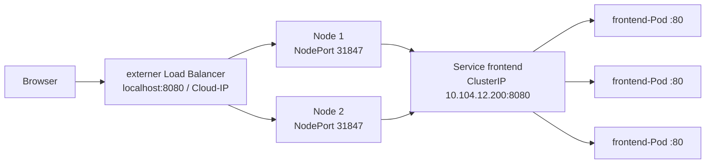

# Lab 5.2: NodePort, LoadBalancer und Port-Forward

**Leitfragen:**

<details>
<summary>Ein Cluster hat fünf Server: an welchen davon schickt der Browser seine Anfrage?</summary>

An irgendeinen. Ein NodePort-Service öffnet denselben Port auf allen Nodes, und jeder Node leitet an einen passenden Pod weiter. Damit niemand eine Node-IP kennen muss, steht in der Cloud ein Load Balancer mit einer festen Adresse davor.

</details>

<details>
<summary>Wie viele öffentliche IP-Adressen braucht eine Firma mit 30 Web-Anwendungen?</summary>

Mit einem Service vom Typ `LoadBalancer` je Anwendung: 30 Load Balancer mit 30 Adressen, jeder kostet in der Cloud Geld. Eine gemeinsame Adresse mit Routing nach Hostname und Pfad löst das (Lab 5.3).

</details>

- Eine ClusterIP (Lab 5.1) ist nur im Cluster erreichbar. Für Zugriffe von außen gibt es die Service-Typen `NodePort` und `LoadBalancer`.
- `kubectl port-forward` bleibt das Werkzeug für schnelle Tests vom eigenen Rechner, nicht für Nutzerinnen und Nutzer.

## Begriffe

| Begriff | Bedeutung |
| --- | --- |
| Node-IP | IP-Adresse eines Servers (Node) im Netz des Rechenzentrums oder Laptops |
| NodePort | Service-Typ, der auf jedem Node denselben Port aus dem Bereich 30000–32767 öffnet und an die Pods weiterleitet |
| LoadBalancer | Service-Typ, der zusätzlich einen externen Load Balancer mit eigener Adresse anfordert |
| externer Load Balancer | Gerät oder Cloud-Dienst vor dem Cluster, der Anfragen auf die Nodes verteilt; wie die Empfangstheke, die Besucher auf freie Schalter schickt |
| `EXTERNAL-IP` | Spalte in `kubectl get service`: Adresse des Load Balancers; `<pending>`, solange keiner bereitsteht |
| Cloud-Controller | Komponente des Cloud-Anbieters, die für jeden `LoadBalancer`-Service einen echten Load Balancer anlegt |
| Port-Forward | Tunnel vom eigenen Rechner durch den API-Server zu einem Pod (Lab 3.1); läuft nur, solange der Befehl läuft |

## Service-Typen im Vergleich

| Typ | erreichbar von | Adresse | typischer Einsatz |
| --- | --- | --- | --- |
| `ClusterIP` (Standard) | nur im Cluster | `backend:80` | Dienste untereinander, z. B. Frontend → Backend |
| `NodePort` | allen, die einen Node erreichen | `<Node-IP>:30000–32767` | Tests, eigene Load Balancer davor, kleine On-Premises-Cluster |
| `LoadBalancer` | Internet oder Firmennetz | eigene IP oder Hostname, z. B. `20.113.4.18:8080` | einzelne Anwendung direkt veröffentlichen |
| `ExternalName` | Pods im Cluster | Cluster-Name als Alias für einen Namen außerhalb, z. B. `db.example.com` | externe Datenbank oder externen Dienst unter einem Cluster-Namen ansprechen |
| Headless (`clusterIP: None`) | nur im Cluster | keine Sammel-IP, eigener DNS-Name je Pod | Datenbanken mit festen Pod-Namen (StatefulSet, Lab 7.3) |

Die ersten drei Typen bauen aufeinander auf: Ein `LoadBalancer`-Service hat auch eine ClusterIP und einen NodePort; der Load Balancer schickt seine Anfragen an diesen NodePort. `ExternalName` und Headless verteilen nichts, sie liefern nur DNS-Antworten (Quelle: [Service](https://kubernetes.io/docs/concepts/services-networking/service/), Stand: 11/2026).




_Quelle: Wikimedia Commons, „Kubernetes High-availability.png" (https://commons.wikimedia.org/wiki/File:Kubernetes_High-availability.png), Natlibfi-arlehiko, CC BY-SA 4.0, abgerufen am 17.11.2026._

Der externe Load Balancer kennt nur die Nodes. Auf jedem Node verteilt kube-proxy (Lab 5.1) weiter auf die Pods, auch auf Pods eines anderen Nodes.

## Frontend-Service als NodePort und LoadBalancer

```yaml
# playground/k8s/frontend-service.yaml (Endstand Lab 5.2)
apiVersion: v1
kind: Service
metadata:
  name: frontend
  labels:
    app: hello
    tier: frontend
spec:
  type: LoadBalancer          # vorher in der Übung: NodePort
  selector:
    app: hello
    tier: frontend
  ports:
    - port: 8080              # Port nach außen: localhost:8080
      targetPort: 80          # Port im Frontend-Container
      protocol: TCP
      # nodePort: 30080       # optional fest; ohne Angabe vergibt Kubernetes einen freien Port
```

```bash
kubectl get service frontend
```

```text
NAME       TYPE           CLUSTER-IP      EXTERNAL-IP   PORT(S)          AGE
frontend   LoadBalancer   10.104.12.200   localhost     8080:31847/TCP   6s
```

`PORT(S) 8080:31847/TCP` heißt: Service-Port 8080, NodePort 31847. Bei `type: NodePort` ist die Spalte `EXTERNAL-IP` `<none>`.

Einen festen `nodePort` zu setzen ist erlaubt, kollidiert aber leicht mit anderen Services; meist bleibt die automatische Vergabe.

## LoadBalancer lokal und in der Cloud

| Umgebung | was bei `type: LoadBalancer` passiert | Adresse |
| --- | --- | --- |
| Docker Desktop (Kubeadm) | Docker Desktop leitet den Service-Port auf den Laptop weiter | `http://localhost:8080` |
| minikube | `EXTERNAL-IP` bleibt `<pending>`, bis `minikube tunnel` läuft | IP aus `kubectl get service` |
| kind | braucht den Zusatz `cloud-provider-kind` (prüfen) | IP aus `kubectl get service` |
| AKS, EKS, GKE | der Cloud-Controller legt einen echten Load Balancer mit öffentlicher IP an; kostet je Stück | öffentliche IP oder DNS-Name |
| eigenes Rechenzentrum | ohne Zusatzsoftware (z. B. MetalLB) bleibt `<pending>` | — |

Docker Desktop macht `LoadBalancer`-Services auf `localhost` erreichbar (Quelle: [Docker Docs, Kubernetes](https://docs.docker.com/desktop/use-desktop/kubernetes/), Stand: 11/2026). Ob ein NodePort beim Kubeadm-Provisioner zusätzlich auf `localhost:<NodePort>` erreichbar ist, hängt von der Docker-Desktop-Version ab (prüfen); im Zweifel `LoadBalancer` oder Port-Forward nutzen.


_Quelle: Kubernetes-Blog, „DIY: Create Your Own Cloud with Kubernetes (Part 2)" (https://kubernetes.io/blog/2024/04/05/diy-create-your-own-cloud-with-kubernetes-part-2/), CC BY 4.0, The Kubernetes Authors, abgerufen am 17.11.2026._

Das „Services plugin" im Bild ist bei Docker Desktop kube-proxy.

## Port-Forward als Entwicklerwerkzeug

| | Port-Forward | NodePort / LoadBalancer |
| --- | --- | --- |
| Zweck | schneller Test vom eigenen Rechner | Zugang für andere |
| Ziel | genau ein Pod (`pod/…`, `deployment/…` oder `service/…` wählen einen Pod aus) | alle passenden Pods, verteilt |
| Lebensdauer | solange das Terminal läuft | solange der Service existiert |
| Rechte | braucht Zugriff auf den Cluster (kubeconfig) | braucht nur die Adresse |

```bash
kubectl port-forward service/frontend 9090:8080   # lokaler Port 9090 -> Service-Port 8080 -> ein Pod
```

Auch `service/frontend` landet immer beim selben Pod: Port-Forward wählt beim Start einen Pod aus und verteilt nicht.

**Neu 2026:** Das Feld `spec.externalIPs`, mit dem ein Service früher auf von Hand eingetragenen Adressen lauschte, ist seit Kubernetes 1.36 veraltet; dafür `LoadBalancer` oder die Gateway API (Lab 5.3) nutzen (Quelle: [Kubernetes v1.36 Release, 22.04.2026](https://kubernetes.io/blog/2026/04/22/kubernetes-v1-36-release/)).

## Typische Fehler

| Symptom | Ursache | Lösung |
| --- | --- | --- |
| `EXTERNAL-IP` bleibt `<pending>` | Port 8080 auf dem Laptop belegt, z. B. durch das Port-Forward aus Lab 5.1, oder Cluster ohne Load-Balancer-Unterstützung (minikube, kind) | Port-Forward mit Strg+C beenden; anderen `port` wählen; bei minikube `minikube tunnel` |
| `spec.ports[0].nodePort: Invalid value: 8080: provided port is not in the valid range` | `nodePort` von Hand außerhalb 30000–32767 gesetzt | Zeile `nodePort` entfernen oder Wert aus dem Bereich wählen |
| `localhost:<NodePort>` lädt nicht | NodePort bei diesem Docker-Desktop-Provisioner nicht nach `localhost` weitergeleitet | `type: LoadBalancer` oder `kubectl port-forward service/frontend 9090:8080` |
| Seite lädt, zeigt `Backend nicht erreichbar` | Service `backend` aus Lab 5.1 fehlt | `kubectl apply -f playground/k8s/backend-service.yaml` |
| `ENDPOINTS <unset>` für `frontend` | Selector passt nicht zu den Frontend-Pods | `tier: frontend` prüfen (wie Lab 5.1) |

## Vertiefung

- **ExternalName:** Service ohne Selector und ohne Pods. Fragt ein Pod nach `datenbank`, antwortet CoreDNS mit dem externen Namen (DNS-Eintrag vom Typ CNAME). Zieht der Dienst später in den Cluster, ändert sich nur der Service, nicht die Konfiguration der Apps. Für HTTPS meist ungeeignet, weil Zertifikat und Hostname der Anfrage nicht zum Cluster-Namen passen.

  ```yaml
  apiVersion: v1
  kind: Service
  metadata:
    name: datenbank
  spec:
    type: ExternalName
    externalName: db.example.com   # Beispielname; kein Proxy, keine Ports, nur DNS
  ```

- **API-Server-Proxy:** `kubectl proxy` öffnet `http://localhost:8001` als Tunnel zum API-Server. Darüber ist auch ein ClusterIP-Service erreichbar, z. B. das Backend unter `http://localhost:8001/api/v1/namespaces/hello/services/http:backend:80/proxy/` (Schema `http:<service>:<port>`). Wie Port-Forward nur für Tests mit eigener kubeconfig; Ende mit **Strg+C**.

## Fazit

- `NodePort` öffnet einen Port 30000–32767 auf jedem Node; `LoadBalancer` setzt einen externen Load Balancer davor und enthält NodePort und ClusterIP.
- Docker Desktop veröffentlicht `LoadBalancer`-Services auf `localhost`; in der Cloud kostet jeder Load Balancer eine eigene Adresse.
- `kubectl port-forward` ist ein Test-Tunnel zu genau einem Pod, kein Zugang für Nutzer.

In der Übung wird die Hello-Seite über NodePort, LoadBalancer und Port-Forward erreichbar.
