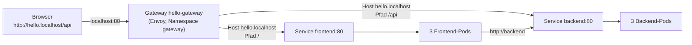

# Lab 5.3: HTTP-Routing mit der Gateway API

**Leitfragen:**

<details>
<summary>30 Web-Anwendungen, eine öffentliche Adresse: wie kommt jede Anfrage zur richtigen Anwendung?</summary>

Über den Inhalt der HTTP-Anfrage: Jede Anfrage nennt den Hostnamen (`shop.example.com`) und einen Pfad (`/api`). Ein Eingangs-Proxy liest beides und leitet nach Regeln an den passenden Service weiter; ein Load Balancer und eine IP reichen für alle 30.

</details>

<details>
<summary>Wer soll Zertifikate und Domains verwalten, wer die Routen einer einzelnen App?</summary>

Der gemeinsame Eingang (Domain, Zertifikat, Port) gehört dem Plattform-Team, die Regeln „`/api` geht an mein Backend" dem App-Team. Die Gateway API trennt genau diese Rollen in eigene Objekte.

</details>

- Lab 5.2 brauchte je Anwendung einen Load Balancer. Ein Gateway ist ein gemeinsamer Eingang auf Port 80, der nach Hostname und Pfad verteilt.
- Ab diesem Lab antwortet die Hello-App unter `http://hello.localhost` (Frontend) und `http://hello.localhost/api` (Backend).

## Begriffe

| Begriff | Bedeutung |
| --- | --- |
| Hostname | Name in der Adresse, z. B. `hello.localhost`; der Browser schickt ihn in jeder Anfrage mit (HTTP-Header `Host`) |
| Pfad | Teil der Adresse nach dem Hostnamen, z. B. `/api` |
| Reverse Proxy | Programm, das Anfragen von außen annimmt und an interne Dienste weiterreicht; wie die Poststelle, die Briefe nach Abteilung verteilt |
| Ingress | älteres Kubernetes-Objekt für HTTP-Routing; braucht einen Ingress-Controller (z. B. ingress-nginx) |
| Gateway API | Nachfolger von Ingress: mehrere Objekte für Eingang und Routen, getrennt nach Rollen |
| CRD (Custom Resource Definition) | Erweiterung, die dem Cluster neue Objektarten beibringt; die Gateway API wird so installiert |
| GatewayClass | legt fest, welche Software Gateways umsetzt (hier Envoy Gateway); clusterweit |
| Gateway | ein konkreter Eingang mit Listener (Port, Protokoll) und der Regel, welche Routen andocken dürfen |
| Listener | Teil eines Gateways: auf welchem Port mit welchem Protokoll Anfragen angenommen werden |
| HTTPRoute | Regeln einer App: Hostname + Pfad → Service und Port |
| Envoy / Envoy Gateway | Envoy ist ein verbreiteter Reverse Proxy; Envoy Gateway setzt die Gateway API mit Envoy um |

## Routing nach Hostname und Pfad

Ein Reverse Proxy am Eingang liest Hostname und Pfad jeder Anfrage und wählt danach den Service.



## Ingress: der bestehende Standard


_Quelle: Kubernetes-Dokumentation, „Ingress" (https://kubernetes.io/docs/concepts/services-networking/ingress/), CC BY 4.0, The Kubernetes Authors, abgerufen am 17.11.2026._

So sieht dieselbe Hello-Route als Ingress aus; in bestehenden Clustern begegnet dieses Format noch oft:

```yaml
apiVersion: networking.k8s.io/v1
kind: Ingress
metadata:
  name: hello
  annotations:                                   # Zusatzfunktionen je Controller als Text-Annotationen
    nginx.ingress.kubernetes.io/ssl-redirect: "false"
spec:
  ingressClassName: nginx                        # welcher Controller zuständig ist
  rules:
    - host: hello.localhost
      http:
        paths:
          - path: /api
            pathType: Prefix
            backend:
              service: { name: backend, port: { number: 80 } }
          - path: /
            pathType: Prefix
            backend:
              service: { name: frontend, port: { number: 80 } }
```

**Neu 2025/2026:**

- ingress-nginx, der meistgenutzte Ingress-Controller, ist seit **24.03.2026** eingestellt: keine Releases und keine Sicherheitsupdates mehr (angekündigt am 11.11.2025). Laut Folge-Statement vom 29.01.2026 ist der Weiterbetrieb ein Sicherheitsrisiko (Quellen: [Ingress NGINX Retirement](https://kubernetes.io/blog/2025/11/11/ingress-nginx-retirement/), [Statement 29.01.2026](https://kubernetes.io/blog/2026/01/29/ingress-nginx-statement/)).
- Die Ingress-API selbst bleibt stabil, ist aber eingefroren; die Kubernetes-Doku empfiehlt die Gateway API (Quelle: [Ingress](https://kubernetes.io/docs/concepts/services-networking/ingress/), Stand: 11/2026).
- `ingress2gateway` (Version 1.0 seit 20.03.2026) übersetzt bestehende Ingress-Objekte samt ingress-nginx-Annotationen in Gateway-API-YAML (Quellen: [ingress2gateway 1.0](https://kubernetes.io/blog/2026/03/20/ingress2gateway-1-0-release), [Releases](https://github.com/kubernetes-sigs/ingress2gateway/releases)).

## Gateway API: drei Objekte, drei Rollen


_Quelle: Gateway API, „Introduction" (https://gateway-api.sigs.k8s.io/docs/introduction/), Kubernetes SIG Network, Apache-2.0, abgerufen am 17.11.2026._

| Objekt | Rolle | Hello-App | Namespace |
| --- | --- | --- | --- |
| GatewayClass | Infrastruktur-Anbieter: welche Software | `eg` (Envoy Gateway) | clusterweit |
| Gateway | Plattform-Team: Port, Protokoll, Domains, Zertifikate, wer andocken darf | `hello-gateway`, Port 80 | `gateway` |
| HTTPRoute | App-Team: Hostname, Pfade, Ziel-Services | `hello` | `hello` |


_Quelle: Gateway API, „Use Cases" (https://gateway-api.sigs.k8s.io/docs/concepts/use-cases/), Kubernetes SIG Network, Apache-2.0, abgerufen am 17.11.2026._

| | Ingress | Gateway API |
| --- | --- | --- |
| Objekte | eines (`Ingress`) für alles | GatewayClass, Gateway, HTTPRoute (+ weitere Route-Typen) |
| Rollen | Plattform und App teilen sich ein Objekt | getrennt, auch über Namespaces |
| Zusatzfunktionen | Annotationen, je Controller anders | im Standard: Header-Regeln, Gewichte, Weiterleitungen |
| Protokolle | HTTP/HTTPS | HTTP, gRPC, TLS, TCP, UDP |
| Stand 11/2026 | eingefroren | aktiv, aktuell v1.7.0 (29.10.2026) |

Quelle Version: [Gateway API Releases](https://github.com/kubernetes-sigs/gateway-api/releases/tag/v1.7.0). Gewichte für Canary-Releases nutzt Lab 11.2.

**Implementierungen** (konform, Stand 11/2026): Envoy Gateway (im Kurs), NGINX Gateway Fabric, Traefik Proxy, Cilium, Istio, kgateway, Agentgateway (Quelle: [Implementations](https://gateway-api.sigs.k8s.io/docs/implementations/list/)). Die YAML-Dateien bleiben bei einem Wechsel gleich, nur die GatewayClass ändert sich.

## Envoy Gateway installieren

Envoy Gateway kommt als ein Release-Manifest. Es enthält die CRDs der Gateway API, den Controller und seine Rechte:

```bash
kubectl apply --server-side -f https://github.com/envoyproxy/gateway/releases/download/v1.10.0/install.yaml
kubectl wait --timeout=5m -n envoy-gateway-system deployment/envoy-gateway --for=condition=Available
```

- `--server-side` lässt den API-Server die Änderung zusammenführen; nötig, weil die CRDs zu groß für das normale `kubectl apply` sind.
- `kubectl wait` blockiert, bis der Controller läuft; Ausgabe: `deployment.apps/envoy-gateway condition met`.
- Version v1.10.0 vom 06.11.2026 (Quelle: [Envoy Gateway, Install with YAML](https://gateway.envoyproxy.io/docs/install/install-yaml/), Stand: 11/2026).

## Gateway und HTTPRoute der Hello-App

```yaml
# playground/k8s/gateway.yaml – Plattform-Teil
apiVersion: v1
kind: Namespace
metadata:
  name: gateway
---
apiVersion: gateway.networking.k8s.io/v1
kind: GatewayClass
metadata:
  name: eg
spec:
  controllerName: gateway.envoyproxy.io/gatewayclass-controller   # Envoy Gateway
---
apiVersion: gateway.networking.k8s.io/v1
kind: Gateway
metadata:
  name: hello-gateway
  namespace: gateway
spec:
  gatewayClassName: eg
  listeners:
    - name: http
      protocol: HTTP
      port: 80
      allowedRoutes:
        namespaces:
          from: All           # Routen aus allen Namespaces dürfen andocken
```

```yaml
# playground/k8s/httproute.yaml – App-Teil, Namespace hello
apiVersion: gateway.networking.k8s.io/v1
kind: HTTPRoute
metadata:
  name: hello
spec:
  parentRefs:                 # an welchem Gateway (anderer Namespace -> namespace angeben)
    - name: hello-gateway
      namespace: gateway
  hostnames:
    - hello.localhost
  rules:
    - matches:
        - path: { type: PathPrefix, value: /api }
      backendRefs:
        - name: backend       # Service im Namespace der Route
          port: 80
    - matches:
        - path: { type: PathPrefix, value: / }
      backendRefs:
        - name: frontend
          port: 80
```

- Der längste passende Pfad gewinnt: `/api/...` geht ans Backend, alles andere ans Frontend.
- Das Backend antwortet selbst unter `/api`; ein Umschreiben des Pfads ist nicht nötig.
- Für das Gateway legt Envoy Gateway im Namespace `envoy-gateway-system` einen Envoy-Pod und einen Service vom Typ `LoadBalancer` an (Lab 5.2). Docker Desktop veröffentlicht ihn auf `localhost:80`.
- Der Service `frontend` braucht deshalb keinen eigenen Load Balancer mehr und wird wieder `ClusterIP` mit Port 80.

## Status prüfen

```bash
kubectl get gatewayclass
kubectl get gateway -n gateway
kubectl get httproute
kubectl get service -n envoy-gateway-system
```

```text
NAME   CONTROLLER                                      ACCEPTED   AGE
eg     gateway.envoyproxy.io/gatewayclass-controller   True       1m

NAME            CLASS   ADDRESS     PROGRAMMED   AGE
hello-gateway   eg      localhost   True         50s

NAME    HOSTNAMES             AGE
hello   ["hello.localhost"]   20s

NAME                                   TYPE           CLUSTER-IP      EXTERNAL-IP   PORT(S)                                            AGE
envoy-gateway                          ClusterIP      10.97.180.12    <none>        18000/TCP,18001/TCP,18002/TCP,19001/TCP,9443/TCP   3m
envoy-gateway-hello-gateway-1d5c2a7e   LoadBalancer   10.108.66.140   localhost     80:30652/TCP                                       50s
```

| Prüfpunkt | gut | wenn nicht |
| --- | --- | --- |
| GatewayClass `ACCEPTED` | `True` | Controller läuft nicht oder `controllerName` falsch |
| Gateway `PROGRAMMED` | `True`, `ADDRESS localhost` | `kubectl describe gateway -n gateway hello-gateway`, Abschnitt `Conditions` |
| HTTPRoute | `kubectl describe httproute hello` zeigt `Accepted True` und `ResolvedRefs True` | `NoMatchingParent`: `parentRefs` prüfen; `BackendNotFound`: Service-Name prüfen |

`*.localhost`-Namen lösen Chrome, Edge, Firefox und curl ohne Eintrag in der hosts-Datei auf `127.0.0.1` auf. Safari tut das unter Umständen nicht; dann einen anderen Browser oder `curl -H "Host: hello.localhost" http://localhost/` verwenden. `curl` ist ein Kommandozeilen-Browser, der unter macOS, Linux und in Git Bash vorhanden ist.

## Typische Fehler

| Symptom | Ursache | Lösung |
| --- | --- | --- |
| `no matches for kind "Gateway" in version "gateway.networking.k8s.io/v1"` | CRDs fehlen, Envoy Gateway nicht installiert | Installationsbefehle oben ausführen, `kubectl get crd \| grep gateway` |
| `metadata.annotations: Too long` beim Installieren | `kubectl apply` ohne `--server-side` | Befehl mit `--server-side` wiederholen |
| Gateway `PROGRAMMED False`, Envoy-Service `EXTERNAL-IP <pending>` | Port 80 auf dem Laptop belegt (lokaler Webserver, IIS, ein `docker run -p 80:…` aus Modul 1) | `docker ps` prüfen und Container stoppen, anderen Dienst beenden; sonst Fallback der Übung |
| Safari: „Server nicht gefunden" bei `hello.localhost` | Safari löst `*.localhost` nicht auf | Chrome/Firefox oder `curl -H "Host: hello.localhost" http://localhost/` |
| `404` auf `http://hello.localhost` | Route nicht angenommen oder Hostname falsch geschrieben | `kubectl describe httproute hello`, `hostnames` prüfen |
| `500` nur auf `/api` | Service `backend` fehlt oder falscher Port | `ResolvedRefs` in `kubectl describe httproute hello` lesen |
| `spec.ports[0].nodePort: Forbidden` beim Zurückstellen auf ClusterIP | alter NodePort im Service | `kubectl delete service frontend`, dann `kubectl apply -f playground/k8s/frontend-service.yaml` |

## Fazit

- Ein Gateway ist der gemeinsame Eingang (Port 80, eine Adresse); HTTPRoutes verteilen nach Hostname und Pfad an Services.
- Die Gateway API trennt GatewayClass (Software), Gateway (Plattform-Team) und HTTPRoute (App-Team), auch über Namespaces.
- Ingress bleibt lesbar, ist aber eingefroren; ingress-nginx ist seit 24.03.2026 eingestellt.
- Status lesen: GatewayClass `ACCEPTED`, Gateway `PROGRAMMED`, HTTPRoute `Accepted` und `ResolvedRefs`.

In der Übung wird Envoy Gateway installiert, und die Hello-App antwortet unter `http://hello.localhost` und `/api`.
