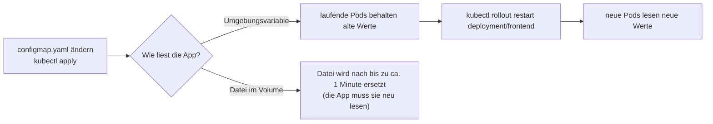

# Lab 6.1: ConfigMaps

**Leitfragen:**

<details>
<summary>Dasselbe Image soll in Test und Produktion laufen, mit verschiedenen Datenbanken: wo steht die Adresse?</summary>

Nicht im Image, sondern in der Umgebung, in der es läuft. Kubernetes legt solche Einstellungen in eine ConfigMap und reicht sie als Umgebungsvariablen oder Dateien in den Container.

</details>

<details>
<summary>Was kostet es heute, eine Einstellung zu ändern, die im Code steht?</summary>

Code ändern, Image neu bauen, testen, ausrollen: für eine Farbe oder eine URL ein kompletter Release. Steht die Einstellung außerhalb, reichen eine geänderte Datei und ein Neustart der Pods.

</details>

- Bisher stehen `BACKEND_URL` im Deployment und `APP_COLOR` im Dockerfile. Beides gehört zur Umgebung, nicht zum Image.
- Eine ConfigMap sammelt solche Einstellungen als Schlüssel-Wert-Paare; das Frontend liest sie mit `envFrom` als Umgebungsvariablen.

## Begriffe

| Begriff | Bedeutung |
| --- | --- |
| Konfiguration | alles, was sich zwischen Umgebungen (Test, Produktion) unterscheidet: Adressen, Farben, Schalter, Grenzwerte |
| Zwölf-Faktor-App | verbreitete Sammlung von zwölf Regeln für Cloud-Anwendungen; Regel III: Konfiguration in der Umgebung speichern |
| ConfigMap | Kubernetes-Objekt mit nicht geheimen Einstellungen als Schlüssel-Wert-Paare; wie ein Merkzettel neben der Maschine statt einer Gravur im Gehäuse |
| `data` | Abschnitt der ConfigMap mit den Einträgen; jeder Wert ist Text |
| `envFrom` | übernimmt alle Schlüssel einer ConfigMap als Umgebungsvariablen in einen Container |
| `valueFrom.configMapKeyRef` | übernimmt einen einzelnen Schlüssel als eine Umgebungsvariable |
| ConfigMap-Volume | bindet die Schlüssel einer ConfigMap als Dateien in einen Ordner des Containers ein |
| `kubectl rollout restart` | ersetzt alle Pods eines Deployments schrittweise durch neue, ohne das Manifest zu ändern |

## Konfiguration außerhalb des Images

Die Zwölf-Faktor-Regel III fordert eine strikte Trennung: Dasselbe Image läuft überall, nur die Konfiguration wechselt (Quelle: [The Twelve-Factor App, III. Konfiguration](https://12factor.net/de/config)).

| Einstellung | gehört zu | Grund | Ort ab diesem Lab |
| --- | --- | --- | --- |
| `APP_VERSION` | Image | beschreibt den Code, der im Image steckt; ein Rollback auf `v1` muss auch „v1" anzeigen | `ENV` im Dockerfile (Lab 1.3) |
| `APP_COLOR` | Umgebung | Dev und Prod sollen sich auf einen Blick unterscheiden (Lab 6.3) | ConfigMap `hello-config` |
| `BACKEND_URL` | Umgebung | hängt davon ab, wo und wie das Backend läuft | ConfigMap `hello-config` |
| Passwort | Umgebung, geheim | darf weder ins Image noch in eine ConfigMap | Secret (Lab 6.2) |

Die Version bleibt bewusst im Image, obwohl sie technisch auch in die ConfigMap passen würde: Stünde sie dort, könnte ein Image `v1` die Seite „Hello-App v2" zeigen, und die Anzeige würde lügen.

## ConfigMap der Hello-App

```yaml
# playground/k8s/configmap.yaml
apiVersion: v1
kind: ConfigMap
metadata:
  name: hello-config
  labels:
    app: hello
data:                           # Schlüssel: Wert
  BACKEND_URL: http://backend   # Service aus Lab 5.1
  APP_COLOR: lightyellow        # überschreibt APP_COLOR=lightgreen aus dem v2-Image
```

- Werte sind immer Text. Zahlen und `true`/`false` brauchen Anführungszeichen (`MAX_ITEMS: "50"`).
- Schlüssel, die als Umgebungsvariable dienen, bestehen aus Buchstaben, Ziffern und `_`.
- Eine ConfigMap ist für kleine Einstellungen gedacht (höchstens 1 MiB).

Ohne YAML entsteht dieselbe ConfigMap per Befehl; mit `--dry-run=client -o yaml` (Lab 2.4) als Vorlage für eine Datei:

```bash
kubectl create configmap hello-config \
  --from-literal=BACKEND_URL=http://backend \
  --from-literal=APP_COLOR=lightyellow \
  --dry-run=client -o yaml
```

## ConfigMap als Umgebungsvariablen

```yaml
# Ausschnitt playground/k8s/frontend-deployment.yaml
      containers:
        - name: frontend
          image: hello-frontend:v2
          envFrom:                       # alle Schlüssel -> Umgebungsvariablen
            - configMapRef:
                name: hello-config
          # Variante für einen einzelnen Schlüssel:
          # env:
          #   - name: BACKEND_URL
          #     valueFrom:
          #       configMapKeyRef:
          #         name: hello-config
          #         key: BACKEND_URL
```

| Form | holt | geeignet für |
| --- | --- | --- |
| `envFrom` + `configMapRef` | alle Schlüssel | ConfigMap, die nur für diese App da ist (Hello-App) |
| `env` + `configMapKeyRef` | einen Schlüssel, Name frei wählbar | gemeinsame ConfigMap, aus der eine App nur einzelne Werte braucht |

Steht eine Variable doppelt, gewinnt `env` vor `envFrom`; beide gewinnen vor `ENV` aus dem Dockerfile.

## ConfigMap als Datei

Manche Programme lesen eine Konfigurationsdatei statt Umgebungsvariablen (z. B. `nginx.conf`, `appsettings.json`). Dann wird jeder Schlüssel zu einer Datei. Die Hello-App braucht das nicht; so sähe es aus:

```yaml
apiVersion: v1
kind: ConfigMap
metadata:
  name: hello-files
data:
  config.json: |                 # Schlüssel = Dateiname, Wert = Dateiinhalt
    { "color": "lightyellow", "features": { "darkMode": false } }
---
# Ausschnitt aus dem Pod-Template eines Deployments
    spec:
      containers:
        - name: frontend
          volumeMounts:
            - name: config
              mountPath: /etc/hello-config   # ergibt /etc/hello-config/config.json
              readOnly: true
      volumes:
        - name: config                       # Volume wie emptyDir in Lab 3.2, Quelle: ConfigMap
          configMap:
            name: hello-files
```

## ConfigMap-Änderungen in laufende Pods übernehmen



- Umgebungsvariablen werden nur beim Start eines Containers gesetzt. Nach einer Änderung der ConfigMap ersetzt `kubectl rollout restart deployment/frontend` die Pods schrittweise, wie ein Rollout in Lab 4.3.
- Dateien aus einem ConfigMap-Volume aktualisiert der kubelet selbst; ob die App die neue Datei liest, hängt von der App ab.
- Ändert sich das Pod-Template (z. B. `env` → `envFrom`), startet `kubectl apply` den Rollout automatisch.


_Quelle: Headlamp-README (https://github.com/kubernetes-sigs/headlamp), Apache-2.0, abgerufen am 17.11.2026._

Headlamp (Lab 2.3) listet ConfigMaps unter **Configuration → Config Maps** und öffnet sie im selben Bearbeiten-Dialog wie im Bild (dort für ein Deployment). Eine Änderung dort wirkt wie `kubectl apply`, landet aber nicht in der Datei unter `playground/k8s/`; die Datei bleibt deshalb die Quelle.

## Typische Fehler

| Symptom | Ursache | Lösung |
| --- | --- | --- |
| Pod im Status `CreateContainerConfigError`, Event `configmap "hello-config" not found` | ConfigMap fehlt oder Name falsch geschrieben | `kubectl get configmap`; ConfigMap anlegen oder Namen korrigieren |
| `cannot unmarshal bool into Go struct field ConfigMap.data of type string` | Wert `true`, `false` oder Zahl ohne Anführungszeichen | Wert in Anführungszeichen setzen |
| Farbe ändert sich nach `kubectl apply` der ConfigMap nicht | Umgebungsvariablen gelten erst für neue Pods | `kubectl rollout restart deployment/frontend` |
| Seite noch grün statt gelb | `envFrom` fehlt im Deployment oder Deployment nicht angewendet | `kubectl exec deploy/frontend -- env \| grep APP_` prüfen |
| `Backend nicht erreichbar (http://backed)` | Tippfehler im Wert `BACKEND_URL` | Wert korrigieren, anwenden, `rollout restart` |

## Fazit

- Konfiguration gehört in die Umgebung, nicht ins Image; die Version bleibt als Eigenschaft des Codes im Image.
- Eine ConfigMap liefert Werte als Umgebungsvariablen (`envFrom`, `configMapKeyRef`) oder als Dateien (Volume).
- Geänderte Umgebungsvariablen wirken erst nach `kubectl rollout restart`; Dateien werden nachgeladen.

In der Übung bezieht das Frontend `BACKEND_URL` und `APP_COLOR` aus der ConfigMap `hello-config`, und eine neue Farbe erscheint ohne neues Image.
