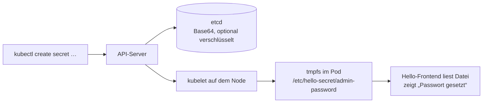

# Lab 6.2: Secrets

**Leitfragen:**

<details>
<summary>Wer in der Firma darf das Datenbankpasswort der Produktion sehen?</summary>

So wenige wie möglich: die Anwendung selbst und eine kleine Betriebsgruppe. Alle anderen, die Manifeste schreiben oder Pods ansehen, brauchen das Passwort nicht. In Kubernetes regeln das Rechte auf Secrets, nicht das Secret selbst.

</details>

<details>
<summary>Ist ein Passwort sicher, wenn es nicht im Klartext dasteht?</summary>

Nur, wenn es verschlüsselt ist. Kubernetes speichert Secrets Base64-codiert; das ist eine Umschreibung, die jeder mit `base64 -d` zurückübersetzt. Schutz entsteht durch Zugriffsrechte, Verschlüsselung im Speicher und Ablage außerhalb von Git.

</details>

- Ein Secret ist eine ConfigMap für vertrauliche Werte: Passwörter, Tokens, Schlüssel, Zertifikate.
- Ab diesem Lab liest das Hello-Frontend ein Admin-Passwort aus der Datei `/etc/hello-secret/admin-password` und zeigt „Passwort gesetzt", nie den Wert.

## Begriffe

| Begriff | Bedeutung |
| --- | --- |
| Secret | Kubernetes-Objekt für vertrauliche Werte als Schlüssel-Wert-Paare; wird wie eine ConfigMap eingebunden, aber getrennt berechtigt |
| Base64 | Verfahren, beliebige Bytes als Buchstaben und Ziffern zu schreiben; keine Verschlüsselung, jeder kann es zurückwandeln |
| `data` / `stringData` | Abschnitte eines Secrets: `data` erwartet Base64-Werte, `stringData` nimmt Klartext an und wird beim Speichern umgewandelt |
| Secret-Typ | Feld `type`, das den erwarteten Inhalt festlegt, z. B. `Opaque` (frei) oder `kubernetes.io/tls` (Zertifikat) |
| etcd | Datenbank der Control Plane (Lab 2.3), in der auch alle Secrets liegen |
| Verschlüsselung im Ruhezustand | etcd speichert Secrets verschlüsselt; ohne Konfiguration nur Base64 (englisch: encryption at rest) |
| RBAC | rollenbasierte Rechte im Cluster: wer welche Objekte lesen oder ändern darf (Modul 10) |
| tmpfs | Dateisystem im Arbeitsspeicher; Secret-Dateien im Pod liegen dort und nie auf der Festplatte des Nodes |

## Secret und ConfigMap im Vergleich

| | ConfigMap (Lab 6.1) | Secret |
| --- | --- | --- |
| Inhalt | Adressen, Farben, Schalter | Passwörter, API-Tokens, Zertifikate |
| Speicherung | Klartext | Base64, optional verschlüsselt in etcd |
| Anzeige | `kubectl describe` zeigt Werte | `kubectl describe` zeigt nur die Länge in Bytes |
| Rechte | oft für alle Entwickler lesbar | eng begrenzt (RBAC) |
| Einbinden | `envFrom`, `configMapKeyRef`, Volume | `envFrom`, `secretKeyRef`, Volume |

| Typ | Zweck | angelegt mit |
| --- | --- | --- |
| `Opaque` | beliebige Schlüssel (Standard) | `kubectl create secret generic` |
| `kubernetes.io/dockerconfigjson` | Zugang zu einer privaten Registry | `kubectl create secret docker-registry` |
| `kubernetes.io/tls` | Zertifikat und Schlüssel, z. B. für HTTPS am Gateway | `kubectl create secret tls` |
| `kubernetes.io/basic-auth`, `ssh-auth` | Benutzername/Passwort, SSH-Schlüssel | YAML |

## Secret der Hello-App anlegen

Im Alltag entsteht ein Secret per Befehl, damit der Wert in keiner Datei landet:

```bash
kubectl create secret generic hello-secret --from-literal=admin-password=uebung-2026
```

Als Manifest sieht dasselbe Secret so aus. `uebung-2026` ist ein Übungswert; mit echten Passwörtern gehört eine solche Datei nie in ein Git-Repository:

```yaml
# examples/m06-configuration/l02-secrets/secret.yaml (Übungswert)
apiVersion: v1
kind: Secret
metadata:
  name: hello-secret
  labels:
    app: hello
type: Opaque
stringData:                     # Klartext beim Anlegen
  admin-password: uebung-2026   # Übungswert
```

## Base64 ist keine Verschlüsselung

```bash
kubectl get secret hello-secret -o yaml
```

```yaml
apiVersion: v1
data:
  admin-password: dWVidW5nLTIwMjY=     # Base64 von "uebung-2026"
kind: Secret
metadata:
  name: hello-secret
  namespace: hello
  # creationTimestamp, uid, resourceVersion …: für jetzt unwichtig
type: Opaque
```

```bash
kubectl get secret hello-secret -o jsonpath='{.data.admin-password}' | base64 -d
```

```text
uebung-2026
```

- `-o jsonpath='{.data.admin-password}'` gibt nur dieses eine Feld aus; `base64 -d` wandelt zurück (macOS, Linux, Git Bash).
- Wer Secrets im Namespace lesen darf, kennt damit jedes Passwort. Leserechte auf Secrets sind deshalb so viel wert wie die Passwörter selbst.
- Dasselbe gilt für `kubectl exec`: Wer in einen Pod darf, liest die eingebundene Datei.

## Secret als Datei einbinden

```yaml
# Ausschnitt playground/k8s/frontend-deployment.yaml
      containers:
        - name: frontend
          envFrom:
            - configMapRef:
                name: hello-config
          volumeMounts:
            - name: admin-secret
              mountPath: /etc/hello-secret   # je Schlüssel eine Datei: /etc/hello-secret/admin-password
              readOnly: true
      volumes:
        - name: admin-secret
          secret:
            secretName: hello-secret
```



| | als Datei (Volume) | als Umgebungsvariable (`secretKeyRef`) |
| --- | --- | --- |
| Sichtbarkeit | nur wer die Datei liest | landet leicht in Logs, Fehlerberichten, Kindprozessen |
| Änderung | Datei wird nach bis zu ca. 1 Minute ersetzt | erst nach `rollout restart` |
| Speicherort | tmpfs, nie auf der Node-Festplatte | im Prozess-Speicher |
| Empfehlung | bevorzugt | nur, wenn die Software es nicht anders kann |

Zum Vergleich die Variante als Umgebungsvariable (in der Hello-App nicht verwendet):

```yaml
          env:
            - name: ADMIN_PASSWORD
              valueFrom:
                secretKeyRef:
                  name: hello-secret
                  key: admin-password
```

## Schutz von Secrets in der Praxis

| Maßnahme | schützt gegen | Ort / Quelle |
| --- | --- | --- |
| RBAC: Lesen von Secrets nur für wenige | neugierige oder kompromittierte Konten im Cluster | [RBAC Good Practices](https://kubernetes.io/docs/concepts/security/rbac-good-practices/), Modul 10 |
| Verschlüsselung in etcd (KMS) | Diebstahl von etcd-Backups oder Festplatten | [Encrypting Confidential Data at Rest](https://kubernetes.io/docs/tasks/administer-cluster/encrypt-data/); bei AKS, EKS, GKE meist einschaltbar |
| External Secrets Operator | Passwörter in Git; holt Werte aus einem externen Tresor und legt Secrets an | [external-secrets.io](https://external-secrets.io/) |
| Sealed Secrets | Klartext in Git; nur der Controller im Cluster kann entschlüsseln | [github.com/bitnami-labs/sealed-secrets](https://github.com/bitnami-labs/sealed-secrets) (Pflegezustand vor Einsatz prüfen) |
| Secrets Store CSI Driver | Secrets im Cluster überhaupt; bindet Tresor-Werte direkt als Datei ein | [secrets-store-csi-driver.sigs.k8s.io](https://secrets-store-csi-driver.sigs.k8s.io/) |
| Cloud-Tresore | verstreute Passwörter; zentrale Verwaltung mit Protokoll und Rotation | [Azure Key Vault](https://learn.microsoft.com/azure/key-vault/), [AWS Secrets Manager](https://aws.amazon.com/secrets-manager/), [Google Secret Manager](https://cloud.google.com/secret-manager), [HashiCorp Vault](https://developer.hashicorp.com/vault), [OpenBao](https://openbao.org/) |


_Quelle: External Secrets Operator, Dokumentation (https://external-secrets.io/latest/), Apache-2.0, abgerufen am 17.11.2026._


_Quelle: Kubernetes-Dokumentation, „Controlling Access to the Kubernetes API" (https://kubernetes.io/docs/concepts/security/controlling-access/), CC BY 4.0, The Kubernetes Authors, abgerufen am 17.11.2026._

Jeder `kubectl get secret` durchläuft diese Prüfung: Schritt 2 (Autorisierung, RBAC) entscheidet, ob das Secret gelesen werden darf. Die Kubernetes-Doku fasst weitere Regeln zusammen (Quelle: [Good practices for Kubernetes Secrets](https://kubernetes.io/docs/concepts/security/secrets-good-practices/), Stand: 11/2026).

> **Merksatz:** Ein Secret schützt nicht durch Base64, sondern durch Rechte, Verschlüsselung und dadurch, dass der Wert nie in Git steht.

## Typische Fehler

| Symptom | Ursache | Lösung |
| --- | --- | --- |
| Pods bleiben in `ContainerCreating`, Event `MountVolume.SetUp failed … secret "hello-secret" not found` | Secret fehlt oder liegt in einem anderen Namespace | `kubectl get secret`; Secret im Namespace `hello` anlegen |
| Seite zeigt weiter `kein Passwort gesetzt` | `mountPath` passt nicht zu `/etc/hello-secret` oder Schlüssel heißt anders als `admin-password` | `kubectl exec deploy/frontend -- ls /etc/hello-secret` |
| `error: failed to create secret secrets "hello-secret" already exists` | Secret wurde schon angelegt | `kubectl delete secret hello-secret` und neu anlegen, oder den Wert per `--dry-run=client -o yaml \| kubectl apply -f -` ersetzen |
| `illegal base64 data at input byte …` | Klartext unter `data:` statt unter `stringData:` | Klartext nach `stringData:` verschieben |
| `base64: invalid input` | Zeilenumbruch oder Anführungszeichen mitkopiert | `-o jsonpath=…` wie oben direkt in `base64 -d` leiten |

## Fazit

- Secrets sind ConfigMaps für vertrauliche Werte; Base64 ist nur eine Schreibweise, keine Verschlüsselung.
- Secrets per `kubectl create secret` anlegen und bevorzugt als Datei (`readOnly`) einbinden.
- Echter Schutz: RBAC auf Secrets, Verschlüsselung in etcd, Tresor-Anbindung (External Secrets, Sealed Secrets, Cloud-Tresore), nie Klartext in Git.

In der Übung entsteht das Secret `hello-secret`, das Frontend zeigt „Passwort gesetzt", und der Klartext lässt sich mit einem Befehl zurückgewinnen.
