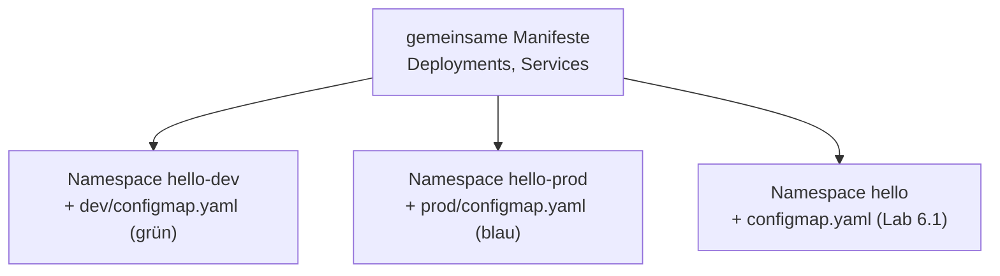

# Lab 6.3: Namespaces für Umgebungen

**Leitfragen:**

<details>
<summary>Test und Produktion auf demselben Cluster: was darf sich gegenseitig nicht stören?</summary>

Namen (zwei Deployments `frontend`), Konfiguration, Rechte und Ressourcen: Ein Lasttest in Test darf Produktion nicht den Speicher wegnehmen. Namespaces trennen Namen, Rechte und Kontingente; Rechenleistung der Nodes und das Netzwerk teilen sich beide weiterhin.

</details>

<details>
<summary>Welche Datei soll sich zwischen zwei Umgebungen unterscheiden und welche nicht?</summary>

Deployments und Services beschreiben die Anwendung und bleiben gleich. Nur die Konfiguration (ConfigMap, Secret) unterscheidet sich. So läuft in Produktion genau das, was in Test geprüft wurde.

</details>

- Ein Namespace (Lab 2.4) ist ein eigener Namensraum im Cluster. Je Umgebung ein Namespace ist der einfachste Weg zu Dev und Prod auf einem Cluster.
- In diesem Lab laufen dieselben Hello-Manifeste in `hello-dev` (grün) und `hello-prod` (blau); nur die ConfigMap unterscheidet sich.

## Begriffe

| Begriff | Bedeutung |
| --- | --- |
| Umgebung | eine Kopie der Anwendung für einen Zweck: Entwicklung (dev), Test, Produktion (prod) |
| namespaced | Objektart, die in einem Namespace liegt: Pod, Deployment, Service, ConfigMap, Secret, HTTPRoute |
| clusterweit | Objektart ohne Namespace: Node, Namespace, StorageClass, PersistentVolume, GatewayClass, ClusterRole |
| `kubectl … -n <ns>` | führt einen Befehl in einem bestimmten Namespace aus, unabhängig vom Standard im Kontext |
| `kubectl … -A` | zeigt Objekte aus allen Namespaces |
| ResourceQuota | Obergrenze je Namespace, z. B. höchstens 10 Pods oder 2 CPU-Kerne insgesamt; wie ein Budget je Abteilung |
| Mandant | Team oder Kunde, das sich einen Cluster mit anderen teilt (englisch: tenant) |

## Namespaces für Teams und Umgebungen


_Quelle: Microsoft Learn, „Kubernetes core concepts for AKS" (https://learn.microsoft.com/en-us/azure/aks/concepts-clusters-workloads), Microsoft, abgerufen am 17.11.2026._

Ein Cluster, mehrere Namensräume: Jede Gruppe sieht und ändert nur ihren Bereich, sofern die Rechte (Modul 10) so gesetzt sind. Übliche Aufteilungen:

| Aufteilung | Beispiel | geeignet für |
| --- | --- | --- |
| je Umgebung | `hello-dev`, `hello-prod` | kleine Teams, ein Cluster für alles |
| je Team | `team-shop`, `team-billing` | mehrere Teams auf einem Cluster |
| je Team und Umgebung | `shop-dev`, `shop-prod` | Kombination; Produktion oft trotzdem auf eigenem Cluster |

## Was Namespaces trennen und was nicht

| trennen Namespaces | trennen Namespaces nicht |
| --- | --- |
| Namen: `frontend` darf in jedem Namespace einmal existieren | Nodes: alle Pods teilen sich CPU und Speicher derselben Server |
| Rechte: Roles und RoleBindings gelten je Namespace (Modul 10) | Netzwerk: Pods erreichen standardmäßig Pods in jedem Namespace |
| Kontingente: ResourceQuota je Namespace | clusterweite Objekte: Nodes, StorageClasses, PersistentVolumes, GatewayClass, ClusterRoles |
| Sicherheitsstufe: Pod-Security-Label je Namespace (Lab 10.3) | Kernel des Nodes: ein ausbrechender Container betrifft alle |

```bash
kubectl api-resources --namespaced=false      # alle clusterweiten Objektarten
kubectl api-resources --namespaced=true       # alle Objektarten mit Namespace
```

Netzwerk-Trennung zwischen Namespaces braucht ein eigenes Objekt, die NetworkPolicy (Firewall-Regeln für Pods); sie ist in diesem Kurs nur ein Ausblick. Für harte Trennung, etwa Produktion mit Kundendaten, nutzen viele Firmen getrennte Cluster.

| | Namespaces auf einem Cluster | getrennte Cluster |
| --- | --- | --- |
| Kosten und Aufwand | gering, eine Control Plane | höher, je Cluster Betrieb und Updates |
| Trennung | Namen, Rechte, Kontingente | vollständig, auch Nodes und Netz |
| Upgrade-Risiko | ein Upgrade trifft alle Umgebungen | Test-Cluster zuerst upgraden |

## Gleiche Manifeste in zwei Namespaces

Die geteilten Manifeste enthalten kein Feld `metadata.namespace`. Der Namespace kommt beim Anwenden über `-n`; nur die ConfigMap liegt je Umgebung in einem eigenen Ordner:

```text
playground/k8s/
├── namespaces.yaml            # hello-dev und hello-prod
├── backend-deployment.yaml    # gleich für alle Umgebungen
├── backend-service.yaml
├── frontend-deployment.yaml
├── frontend-service.yaml
├── dev/configmap.yaml         # APP_COLOR: lightgreen
└── prod/configmap.yaml        # APP_COLOR: lightblue
```

```bash
kubectl apply -f playground/k8s/namespaces.yaml
kubectl apply -n hello-dev -f playground/k8s/dev/ \
  -f playground/k8s/backend-deployment.yaml -f playground/k8s/backend-service.yaml \
  -f playground/k8s/frontend-deployment.yaml -f playground/k8s/frontend-service.yaml
```

- `-f` darf mehrfach stehen; ein Ordner (`dev/`) wendet alle YAML-Dateien darin an.
- Nicht `-f playground/k8s/` als Ganzes: Darin liegen auch `gateway.yaml` (fester Namespace `gateway`), `httproute.yaml` und die ConfigMap von `hello`.
- Secrets entstehen je Umgebung per Befehl mit `-n` (Lab 6.2); in echten Umgebungen hat jede ihr eigenes Passwort.
- Helm-Werte je Umgebung lösen dieselbe Aufgabe später komfortabler (Lab 9.3).



## DNS über Namespace-Grenzen

`BACKEND_URL: http://backend` funktioniert in jeder Umgebung, weil der kurze Name im eigenen Namespace aufgelöst wird (Lab 5.1). Das Frontend in `hello-dev` erreicht also das Backend in `hello-dev`.

| Aufruf aus `hello-dev` | landet bei |
| --- | --- |
| `http://backend` | Backend in `hello-dev` |
| `http://backend.hello-prod` | Backend in `hello-prod` |
| `http://backend.hello-prod.svc.cluster.local` | Backend in `hello-prod` (vollständiger Name) |

Dass der zweite und dritte Aufruf funktionieren, zeigt: Namespaces sind keine Netzwerkgrenze.


_Quelle: Headlamp-README (https://github.com/kubernetes-sigs/headlamp/tree/screenshots/screenshots), Apache-2.0, abgerufen am 17.11.2026._

In Headlamp filtert das Feld **Namespaces** oben jede Liste; mit `hello-dev` und `hello-prod` erscheinen beide Umgebungen nebeneinander.

## Obergrenzen je Namespace mit ResourceQuota

Eine ResourceQuota begrenzt, was ein Namespace insgesamt verbrauchen darf. Beispiel (nicht Teil der Übung):

```yaml
apiVersion: v1
kind: ResourceQuota
metadata:
  name: dev-limits
  namespace: hello-dev
spec:
  hard:
    pods: "10"                  # höchstens 10 Pods im Namespace
    services: "5"
    configmaps: "10"
    secrets: "10"
    # requests.cpu: "2"         # Summe der CPU-Anforderungen; setzt requests an jedem Pod voraus (Lab 8.2)
    # requests.memory: 2Gi
```

```bash
kubectl describe resourcequota dev-limits -n hello-dev
```

```text
Name:       dev-limits
Namespace:  hello-dev
Resource    Used  Hard
--------    ----  ----
configmaps  2     10
pods        6     10
secrets     1     10
services    2     5
```

Wird die Grenze erreicht, lehnt der API-Server neue Objekte ab; ein Deployment zeigt dann weniger Pods als gewünscht und das Event `exceeded quota`. `configmaps 2` zählt die automatisch angelegte ConfigMap `kube-root-ca.crt` mit.

## Typische Fehler

| Symptom | Ursache | Lösung |
| --- | --- | --- |
| `the namespace from the provided object "hello" does not match the namespace "hello-dev"` | Manifest enthält `metadata.namespace: hello` | Zeile `namespace:` aus den geteilten Manifesten entfernen |
| `namespaces "hello-dev" not found` | Namespaces noch nicht angelegt | zuerst `kubectl apply -f playground/k8s/namespaces.yaml` |
| Seite in dev ist hellgelb statt grün | ConfigMap aus `hello` statt aus `dev/` angewendet | `kubectl get configmap hello-config -n hello-dev -o yaml` prüfen, `dev/configmap.yaml` anwenden, `rollout restart -n hello-dev` |
| Frontend-Pods in `hello-dev` hängen in `ContainerCreating` | Secret `hello-secret` fehlt in diesem Namespace | `kubectl create secret generic hello-secret … -n hello-dev` |
| `kubectl get pods` zeigt die neuen Pods nicht | Standard-Namespace im Kontext ist `hello` | `-n hello-dev` anhängen oder `kubectl get pods -A -l app=hello` |
| zweite Route auf `hello.localhost`, Seite wechselt zufällig die Farbe | `httproute.yaml` versehentlich mit `-n hello-dev` angewendet | `kubectl delete httproute hello -n hello-dev` |

## Fazit

- Namespaces trennen Namen, Rechte und Kontingente, aber nicht Nodes und Netzwerk.
- Dieselben Manifeste ohne `namespace`-Feld laufen mit `kubectl apply -n` in jeder Umgebung; nur ConfigMap und Secret unterscheiden sich.
- `backend` löst im eigenen Namespace auf, `backend.<namespace>` erreicht andere Namespaces.
- ResourceQuota begrenzt den Verbrauch je Namespace.

In der Übung laufen `hello-dev` (grün) und `hello-prod` (blau) nebeneinander, erreichbar über zwei Port-Forwards.
