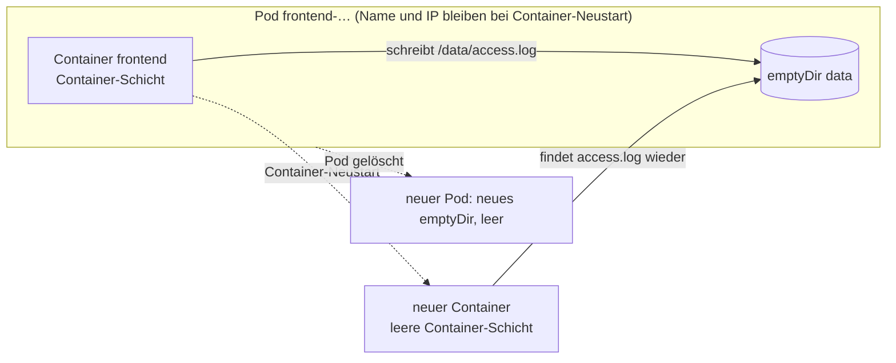

# Lab 7.1: Volumes

**Leitfragen:**

<details>
<summary>Ein Pod wird ersetzt: was passiert mit Dateien, die er geschrieben hat?</summary>

Ohne Volume liegen sie in der beschreibbaren Schicht des Containers und verschwinden mit ihm. Ein Volume hängt einen Ordner von außen in den Container; wie lange er lebt, hängt von der Volume-Art ab.

</details>

<details>
<summary>Welche Daten einer Web-App dürfen verloren gehen und welche nicht?</summary>

Zwischenspeicher (Cache, temporäre Uploads, Sitzungsdaten mit Ablaufzeit) dürfen verloren gehen. Bestellungen, Benutzerkonten, Protokolle für die Revision und hochgeladene Dokumente nicht: Diese Daten brauchen Speicher, der den Pod überlebt (Lab 7.2).

</details>

- Ein Container startet immer mit dem Dateisystem seines Images; was er schreibt, geht beim Neustart verloren.
- Ein Volume ist ein Ordner, den Kubernetes in einen Container einhängt. Die Volume-Art entscheidet, ob er den Container, den Pod oder beide überlebt.

## Begriffe

| Begriff | Bedeutung |
| --- | --- |
| Container-Schicht | dünne, beschreibbare Schicht über den Image-Schichten; jeder neue Container bekommt eine leere, wie ein frisch zurückgesetzter Schulungsrechner |
| Volume | Ordner, den Kubernetes unabhängig vom Image bereitstellt und in Container einhängt; wie ein USB-Stick, der in den Rechner gesteckt wird |
| `volumes` | Liste im Pod-Bauplan: welche Volumes der Pod hat und woher sie kommen |
| `volumeMounts` | Liste im Container: welches Volume in welchem Ordner (`mountPath`) erscheint |
| `emptyDir` | leerer Ordner auf dem Node, der mit dem Pod entsteht und mit ihm gelöscht wird (aus Lab 3.2) |
| `hostPath` | ein fester Ordner des Nodes im Container; hängt am Node, nicht am Pod |
| `configMap`/`secret`-Volume | Einträge einer ConfigMap oder eines Secrets als Dateien, nur lesbar (aus Lab 6.2) |
| `persistentVolumeClaim` | Antrag auf dauerhaften Speicher, der unabhängig vom Pod existiert (Lab 7.2) |
| Container-Neustart | der kubelet startet einen beendeten Container im selben Pod neu; Pod-Name und IP bleiben, Spalte `RESTARTS` zählt hoch |
| Pod-Ersatz | ein Pod wird gelöscht, das Deployment legt einen neuen mit neuem Namen und neuer IP an |
| PID 1 | Hauptprozess eines Containers; endet er, endet der Container |

## Container-Schicht und verlorene Dateien


_Quelle: Docker Docs, „Storage drivers" (https://docs.docker.com/engine/storage/drivers/), abgerufen am 17.11.2026._

Das Frontend schreibt bei jedem Aufruf von `/` eine Zeile nach `/data/access.log`. Ohne Volume landet die Datei in der Container-Schicht. Startet der Container neu oder wird der Pod ersetzt, beginnt ein neuer Container mit leerer Schicht: das Log ist weg. Das ist dasselbe Verhalten wie bei `docker run` ohne `-v` aus Lab 1.2.

## Volume im Pod-Bauplan

Ein Volume besteht immer aus zwei Teilen: der Definition unter `spec.volumes` und dem Einhängen unter `containers[].volumeMounts`. Verbunden werden beide über den Namen.

```yaml
# Ausschnitt aus playground/k8s/frontend-deployment.yaml (Lab 7.1)
    spec:
      containers:
        - name: frontend
          image: hello-frontend:v2
          volumeMounts:
            - name: data                 # verweist auf das Volume "data" unten
              mountPath: /data           # Ordner im Container
      volumes:
        - name: data                     # frei wählbarer Name, eindeutig im Pod
          emptyDir: {}                   # Volume-Art; {} = ohne weitere Einstellungen
```

| Feld | Bedeutung |
| --- | --- |
| `volumes[].name` | Name, über den Container das Volume ansprechen |
| `volumes[].<art>` | genau eine Volume-Art: `emptyDir`, `hostPath`, `secret`, `configMap`, `persistentVolumeClaim` … |
| `volumeMounts[].mountPath` | Ordner im Container; ein vorhandener Ordner aus dem Image wird überdeckt |
| `volumeMounts[].readOnly` | `true` = Container darf nur lesen |

Ein Pod kann mehrere Volumes haben; das Frontend hat nach diesem Lab zwei: `data` für das Log und `admin-secret` für das Passwort aus Lab 6.2.

## Volume-Arten nach Lebensdauer

Die Kubernetes-Dokumentation teilt Volumes danach ein, wie lange ihre Daten leben (Quelle: [Volumes](https://kubernetes.io/docs/concepts/storage/volumes/), Stand: 11/2026).

| Volume-Art | Daten kommen aus | Lebensdauer | Typischer Einsatz |
| --- | --- | --- | --- |
| `emptyDir` | leerer Ordner auf dem Node | so lange wie der Pod; überlebt Container-Neustarts | Zwischenspeicher, Austausch zwischen Containern eines Pods (Lab 3.2) |
| `configMap`, `secret` | ConfigMap/Secret im Cluster | so lange wie der Pod; Inhalt kommt aus dem Objekt | Konfigurationsdateien, Passwörter (Lab 6.2) |
| `image` | Dateien aus einem Container-Image, nur lesbar | so lange wie der Pod | Modelle, statische Inhalte getrennt von der App |
| `hostPath` | fester Ordner des Nodes | so lange wie der Node; anderer Node = andere Daten | Systemwerkzeuge, die Node-Dateien lesen (z. B. Log-Sammler) |
| `persistentVolumeClaim` | eigener Speicher (Platte, Netzlaufwerk, Cloud-Disk) | unabhängig vom Pod, bis der Claim gelöscht wird | Datenbanken, Uploads, Logs (Lab 7.2) |

`hostPath` sieht dauerhaft aus, ist es aber nur auf einem einzigen Node: Landet der Pod nach einem Neustart auf einem anderen Node, findet er einen leeren Ordner. Dazu kommt ein Sicherheitsrisiko, weil der Container Dateien des Nodes lesen und schreiben kann.

**Neu 2025/2026:** Das Volume `image` (Dateien aus einem OCI-Image) ist seit Kubernetes 1.36 stabil; das alte Volume `gitRepo` gibt es seit 1.36 nicht mehr, letzte Version damit war 1.35 (Quelle: [Volume Types](https://kubernetes.io/docs/reference/storage/volume-types/), [Kubernetes v1.36 Release, 22.04.2026](https://kubernetes.io/blog/2026/04/22/kubernetes-v1-36-release/)).

## Container-Neustart und Pod-Ersatz



| Ereignis | Wer löst es aus | Container-Schicht | `emptyDir` |
| --- | --- | --- | --- |
| Container-Neustart | Hauptprozess endet, später auch eine fehlgeschlagene Liveness-Probe (Lab 8.1) | neu, leer | bleibt |
| Pod-Ersatz | `kubectl delete pod`, Rollout, Ausfall des Nodes | neu, leer | neu, leer |

Einen Container-Neustart löst in der Übung ein Signal an den Hauptprozess aus:

```bash
kubectl exec deploy/frontend -- kill -INT 1   # SIGINT an PID 1, wirkt wie Strg+C: Flask beendet sich
```

`kubectl exec deploy/frontend` wählt einen Pod des Deployments. `kill -INT 1` schickt das Signal `SIGINT` an den Prozess mit der Nummer 1, also an Python. Python beendet sich darauf wie nach **Strg+C**, der Container endet, und der kubelet startet ihn im selben Pod neu. Ein einfaches `kill 1` (Signal `SIGTERM`) wirkt dagegen nicht: Linux stellt PID 1 nur Signale zu, für die das Programm eine Behandlung eingerichtet hat, und Python richtet sie nur für `SIGINT` ein.

## Typische Fehler

| Symptom | Ursache | Lösung |
| --- | --- | --- |
| `spec.template.spec.containers[0].volumeMounts[0].name: Not found: "data"` | Volume unter `volumes` fehlt oder heißt anders | Namen in `volumes` und `volumeMounts` angleichen |
| `cat: can't open '/data/access.log': No such file or directory` | neuer Pod, Seite seitdem nicht aufgerufen | Seite einmal aufrufen; die App legt die Datei beim ersten Aufruf an |
| `kill 1` ändert nichts, `RESTARTS` bleibt 0 | `SIGTERM` an PID 1 ohne Signalbehandlung wird ignoriert | `kill -INT 1` verwenden |
| Log zeigt Zeilen eines anderen Pods als erwartet | mehrere Replikas, jeder Pod hat sein eigenes `emptyDir` | für die Beobachtung `replicas: 1` setzen |
| Nach `kubectl delete pod` dauert es rund 30 Sekunden | Python als PID 1 reagiert nicht auf `SIGTERM`; Kubernetes wartet die Frist ab und beendet hart | normal für diese App; Pod-Ersatz abwarten |

## Vertiefung

- `emptyDir` mit `medium: Memory` liegt im Arbeitsspeicher (tmpfs): schnell, zählt aber zum Speicherverbrauch des Pods. `sizeLimit` begrenzt die Größe; wird sie überschritten, verdrängt der kubelet den Pod.
- `projected` fasst mehrere Quellen (Secret, ConfigMap, Pod-Infos) in einem Ordner zusammen.

## Fazit

- Ohne Volume lebt eine Datei nur so lange wie der Container; jeder Neustart beginnt mit leerer Container-Schicht.
- Ein Volume braucht zwei Einträge: `volumes` im Pod und `volumeMounts` im Container, verbunden über den Namen.
- `emptyDir` überlebt Container-Neustarts, aber nicht das Löschen des Pods; dafür braucht es ein PersistentVolume.

In der Übung bekommt das Frontend das Volume `data`, und Container-Neustart und Pod-Ersatz zeigen, wann `access.log` erhalten bleibt.
