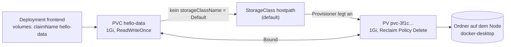

# Lab 7.2: PersistentVolumes und StorageClasses

**Leitfragen:**

<details>
<summary>Wer stellt in einer Firma Speicher bereit und wer nutzt ihn?</summary>

Der Betrieb kauft und verwaltet Speichersysteme (NAS, SAN, Cloud-Speicher), die Entwicklung braucht nur „10 GB für die Datenbank". Kubernetes trennt genauso: Die StorageClass beschreibt das Angebot, der PersistentVolumeClaim ist die Bestellung.

</details>

<details>
<summary>Zwei Server wollen gleichzeitig in dieselbe Datei schreiben: was kann schiefgehen?</summary>

Zeilen überschreiben sich, Dateien werden beschädigt, und eine normale Festplatte lässt sich gar nicht an zwei Rechner gleichzeitig anschließen. Deshalb legt jedes Volume fest, wie viele Nodes oder Pods es gleichzeitig nutzen dürfen (Access Mode).

</details>

- Ein PersistentVolume ist Speicher, der unabhängig von jedem Pod existiert; ein Pod bekommt ihn über einen PersistentVolumeClaim.
- Die StorageClass legt den Speicher auf Bestellung an; auf Docker Desktop heißt sie `hostpath`.

## Begriffe

| Begriff | Bedeutung |
| --- | --- |
| PersistentVolume (PV) | ein Stück Speicher im Cluster (Ordner, Platte, Netzlaufwerk), das unabhängig von Pods existiert; wie ein gemieteter Lagerraum |
| PersistentVolumeClaim (PVC) | Antrag auf Speicher mit Größe und Zugriffsart; der Pod nennt nur den Claim, nicht den Speicher selbst; wie der Mietvertrag |
| StorageClass | Speicherangebot des Clusters mit Namen, Anbieter und Regeln; wie eine Preisliste „Standard", „schnell", „Netzlaufwerk" |
| Provisioner | Programm hinter einer StorageClass, das PVs automatisch anlegt und löscht |
| dynamische Bereitstellung | ein PV entsteht automatisch, sobald ein PVC es braucht; ohne StorageClass legt jemand PVs vorab von Hand an (statisch) |
| Bound | Zustand eines PVC, dem ein PV fest zugeordnet ist |
| Access Mode | wie viele Nodes oder Pods das Volume gleichzeitig lesend oder schreibend einhängen dürfen |
| Reclaim Policy | was mit dem PV und den Daten passiert, wenn der PVC gelöscht wird: `Delete` oder `Retain` |
| Default-StorageClass | StorageClass, die ein PVC ohne `storageClassName` bekommt; in `kubectl get storageclass` mit `(default)` markiert |
| CSI | Container Storage Interface: Standard-Schnittstelle, über die Speicherhersteller Treiber für Kubernetes liefern |
| Block-/Dateispeicher | Blockspeicher ist eine rohe Platte für genau einen Rechner; Dateispeicher (NAS) teilt Ordner über das Netz mit vielen |
| Objektspeicher | speichert ganze Dateien (Objekte) in Behältern (Buckets) und wird über HTTP angesprochen, z. B. Amazon S3; kein vollständiges Dateisystem |

## PV, PVC und StorageClass



| Objekt | Wer legt es an | Gilt für |
| --- | --- | --- |
| StorageClass | Betrieb, Cloud-Anbieter oder Docker Desktop | ganzer Cluster (ohne Namespace) |
| PersistentVolumeClaim | Entwicklung, im Manifest der App | Namespace (`hello`) |
| PersistentVolume | Provisioner automatisch, selten von Hand | ganzer Cluster (ohne Namespace) |

```text
$ kubectl get storageclass
NAME                 PROVISIONER          RECLAIMPOLICY   VOLUMEBINDINGMODE   ALLOWVOLUMEEXPANSION   AGE
hostpath (default)   docker.io/hostpath   Delete          Immediate           false                  12d
```

`hostpath` legt für jeden Claim einen Ordner auf dem einen Node `docker-desktop` an. Das reicht für ein Laptop-Cluster; in Produktion steckt hinter der StorageClass ein Netzwerk- oder Cloud-Speicher.


_Quelle: Kubernetes Blog, „DIY: Create Your Own Cloud with Kubernetes (Part 2)" (https://kubernetes.io/blog/2024/04/05/diy-create-your-own-cloud-with-kubernetes-part-2/), CC BY 4.0, The Kubernetes Authors, abgerufen am 17.11.2026._

Lokaler Speicher wie bei `hostpath` steckt im Node selbst: schnell und einfach, aber an diesen einen Node gebunden.

## PersistentVolumeClaim der Hello-App

```yaml
# playground/k8s/pvc.yaml
apiVersion: v1
kind: PersistentVolumeClaim
metadata:
  name: hello-data
spec:
  accessModes:
    - ReadWriteOnce              # lesen und schreiben von einem Node aus
  resources:
    requests:
      storage: 1Gi               # Größe: Gi = Gibibyte (1024³ Byte)
  # storageClassName: hostpath   # weglassen = Default-StorageClass
```

Im Deployment ersetzt der Claim das `emptyDir` aus Lab 7.1; `volumeMounts` bleibt gleich:

```yaml
      volumes:
        - name: data
          persistentVolumeClaim:
            claimName: hello-data      # Name des PVC im selben Namespace
```

```text
$ kubectl get pvc,pv
NAME                               STATUS   VOLUME                                     CAPACITY   ACCESS MODES   STORAGECLASS   VOLUMEATTRIBUTESCLASS   AGE
persistentvolumeclaim/hello-data   Bound    pvc-3f1c2a7e-9b1d-4c55-8e0a-6d2f1b7c9a10   1Gi        RWO            hostpath       <unset>                 12s

NAME                                                        CAPACITY   ACCESS MODES   RECLAIM POLICY   STATUS   CLAIM              STORAGECLASS   ...
persistentvolume/pvc-3f1c2a7e-9b1d-4c55-8e0a-6d2f1b7c9a10   1Gi        RWO            Delete           Bound    hello/hello-data   hostpath       ...
```

Wichtig sind `STATUS Bound` und beim PV `RECLAIM POLICY` und `CLAIM`; die übrigen Spalten können vorerst ignoriert werden.

## Access Modes

| Access Mode | Kurz | Bedeutung | Typischer Speicher |
| --- | --- | --- | --- |
| `ReadWriteOnce` | RWO | lesen und schreiben von **einem Node**; alle Pods auf diesem Node dürfen | lokale Platte, Cloud-Disk, Ceph RBD |
| `ReadOnlyMany` | ROX | nur lesen, von vielen Nodes | Netzlaufwerk |
| `ReadWriteMany` | RWX | lesen und schreiben von vielen Nodes | NFS, SMB, CephFS, Azure Files |
| `ReadWriteOncePod` | RWOP | lesen und schreiben von genau **einem Pod** im ganzen Cluster (stabil seit 1.29) | CSI-Treiber, die es unterstützen |

`ReadWriteOnce` heißt „ein Node", nicht „ein Pod" (Quelle: [Persistent Volumes, Access Modes](https://kubernetes.io/docs/concepts/storage/persistent-volumes/#access-modes), Stand: 11/2026). Docker Desktop hat nur einen Node: Alle drei Frontend-Pods hängen dasselbe Volume ein und schreiben in dieselbe `access.log`. In einem Cluster mit mehreren Nodes bleibt ein Pod auf einem zweiten Node mit `Multi-Attach error` hängen; dann braucht es RWX-Speicher oder eigene Volumes je Pod (StatefulSet, Lab 7.3).


_Quelle: Docker Docs, „Volumes – Share data between machines" (https://docs.docker.com/engine/storage/volumes/), abgerufen am 17.11.2026._

Gemeinsamer Dateispeicher wie im Bild ist der Fall `ReadWriteMany`: Repliken auf verschiedenen Nodes lesen und schreiben dieselben Dateien.

## Reclaim Policy

| Policy | Nach `kubectl delete pvc` | Einsatz |
| --- | --- | --- |
| `Delete` | PV und Daten werden gelöscht | Standard bei dynamischer Bereitstellung; Test, Zwischenspeicher |
| `Retain` | PV bleibt mit Status `Released`, Daten bleiben; Freigabe von Hand | Produktionsdaten |

`hostpath` arbeitet mit `Delete`: Wer `kubectl delete -f playground/k8s/` ausführt, löscht mit `pvc.yaml` auch das Log. Solange ein Pod den Claim nutzt, bleibt der PVC im Zustand `Terminating`, bis der Pod weg ist.

## Speicher im Rechenzentrum und CSI-Treiber


_Quelle: Wikimedia Commons, „SANvsNAS.svg" (https://commons.wikimedia.org/wiki/File:SANvsNAS.svg), CC BY-SA 2.5, abgerufen am 17.11.2026._

Blockspeicher (SAN, Cloud-Disk) hängt wie eine Festplatte an einem Rechner: passt zu RWO. Dateispeicher (NAS mit NFS oder SMB) teilt Ordner mit vielen Rechnern: passt zu RWX. Kubernetes spricht beide über CSI-Treiber an, die als Pods im Cluster laufen und eine StorageClass mitbringen.

| Speicher | CSI-Treiber | Access Modes | Einsatz |
| --- | --- | --- | --- |
| NFS | [csi-driver-nfs](https://github.com/kubernetes-csi/csi-driver-nfs) | RWO, ROX, RWX | vorhandener Linux-Fileserver oder NAS |
| SMB/CIFS | [csi-driver-smb](https://github.com/kubernetes-csi/csi-driver-smb) | RWO, ROX, RWX | Windows-Freigaben, NAS im Firmennetz |
| Cloud-Disks | [AWS EBS](https://github.com/kubernetes-sigs/aws-ebs-csi-driver), [Azure Disk](https://github.com/kubernetes-sigs/azuredisk-csi-driver), [Google PD](https://github.com/kubernetes-sigs/gcp-compute-persistent-disk-csi-driver) | RWO (teils RWOP) | Datenbanken in AKS, EKS, GKE; meist schon als Default-StorageClass eingerichtet |
| Cloud-Dateidienste | [Azure Files](https://github.com/kubernetes-sigs/azurefile-csi-driver), [AWS EFS](https://github.com/kubernetes-sigs/aws-efs-csi-driver) | RWX | gemeinsame Ordner über Nodes hinweg |
| Ceph mit Rook | [Rook](https://rook.io) (Operator, Lab 7.3) | RBD (Block): RWO; CephFS (Datei): RWX | eigener verteilter Speicher auf den Cluster-Nodes; verteilt Daten auf mehrere Nodes, bietet Block-, Datei- und Objektspeicher (S3-Schnittstelle) |
| Objektspeicher Amazon S3 | [Mountpoint for Amazon S3 CSI Driver](https://github.com/awslabs/mountpoint-s3-csi-driver) | RWX, ROX; nur statisch (vorhandener Bucket als PV) | große, selten geänderte Dateien: Archive, Medien, KI-Modelle; kein Ändern mitten in einer Datei |

Stand: 11/2026; welche Access Modes ein Treiber bietet, steht in seiner Dokumentation.

## StorageClass für ein NFS-Laufwerk

Eine StorageClass nennt den Provisioner und die Parameter, die er versteht. Mit dem NFS-CSI-Treiber bekommt jeder PVC einen eigenen Unterordner auf einem vorhandenen NFS-Server (Quelle: [csi-driver-nfs, Beispiel-StorageClass](https://github.com/kubernetes-csi/csi-driver-nfs), Stand: 11/2026):

```yaml
# Beispiel, nicht Teil der Übung (Docker Desktop hat keinen NFS-Server)
apiVersion: storage.k8s.io/v1
kind: StorageClass
metadata:
  name: nfs-csi
provisioner: nfs.csi.k8s.io          # CSI-Treiber, der die PVs anlegt
parameters:                          # Einstellungen, die nur dieser Treiber versteht
  server: nfs.example.local          # NFS-Server im Firmennetz (Beispielname)
  share: /exports/k8s                # freigegebener Ordner
reclaimPolicy: Delete                # Retain für Produktionsdaten
volumeBindingMode: Immediate
allowVolumeExpansion: true           # PVCs dürfen nachträglich wachsen
mountOptions:
  - nfsvers=4.1
```

Ein PVC mit `storageClassName: nfs-csi` und `accessModes: ["ReadWriteMany"]` bekommt daraus ein PV, das Pods auf allen Nodes gleichzeitig nutzen können.

## Typische Fehler

| Symptom | Ursache | Lösung |
| --- | --- | --- |
| PVC bleibt `Pending`, Event `no persistent volumes available for this claim and no storage class is set` | Cluster ohne Default-StorageClass | `kubectl get storageclass`; `storageClassName` im PVC angeben |
| Pod bleibt `ContainerCreating`, Event `Multi-Attach error` | RWO-Volume, Pod auf einem zweiten Node (mehrere Nodes) | RWX-Speicher nutzen oder eigene Volumes je Pod |
| PVC hängt in `Terminating` | ein Pod nutzt den Claim noch | Deployment löschen oder auf anderen Claim umstellen |
| Log nach `kubectl delete -f playground/k8s/` weg | `pvc.yaml` mitgelöscht, Reclaim Policy `Delete` | PVC nur gezielt löschen; für wichtige Daten `Retain` |
| `spec: Forbidden: spec is immutable after creation` beim Ändern des PVC | Access Mode oder StorageClass nachträglich geändert | neuen PVC anlegen; nur die Größe darf wachsen, wenn die StorageClass `ALLOWVOLUMEEXPANSION true` zeigt |

## Vertiefung

- Snapshots: Mit CSI-Treibern lassen sich Volumes sichern (`VolumeSnapshot`); seit Kubernetes 1.36 auch mehrere PVCs gleichzeitig als Gruppe (`VolumeGroupSnapshot`, GA, Quelle: [Kubernetes v1.36 Release, 22.04.2026](https://kubernetes.io/blog/2026/04/22/kubernetes-v1-36-release/)).
- `volumeBindingMode: WaitForFirstConsumer` legt das PV erst an, wenn der erste Pod einen Node hat; wichtig bei Speicher, der nur in einer Zone erreichbar ist.
- Statische Bereitstellung: Ohne Provisioner legt der Betrieb das PV selbst an, der PVC verweist mit `volumeName` darauf, und `storageClassName: ""` verhindert, dass die Default-StorageClass ein neues PV erzeugt. Beispiel für einen vorhandenen S3-Bucket mit dem Mountpoint-Treiber; die Rechte auf den Bucket regelt AWS, z. B. über EKS Pod Identity (Quelle: [Beispiel Static Provisioning](https://github.com/awslabs/mountpoint-s3-csi-driver/tree/main/examples/kubernetes/static_provisioning), Stand: 11/2026):

  ```yaml
  apiVersion: v1
  kind: PersistentVolume
  metadata:
    name: s3-pv
  spec:
    capacity:
      storage: 1200Gi                # Pflichtfeld, bei S3 ohne Wirkung
    accessModes: ["ReadWriteMany"]
    storageClassName: ""             # statisch, ohne StorageClass
    mountOptions:
      - region eu-central-1
    csi:
      driver: s3.csi.aws.com
      volumeHandle: s3-archiv        # eindeutige Kennung des Volumes
      volumeAttributes:
        bucketName: firma-archiv     # vorhandener Bucket (Beispielname)
  ---
  apiVersion: v1
  kind: PersistentVolumeClaim
  metadata:
    name: s3-pvc
  spec:
    accessModes: ["ReadWriteMany"]
    storageClassName: ""
    resources:
      requests:
        storage: 1200Gi
    volumeName: s3-pv                # genau dieses PV binden
  ```

## Fazit

- Der Pod nennt nur den PVC; die StorageClass legt das passende PV automatisch an.
- `ReadWriteOnce` bindet das Volume an einen Node, nicht an einen Pod; RWX braucht Dateispeicher wie NFS oder SMB, RWOP beschränkt auf genau einen Pod.
- Reclaim Policy `Delete` löscht die Daten mit dem PVC; Produktionsdaten bekommen `Retain` und Backups.

In der Übung bekommt das Frontend den PVC `hello-data`, und `access.log` übersteht das Löschen des Pods.
