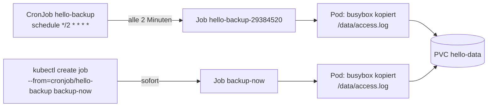

# Lab 7.3: StatefulSets, DaemonSets, Jobs und CronJobs

**Leitfragen:**

<details>
<summary>Was unterscheidet einen Webserver von einer nächtlichen Sicherung?</summary>

Der Webserver soll immer laufen und wird nach jedem Ende neu gestartet. Die Sicherung läuft einmal, soll dann fertig sein und nach Plan wiederkommen. Dafür gibt es eigene Controller: Job und CronJob statt Deployment.

</details>

<details>
<summary>Drei Datenbank-Kopien: warum reicht „drei gleiche Pods" nicht?</summary>

Eine Kopie ist die führende (Primary), die anderen spiegeln sie; jede braucht ihre eigenen Daten und einen festen Namen, unter dem die anderen sie finden. Ein Deployment liefert austauschbare Pods mit Zufallsnamen und, wie in Lab 7.2, einem gemeinsamen Volume. Das StatefulSet liefert feste Namen und ein Volume je Pod.

</details>

- Deployment, StatefulSet, DaemonSet, Job und CronJob sind Controller (Lab 4.1) für unterschiedliche Arten von Arbeit; alle legen Pods nach einem Bauplan (`template`) an.
- Die Hello-App bekommt einen CronJob `hello-backup`, der `access.log` alle zwei Minuten auf dem PVC sichert.

## Begriffe

| Begriff | Bedeutung |
| --- | --- |
| Workload | Oberbegriff für alles, was im Cluster Pods laufen lässt |
| zustandslos (stateless) | Pod hält keine eigenen Daten; jeder Pod ist durch jeden anderen ersetzbar, wie Kassen im Supermarkt |
| zustandsbehaftet (stateful) | Pod hält eigene Daten und eine Rolle, z. B. Datenbank-Primary; nicht beliebig austauschbar |
| StatefulSet | Controller für zustandsbehaftete Pods: feste Namen `db-0`, `db-1`, feste Reihenfolge, je Pod ein eigenes PVC |
| Headless Service | Service mit `clusterIP: None`: verteilt nicht, sondern gibt jedem Pod einen eigenen DNS-Namen |
| `volumeClaimTemplates` | PVC-Bauplan im StatefulSet; daraus entsteht je Pod ein eigener Claim |
| DaemonSet | Controller, der auf jedem Node genau einen Pod startet |
| Job | Controller für Arbeit mit Ende: startet Pods, bis die gewünschte Zahl erfolgreich beendet ist |
| CronJob | legt nach Zeitplan Jobs an, wie `cron` unter Linux oder die Windows-Aufgabenplanung |
| Cron-Ausdruck | Zeitplan aus fünf Feldern: Minute, Stunde, Tag, Monat, Wochentag |
| Operator | Programm im Cluster, das eine bestimmte Software (z. B. PostgreSQL) wie ein erfahrener Admin betreibt |
| CRD | Custom Resource Definition: erweitert die Kubernetes-API um eigene Objektarten wie `Cluster` für PostgreSQL |

## Workload-Typen im Vergleich

| Workload | Läuft | Pod-Namen | Speicher | Beispiel |
| --- | --- | --- | --- | --- |
| Deployment (Lab 4.2) | dauerhaft, n gleiche Repliken | zufällig: `frontend-5d8c7b9f4-p9xtd` | keiner oder ein gemeinsamer PVC | Hello-Frontend, Web-APIs |
| StatefulSet | dauerhaft, n Repliken mit Rolle | fest und nummeriert: `db-0`, `db-1` | je Pod ein eigener PVC | Datenbanken, Kafka, Elasticsearch |
| DaemonSet | dauerhaft, ein Pod je Node | `<name>-<zufall>` je Node | meist `hostPath` des Nodes | `kube-proxy`, Log-Sammler, Monitoring-Agenten |
| Job | einmal bis zum erfolgreichen Ende | `<job>-<zufall>` | nach Bedarf | Datenbank-Migration, Import, Berechnung |
| CronJob | nach Zeitplan, je Lauf ein Job | `<cronjob>-<zeitnummer>-<zufall>` | nach Bedarf | Backup, Bericht, Aufräumen |


_Quelle: Headlamp, README (https://github.com/kubernetes-sigs/headlamp), Apache-2.0, abgerufen am 17.11.2026._

Headlamp (Lab 2.3) zeigt alle Workload-Typen unter **Workloads**. Die Jobs `hello-28184532` … im Bild stammen von einem CronJob: Die Zahl ist die geplante Startzeit in Minuten seit 1970.

## Jobs und CronJobs



Ein Job-Pod endet absichtlich: Status `Completed`, Phase `Succeeded` (Lab 3.1). Deshalb ist `restartPolicy: Always` im Job verboten; erlaubt sind `Never` (bei Fehler neuer Pod) und `OnFailure` (Container im selben Pod neu starten).

```yaml
# playground/k8s/cronjob.yaml
apiVersion: batch/v1                    # batch/v1beta1 ist seit Kubernetes 1.25 entfernt
kind: CronJob
metadata:
  name: hello-backup
spec:
  schedule: "*/2 * * * *"               # immer in Anführungszeichen: * hat in YAML eine Sonderbedeutung
  concurrencyPolicy: Forbid             # kein zweiter Lauf, solange einer läuft
  successfulJobsHistoryLimit: 3         # so viele erledigte Jobs bleiben sichtbar
  failedJobsHistoryLimit: 1
  jobTemplate:                          # Bauplan des Jobs ...
    spec:
      backoffLimit: 2                   # bei Fehler höchstens 2 weitere Versuche
      template:                         # ... mit Pod-Bauplan wie beim Deployment
        spec:
          restartPolicy: Never
          containers:
            - name: backup
              image: busybox:1.37
              command: ["/bin/sh", "-c", "mkdir -p /data/backup && cp /data/access.log /data/backup/access-$(date +%H%M%S).log && ls /data/backup"]
              volumeMounts:
                - name: data
                  mountPath: /data
          volumes:
            - name: data
              persistentVolumeClaim:
                claimName: hello-data   # derselbe Claim wie das Frontend (Lab 7.2)
```

### Cron-Ausdruck

```text
 ┌──────── Minute        (0–59)    */2 = jede zweite Minute
 │ ┌────── Stunde        (0–23)
 │ │ ┌──── Tag im Monat  (1–31)
 │ │ │ ┌── Monat         (1–12)
 │ │ │ │ ┌ Wochentag     (0–6, 0 = Sonntag)
 * * * * *
```

| Ausdruck | Bedeutung |
| --- | --- |
| `*/2 * * * *` | alle 2 Minuten |
| `0 2 * * *` | täglich um 02:00 |
| `30 6 * * 1-5` | montags bis freitags um 06:30 |
| `0 0 1 * *` | am Ersten jedes Monats um Mitternacht |

Die Uhrzeit ist die Zeitzone des Controllers, meist UTC. Das Feld `timeZone: Europe/Berlin` legt sie fest. `suspend: true` pausiert einen CronJob, ohne ihn zu löschen.

| `concurrencyPolicy` | Wenn der vorige Lauf noch arbeitet |
| --- | --- |
| `Allow` (Standard) | neuer Lauf startet trotzdem |
| `Forbid` | neuer Lauf fällt aus |
| `Replace` | voriger Lauf wird abgebrochen, neuer startet |

| Befehl | Wirkung |
| --- | --- |
| `kubectl get cronjobs` | Zeitplan, `SUSPEND`, `ACTIVE`, `LAST SCHEDULE` |
| `kubectl get jobs` | Jobs mit `STATUS` und `COMPLETIONS` (`1/1` = fertig) |
| `kubectl create job --from=cronjob/hello-backup backup-now` | Job sofort aus dem Bauplan des CronJobs starten |
| `kubectl logs job/backup-now` | Ausgabe des Job-Pods |
| `kubectl delete job backup-now` | Job samt Pod löschen |

## DaemonSets

Ein DaemonSet hat keine Replikazahl: Jeder neue Node bekommt automatisch einen Pod, jeder entfernte Node verliert ihn. Auf Docker Desktop läuft so `kube-proxy`, der die Service-Regeln (Lab 5.1) auf dem Node einrichtet:

```text
$ kubectl get daemonsets -n kube-system
NAME         DESIRED   CURRENT   READY   UP-TO-DATE   AVAILABLE   NODE SELECTOR            AGE
kube-proxy   1         1         1       1            1           kubernetes.io/os=linux   12d
```

`DESIRED 1`, weil der Cluster einen Node hat.

## StatefulSets

```yaml
# Beispiel, nicht Teil der Hello-App: PostgreSQL mit festen Namen und eigenem Volume je Pod
apiVersion: v1
kind: Service
metadata:
  name: db
spec:
  clusterIP: None                       # headless: DNS-Namen db-0.db, db-1.db statt einer Sammel-IP
  selector:
    app: db
  ports:
    - port: 5432
---
apiVersion: apps/v1
kind: StatefulSet
metadata:
  name: db
spec:
  serviceName: db                       # der Headless Service oben
  replicas: 2                           # Pods db-0 und db-1, in dieser Reihenfolge gestartet
  selector:
    matchLabels:
      app: db
  template:
    metadata:
      labels:
        app: db
    spec:
      containers:
        - name: postgres
          image: postgres:18-alpine      # Docker Official Image
          envFrom:
            - secretRef:                 # wie configMapRef (Lab 6.1), nur aus einem Secret
                name: db-secret          # enthält POSTGRES_PASSWORD
          volumeMounts:
            - name: pgdata
              mountPath: /var/lib/postgresql
  volumeClaimTemplates:                 # je Pod ein eigener PVC: pgdata-db-0, pgdata-db-1
    - metadata:
        name: pgdata
      spec:
        accessModes: ["ReadWriteOnce"]
        resources:
          requests:
            storage: 1Gi
```

| Eigenschaft | Deployment | StatefulSet |
| --- | --- | --- |
| Pod-Name nach Neustart | neu und zufällig | gleich (`db-0` bleibt `db-0`) |
| Start und Stopp | alle gleichzeitig | der Reihe nach: `db-0`, dann `db-1` |
| Volume | ein gemeinsamer PVC im Bauplan | je Pod ein PVC aus `volumeClaimTemplates`; bleibt beim Löschen des Pods erhalten |
| Netzwerk | Service verteilt auf alle | Headless Service: jeder Pod einzeln erreichbar (`db-0.db.hello.svc.cluster.local`) |

Das StatefulSet sorgt nur für Namen, Reihenfolge und Volumes. Dass `db-1` die Daten von `db-0` spiegelt, Backups laufen und bei Ausfall `db-1` übernimmt, muss jemand einrichten: von Hand oder durch einen Operator.

## Datenbanken im Cluster mit Operatoren

Ein Operator besteht aus einer CRD (neue Objektart) und einem Controller, der dieses Objekt wie ein Admin in Pods, Services, PVCs, Backups und Failover übersetzt ([Kubernetes-Doku: Operator pattern](https://kubernetes.io/docs/concepts/extend-kubernetes/operator/)). Beispiel [CloudNativePG](https://cloudnative-pg.io) für PostgreSQL:

```yaml
# Ausblick, nicht im Kurs installiert: drei PostgreSQL-Instanzen mit automatischem Failover
apiVersion: postgresql.cnpg.io/v1
kind: Cluster                            # Objektart aus der CRD von CloudNativePG
metadata:
  name: shop-db
spec:
  instances: 3                           # 1 Primary + 2 Standby
  storage:
    size: 5Gi
```


_Quelle: CloudNativePG-Dokumentation, „Architecture" (https://cloudnative-pg.io/docs/1.30/architecture), Apache-2.0, abgerufen am 17.11.2026._

Der Operator legt für `shop-db` Pods, PVCs und einen Service an, der immer auf den aktuellen Primary zeigt. Fällt der Primary aus, befördert er einen Standby.

| Operator | betreibt | Objektarten (Auswahl) |
| --- | --- | --- |
| [CloudNativePG](https://cloudnative-pg.io) | PostgreSQL mit Replikation, Backups, Failover | `Cluster`, `Backup` |
| [MySQL Operator for Kubernetes](https://dev.mysql.com/doc/mysql-operator/en/) | MySQL als InnoDB Cluster mit Replikaten und Backups | `InnoDBCluster` |
| [Prometheus Operator](https://prometheus-operator.dev/) | Monitoring mit Prometheus und Alertmanager (Lab 11.3) | `Prometheus`, `ServiceMonitor` |
| [Rook](https://rook.io) | verteilten Ceph-Speicher (Lab 7.2) | `CephCluster` |

Weitere Operatoren finden sich auf [OperatorHub.io](https://operatorhub.io) und [Artifact Hub](https://artifacthub.io); vor dem Einsatz Herausgeber und Pflegezustand prüfen (Stand: 11/2026).

**Neu 2025:** Der Bitnami-Katalog mit den früher üblichen Charts `bitnami/postgresql` und `bitnami/mysql` ist seit 28.08.2025 eingefroren und wird nicht mehr kostenlos gepflegt. Für eigene Manifeste dienen Docker Official Images wie `postgres` oder `redis`, für Datenbanken mit Betrieb Operatoren (Quelle: [bitnami/charts Issue 35164](https://github.com/bitnami/charts/issues/35164), Stand: 11/2026).

## Typische Fehler

| Symptom | Ursache | Lösung |
| --- | --- | --- |
| `no matches for kind "CronJob" in version "batch/v1beta1"` | altes Beispiel aus dem Internet | `apiVersion: batch/v1` |
| `error converting YAML to JSON: yaml: line …: did not find expected alphabetic or numeric character` | `schedule: */2 * * * *` ohne Anführungszeichen | `schedule: "*/2 * * * *"` |
| Job `Failed`, Log: `cp: can't stat '/data/access.log': No such file or directory` | Seite seit dem Anlegen des PVC nicht aufgerufen | Seite einmal aufrufen, Job neu auslösen |
| `spec.template.spec.restartPolicy: Unsupported value: "Always"` | `restartPolicy` im Job vergessen oder `Always` | `Never` oder `OnFailure` |
| Dateinamen zeigen eine Stunde früher | Container-Uhr läuft in UTC | normal; Zeitzone bei Bedarf über `timeZone` und `TZ` setzen |

## Fazit

- Deployment für austauschbare Dauerläufer, StatefulSet für Pods mit festem Namen und eigenem Volume, DaemonSet für einen Pod je Node.
- Job = Arbeit mit Ende; CronJob = Job nach Zeitplan mit Cron-Ausdruck, `concurrencyPolicy` und History-Limits.
- Datenbanken im Cluster betreibt in der Praxis ein Operator (CRD + Controller), nicht ein handgeschriebenes StatefulSet.

In der Übung entsteht der CronJob `hello-backup`, und ein manuell ausgelöster Job legt die erste Sicherungsdatei auf dem PVC an.
