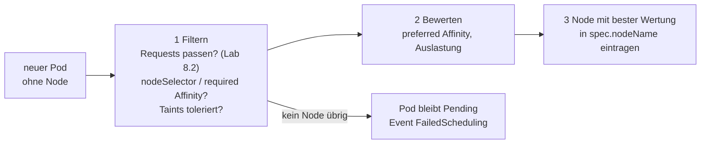

# Anhang: Pods auf Nodes steuern mit nodeSelector, Node-Affinity, Taints und Tolerations

Nachschlagewerk zu Modul 8, nicht im Zeitplan. Auf dem Ein-Node-Cluster von Docker Desktop landet jeder Pod auf `docker-desktop`; die Regeln hier zählen in Clustern mit mehreren Nodes, z. B. wenn nur einige Nodes eine GPU oder schnelle SSDs haben.

## Begriffe

| Begriff | Bedeutung |
| --- | --- |
| Scheduling | Entscheidung, auf welchem Node ein neuer Pod läuft; trifft der Scheduler in der Control Plane (Lab 2.3) |
| Node-Label | Schlüssel-Wert-Paar an einem Node, z. B. `disktype=ssd`; wie Labels an Pods (Lab 3.3) |
| `nodeSelector` | einfachste Regel im Pod: „nur auf Nodes mit diesen Labels" |
| Node-Affinity | ausdrucksstärkere Regel: Pflicht (`required…`) oder Wunsch (`preferred…`), mit Operatoren wie `In`, `NotIn`, `Exists` |
| Taint | „Makel" an einem Node, der Pods abweist; wie ein Schild „Nur für Personal" |
| Toleration | Eintrag im Pod, der einen bestimmten Taint duldet; wie der Personalausweis zum Schild |
| Effekt | was ein Taint bewirkt: `NoSchedule`, `PreferNoSchedule`, `NoExecute` |

## Wie der Scheduler einen Node wählt


_Quelle: Kubernetes Blog, „Protect Your Mission-Critical Pods From Eviction With PriorityClass" (https://kubernetes.io/blog/2023/01/12/protect-mission-critical-pods-priorityclass/), CC BY 4.0, The Kubernetes Authors, abgerufen am 17.11.2026._



Labels und Affinity **ziehen** Pods zu Nodes; Taints **stoßen** Pods ab, die keine passende Toleration haben. Für „nur GPU-Pods auf GPU-Nodes" braucht es beides: Taint am GPU-Node (andere bleiben fern) und Affinity im GPU-Pod (er geht dorthin).

## Node-Labels und nodeSelector

```bash
kubectl get nodes --show-labels                       # vorhandene Labels
kubectl label nodes docker-desktop disktype=ssd       # Label setzen
kubectl label nodes docker-desktop disktype-          # Label entfernen (Minus am Ende)
```

Vorhandene Standard-Labels: `kubernetes.io/hostname`, `kubernetes.io/os`, `kubernetes.io/arch`; in Cloud-Clustern zusätzlich `topology.kubernetes.io/zone`.

```yaml
# im Pod-Bauplan (spec.template.spec eines Deployments)
    spec:
      nodeSelector:
        disktype: ssd            # nur Nodes mit genau diesem Label
      containers:
        - name: frontend
          ...
```

## Node-Affinity

```yaml
    spec:
      affinity:
        nodeAffinity:
          requiredDuringSchedulingIgnoredDuringExecution:     # Pflicht beim Einplanen
            nodeSelectorTerms:
              - matchExpressions:
                  - key: kubernetes.io/arch
                    operator: In
                    values: ["amd64", "arm64"]
          preferredDuringSchedulingIgnoredDuringExecution:    # Wunsch, mit Gewicht 1-100
            - weight: 80
              preference:
                matchExpressions:
                  - key: disktype
                    operator: In
                    values: ["ssd"]
```

| Teil des Namens | Bedeutung |
| --- | --- |
| `required…` | ohne passenden Node bleibt der Pod `Pending` |
| `preferred…` | passende Nodes bekommen Pluspunkte, sonst geht auch ein anderer |
| `…IgnoredDuringExecution` | ändert sich ein Label später, bleibt ein laufender Pod, wo er ist |

| Operator | passt, wenn das Label … |
| --- | --- |
| `In` / `NotIn` | einen der Werte hat / keinen davon |
| `Exists` / `DoesNotExist` | vorhanden ist / fehlt (ohne `values`) |
| `Gt` / `Lt` | als Zahl größer / kleiner ist |

Pod-Affinity und Pod-Anti-Affinity arbeiten genauso, beziehen sich aber auf andere Pods: „neben dem Cache" oder „nie zwei Frontend-Pods auf demselben Node". Für gleichmäßige Verteilung über Nodes oder Zonen gibt es `topologySpreadConstraints` (Quelle: [Assigning Pods to Nodes](https://kubernetes.io/docs/concepts/scheduling-eviction/assign-pod-node/), Stand: 11/2026).

## Taints

```bash
kubectl taint nodes <node> dedicated=gpu:NoSchedule    # Taint setzen: Schlüssel=Wert:Effekt
kubectl taint nodes <node> dedicated=gpu:NoSchedule-   # Taint entfernen (Minus am Ende)
kubectl describe node <node> | grep Taints             # Taints anzeigen
```

| Effekt | Neue Pods ohne Toleration | Laufende Pods ohne Toleration |
| --- | --- | --- |
| `NoSchedule` | werden nicht eingeplant | bleiben |
| `PreferNoSchedule` | möglichst nicht, notfalls doch | bleiben |
| `NoExecute` | werden nicht eingeplant | werden entfernt (sofort oder nach `tolerationSeconds`) |

Kubernetes setzt selbst Taints, z. B. `node-role.kubernetes.io/control-plane:NoSchedule` auf Control-Plane-Nodes in kubeadm-Clustern mit mehreren Nodes oder `node.kubernetes.io/not-ready:NoExecute`, wenn ein Node ausfällt. Jeder Pod bekommt dafür automatisch eine Toleration von 300 Sekunden; erst danach werden seine Pods auf andere Nodes verteilt (Quelle: [Taints and Tolerations](https://kubernetes.io/docs/concepts/scheduling-eviction/taint-and-toleration/), Stand: 11/2026).

## Tolerations

```yaml
    spec:
      tolerations:
        - key: dedicated
          operator: Equal          # Standard: Schlüssel UND Wert müssen passen
          value: gpu
          effect: NoSchedule       # muss zum Effekt des Taints passen
        - key: node.kubernetes.io/unreachable
          operator: Exists         # nur der Schlüssel zählt, ohne value
          effect: NoExecute
          tolerationSeconds: 60    # bei NoExecute: so lange darf der Pod noch bleiben
```

| Feld | Bedeutung |
| --- | --- |
| `operator: Equal` | Schlüssel und Wert müssen gleich sein |
| `operator: Exists` | Schlüssel genügt; ohne `key` duldet die Toleration jeden Taint |
| `effect` | leer = alle Effekte dieses Schlüssels |
| `tolerationSeconds` | nur bei `NoExecute`: Frist bis zur Entfernung |

Eine Toleration erlaubt einen Node nur, sie erzwingt ihn nicht. Erst zusammen mit `nodeSelector` oder Node-Affinity landet der Pod sicher auf dem gewünschten Node.

## Taint auf Docker Desktop ausprobieren

```bash
kubectl taint nodes docker-desktop dedicated=gpu:NoSchedule
kubectl run probe-pod --image=busybox:1.37 --restart=Never -- sleep 60
kubectl get pod probe-pod                     # STATUS Pending
kubectl describe pod probe-pod | tail -3      # FailedScheduling … untolerated taint
kubectl taint nodes docker-desktop dedicated=gpu:NoSchedule-   # Taint wieder entfernen
kubectl get pod probe-pod                     # jetzt Running
kubectl delete pod probe-pod
```

Nur `NoSchedule` verwenden: Ein `NoExecute`-Taint würde auf dem einzigen Node alle Pods ohne passende Toleration entfernen, auch die Hello-App.

## Typische Fehler

| Symptom | Ursache | Lösung |
| --- | --- | --- |
| `Pending`, Event `0/1 nodes are available: 1 node(s) didn't match Pod's node affinity/selector` | kein Node hat das verlangte Label | `kubectl get nodes --show-labels`; Label setzen oder Regel korrigieren |
| `Pending`, Event `… 1 node(s) had untolerated taint {dedicated: gpu}` | Taint ohne passende Toleration | Toleration ergänzen oder Taint entfernen |
| Pod mit Toleration landet trotzdem auf einem anderen Node | Toleration erlaubt nur, zieht nicht an | zusätzlich `nodeSelector` oder Node-Affinity |
| Taint lässt sich nicht entfernen | Minus am Ende vergessen oder Effekt weggelassen | exakt `schlüssel=wert:Effekt-` |
