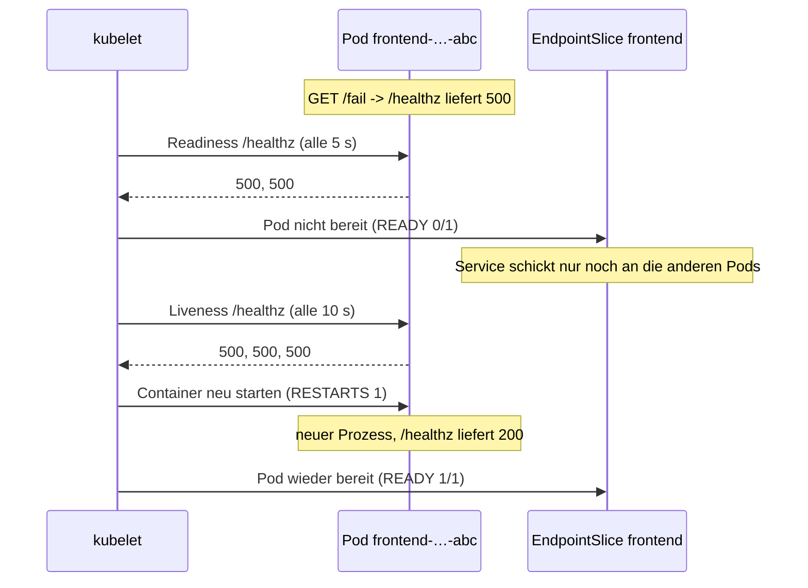

# Lab 8.1: Liveness, Readiness und Startup Probes

**Leitfragen:**

<details>
<summary>Ein Programm läuft, antwortet aber nicht mehr: woran merkt man das von außen?</summary>

Am Prozess allein nicht: Er existiert ja noch. Man muss ihn fragen, z. B. regelmäßig eine Testseite abrufen. Genau das macht Kubernetes mit Probes: Der kubelet ruft z. B. `/healthz` auf und wertet die Antwort aus.

</details>

<details>
<summary>Ein Dienst braucht zwei Minuten zum Start: wann darf er Anfragen bekommen?</summary>

Erst wenn er wirklich antworten kann. Bis dahin soll ihn niemand neu starten, weil er „hängt", und der Service soll ihm keine Besucher schicken. Dafür gibt es die Startup- und die Readiness-Probe.

</details>

- Ohne Probes gilt ein Container als gesund, solange sein Prozess läuft; eine hängende App bekommt weiter Anfragen.
- Readiness entscheidet über Anfragen, Liveness über Neustarts, Startup über die Wartezeit beim Start.

## Begriffe

| Begriff | Bedeutung |
| --- | --- |
| Probe | regelmäßige Prüfung eines Containers durch den kubelet auf dem Node, wie ein Wachmann, der stündlich an jede Tür klopft |
| Readiness-Probe | fragt „Darf dieser Pod Anfragen bekommen?"; bei Fehlschlag bekommt der Pod über den Service keine Anfragen mehr |
| Liveness-Probe | fragt „Lebt der Container noch?"; bei Fehlschlag startet der kubelet den Container neu |
| Startup-Probe | fragt „Ist der Start fertig?"; solange sie nicht bestanden ist, ruhen Readiness und Liveness |
| `READY` | Spalte in `kubectl get pods`: bereite Container / alle Container, z. B. `0/1` |
| Health-Endpunkt | Adresse der App nur für Prüfungen, hier `/healthz`; antwortet schnell mit `200` oder einem Fehlercode |
| `periodSeconds` | Abstand zwischen zwei Prüfungen |
| `failureThreshold` | so viele Fehlschläge in Folge, bis die Probe als gescheitert gilt |
| Rollout hängt | ein neuer Pod wird nie bereit; mit `maxUnavailable: 0` (Lab 4.3) bleiben die alten Pods in Betrieb |

## Readiness-, Liveness- und Startup-Probe

| Probe | Frage | Bei Fehlschlag | Typischer Endpunkt |
| --- | --- | --- | --- |
| `readinessProbe` | Darf der Pod Anfragen bekommen? | Pod steht in der EndpointSlice (Lab 5.1) als `ready: false`, der Service schickt keine Anfragen mehr hin; Container läuft weiter | `/ready`, `/healthz` |
| `livenessProbe` | Lebt der Container noch? | Container wird neu gestartet (`RESTARTS` + 1) | `/healthz`, `/livez` |
| `startupProbe` | Ist der Start abgeschlossen? | nach `failureThreshold × periodSeconds` Neustart; vorher ruhen die anderen Probes | wie Liveness |


_Quelle: Google Cloud Blog, „Kubernetes best practices: Setting up health checks with readiness and liveness probes" (https://cloud.google.com/blog/products/containers-kubernetes/kubernetes-best-practices-setting-up-health-checks-with-readiness-and-liveness-probes), abgerufen am 17.11.2026._


_Quelle: Google Cloud Blog, wie oben, abgerufen am 17.11.2026._

## Prüfmethoden

| Methode | Prüft | Bestanden, wenn | Beispiel |
| --- | --- | --- | --- |
| `httpGet` | HTTP-Anfrage an Pfad und Port | Statuscode 200–399 | Web-Apps wie die Hello-App |
| `tcpSocket` | Verbindung zu einem Port | Verbindung klappt | Datenbanken, Dienste ohne HTTP |
| `exec` | Befehl im Container | Exit-Code 0 | `pg_isready`, Prüfskript |
| `grpc` | gRPC-Health-Check | Antwort `SERVING` | gRPC-Dienste |

```yaml
# Beispiele, nicht Teil der Hello-App: Probes eines PostgreSQL-Containers
          livenessProbe:
            tcpSocket:
              port: 5432                                 # Verbindung klappt = bestanden
          readinessProbe:
            exec:
              command: ["pg_isready", "-U", "postgres"]  # Exit-Code 0 = bestanden
```

## Probes der Hello-App

Frontend und Backend haben `/healthz`. Das Frontend kann einen Ausfall simulieren: Nach `GET /fail` antwortet `/healthz` mit `500`, bis `GET /recover` aufgerufen wird oder der Container neu startet. Der Schalter gilt nur für den einen Pod, der `/fail` bekommen hat.

```yaml
# Ausschnitt aus playground/k8s/frontend-deployment.yaml (Lab 8.1), im Container frontend
          readinessProbe:
            httpGet:
              path: /healthz         # Antwort 200-399 = bestanden
              port: 80
            periodSeconds: 5         # alle 5 Sekunden
            failureThreshold: 2      # 2 Fehlschläge in Folge (ca. 10 s) -> nicht bereit
          livenessProbe:
            httpGet:
              path: /healthz
              port: 80
            periodSeconds: 10        # alle 10 Sekunden
            failureThreshold: 3      # 3 Fehlschläge in Folge (ca. 30 s) -> Neustart
```

| Parameter | Standard | Bedeutung |
| --- | --- | --- |
| `initialDelaySeconds` | 0 | Wartezeit nach Containerstart bis zur ersten Prüfung |
| `periodSeconds` | 10 | Abstand zwischen Prüfungen |
| `timeoutSeconds` | 1 | so lange darf eine Antwort dauern |
| `failureThreshold` | 3 | Fehlschläge in Folge bis „gescheitert" |
| `successThreshold` | 1 | Erfolge in Folge bis „wieder gut" (bei Liveness und Startup immer 1) |

Reaktionszeit ≈ `periodSeconds × failureThreshold`. Readiness reagiert hier nach etwa 10 Sekunden, Liveness nach etwa 30: Ein kurzer Aussetzer nimmt den Pod nur aus dem Verkehr, erst ein längerer führt zum Neustart (Quelle: [Configure Liveness, Readiness and Startup Probes](https://kubernetes.io/docs/tasks/configure-pod-container/configure-liveness-readiness-startup-probes/), Stand: 11/2026).

Ohne Startup-Probe muss `initialDelaySeconds` einer Liveness-Probe länger sein als fast jeder Start der App, z. B. die Startzeit, die 99 von 100 Starts unterschreiten (P99), plus Puffer. Sonst startet der kubelet die App neu, bevor sie fertig ist, und das immer wieder. Die Startup-Probe (unten) löst das ohne geschätzte Wartezeit.

## Simulierter Ausfall im Frontend




_Quelle: Kubernetes Blog, „From Kubernetes Dashboard to Headlamp" (https://kubernetes.io/blog/2026/06/01/dashboard-to-headlamp/), CC BY 4.0, The Kubernetes Authors, abgerufen am 17.11.2026._

Headlamp (Lab 2.3) zeigt dieselben Werte wie `kubectl get pods`: Ein Pod mit `Ready 0/1` und vielen Restarts läuft zwar, besteht aber seine Probes nicht.

## Readiness und Rollouts

Beim Rollout (Lab 4.3) zählt ein neuer Pod erst als verfügbar, wenn seine Readiness-Probe besteht. Mit `maxUnavailable: 0` entfernt das Deployment keinen alten Pod, bevor ein neuer bereit ist. Ist die Readiness-Probe falsch (z. B. Pfad `/nope`), bleibt der Rollout stehen, und die alten Pods bedienen die Seite weiter:

```text
$ kubectl rollout status deployment/frontend
Waiting for deployment "frontend" rollout to finish: 1 out of 3 new replicas have been updated...
```

Nach `progressDeadlineSeconds` (Standard 600 Sekunden) meldet `kubectl rollout status` `error: deployment "frontend" exceeded its progress deadline`. Der Weg zurück: Pfad korrigieren und erneut anwenden, oder `kubectl rollout undo deployment/frontend`.

## Startup-Probe für langsame Starts

Manche Apps brauchen beim Start lange (Caches laden, Datenbank migrieren). Eine Liveness-Probe würde sie vorher als „tot" neu starten, immer wieder: `CrashLoopBackOff`. Die Startup-Probe gibt dem Start ein eigenes Zeitbudget:

```yaml
          startupProbe:
            httpGet:
              path: /healthz
              port: 80
            periodSeconds: 5
            failureThreshold: 12     # bis zu 12 x 5 s = 60 s für den Start
```

Das Frontend wartet beim Start `STARTUP_DELAY` Sekunden, bevor es Anfragen annimmt; damit lässt sich ein langsamer Start nachstellen (Erweiterung der Übung).

## Typische Fehler

| Symptom | Ursache | Lösung |
| --- | --- | --- |
| alle Frontend-Pods starten neu, sobald das Backend ausfällt | Liveness prüft auch das Backend | Liveness prüft nur den eigenen Prozess; Abhängigkeiten höchstens in der Readiness |
| `CrashLoopBackOff`, Events `Liveness probe failed: … connection refused` direkt nach dem Start | App startet langsamer als `periodSeconds × failureThreshold` | Startup-Probe ergänzen |
| Pod bleibt `0/1`, Event `Readiness probe failed: HTTP probe failed with statuscode: 404` | falscher Pfad | Pfad korrigieren (`/healthz`) |
| Event `… dial tcp 10.1.0.97:8080: connect: connection refused` | falscher Port in der Probe | Port = `containerPort` |
| sporadische Neustarts unter Last | `timeoutSeconds: 1` zu knapp, Health-Endpunkt macht teure Arbeit | Endpunkt leicht halten, Timeout erhöhen |

## Fazit

- Readiness steuert, ob ein Pod Anfragen bekommt; Liveness steuert Neustarts; Startup schützt langsame Starts.
- Reaktionszeit = `periodSeconds × failureThreshold`; Readiness kürzer als Liveness wählen.
- Mit `maxUnavailable: 0` hält eine falsche Readiness-Probe den Rollout an, statt die Seite abzuschalten.

In der Übung bekommen Frontend und Backend beide Probes, ein simulierter Ausfall läuft durch, und ein Rollout mit falscher Probe bleibt stehen.
