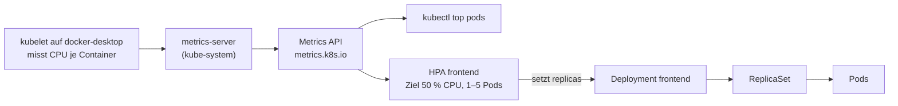

# Lab 8.3: Horizontal Pod Autoscaler

**Leitfragen:**

<details>
<summary>Montags um 9 Uhr kommt dreimal so viel Last wie sonst: wie viele Kopien sollen dauerhaft laufen?</summary>

So viele wie für die Spitze nötig wäre teuer, so wenige wie im Leerlauf zu knapp. Besser ist eine Untergrenze für ruhige Zeiten und eine Obergrenze für Spitzen; dazwischen passt ein Automat die Zahl an.

</details>

<details>
<summary>Woher soll ein Automat wissen, dass gerade viel los ist?</summary>

Aus Messwerten: CPU-Last, Speicher, Anfragen pro Sekunde oder Länge einer Warteschlange. Kubernetes misst CPU und Speicher mit dem metrics-server; der Horizontal Pod Autoscaler vergleicht sie mit einem Zielwert.

</details>

- Der Horizontal Pod Autoscaler (HPA) ändert die Replikazahl eines Deployments automatisch, statt `kubectl scale` von Hand (Lab 4.2).
- Grundlage sind Messwerte aus dem metrics-server und die Requests aus Lab 8.2.

## Begriffe

| Begriff | Bedeutung |
| --- | --- |
| metrics-server | Zusatzdienst im Cluster, der CPU- und Speicherverbrauch aller Pods beim kubelet abfragt und bereitstellt |
| Metrics API (`metrics.k8s.io`) | Schnittstelle, über die `kubectl top` und der HPA die Werte des metrics-server lesen |
| `kubectl top` | zeigt aktuellen CPU- und Speicherverbrauch von Nodes und Pods |
| horizontal skalieren | mehr oder weniger Pods derselben Art, wie zusätzliche Kassen im Supermarkt |
| vertikal skalieren | einem Pod mehr oder weniger CPU/Speicher geben, wie eine schnellere Kasse |
| Horizontal Pod Autoscaler (HPA) | Controller, der die Replikazahl zwischen Minimum und Maximum an einen Zielwert anpasst |
| Auslastung (Utilization) | gemessener Verbrauch in Prozent des Requests: 50m bei Request 100m = 50 % |
| Stabilisierungsfenster | Wartezeit, bevor der HPA herunterskaliert, damit die Zahl nicht ständig springt |
| Lastgenerator | Pod, der in einer Schleife Anfragen schickt, um Last zu erzeugen |
| KEDA | Zusatz für ereignisbasiertes Skalieren, z. B. nach Länge einer Warteschlange, auch auf null |

## Vom Messwert zur Replikazahl




_Quelle: Kubernetes-Dokumentation, „HorizontalPodAutoscaler" (https://kubernetes.io/id/docs/tasks/run-application/horizontal-pod-autoscale/), CC BY 4.0, The Kubernetes Authors, abgerufen am 17.11.2026._

Der HPA startet keine Pods selbst: Er ändert nur `replicas` des Deployments, den Rest erledigen Deployment und ReplicaSet wie in Modul 4.

## metrics-server installieren

```bash
kubectl apply -f https://github.com/kubernetes-sigs/metrics-server/releases/download/v0.9.1/components.yaml
# nur Docker Desktop: Zertifikat des kubelet nicht prüfen (lokales Testcluster)
kubectl patch deployment metrics-server -n kube-system --type=json \
  -p '[{"op":"add","path":"/spec/template/spec/containers/0/args/-","value":"--kubelet-insecure-tls"}]'
kubectl rollout status deployment/metrics-server -n kube-system
```

Der metrics-server prüft standardmäßig das TLS-Zertifikat jedes kubelet. Auf Docker Desktop ist es nicht von der Cluster-CA signiert, deshalb hängt der Patch die Option `--kubelet-insecure-tls` an die Startargumente; die README nennt sie „for testing purposes only" (Quelle: [metrics-server README](https://github.com/kubernetes-sigs/metrics-server), v0.9.1 vom 29.10.2026, Stand: 11/2026). In Cloud-Clustern ist der metrics-server meist vorinstalliert.

```text
$ kubectl top pods -l tier=frontend
NAME                       CPU(cores)   MEMORY(bytes)
frontend-6f8d7c9b5-4hx2p   1m           38Mi
frontend-6f8d7c9b5-k9w3z   1m           37Mi
frontend-6f8d7c9b5-r7m5t   1m           38Mi
```

Erste Werte erscheinen etwa eine Minute nach dem Start.

## HPA für das Frontend

```yaml
# playground/k8s/hpa.yaml
apiVersion: autoscaling/v2
kind: HorizontalPodAutoscaler
metadata:
  name: frontend
spec:
  scaleTargetRef:              # welches Objekt skaliert wird
    apiVersion: apps/v1
    kind: Deployment
    name: frontend
  minReplicas: 1
  maxReplicas: 5
  metrics:
    - type: Resource           # CPU oder Speicher aus dem metrics-server
      resource:
        name: cpu
        target:
          type: Utilization    # Prozent des CPU-Requests (100m)
          averageUtilization: 50
```

Gleiche Wirkung per Befehl: `kubectl autoscale deployment frontend --cpu=50% --min=1 --max=5` (die alte Option `--cpu-percent` ist veraltet).

Der HPA rechnet alle 15 Sekunden:

```text
gewünschte Replikas = aufrunden( aktuelle Replikas × aktueller Wert / Zielwert )
Beispiel: 3 Pods, im Mittel 150 % CPU -> aufrunden(3 × 150 / 50) = 9 -> begrenzt auf maxReplicas = 5
```

| Verhalten | Standard |
| --- | --- |
| Prüfintervall | 15 Sekunden |
| Toleranz | Abweichungen bis 10 % vom Ziel lösen nichts aus |
| Hochskalieren | sofort, ohne Wartezeit |
| Herunterskalieren | erst nach 5 Minuten Stabilisierungsfenster (`behavior.scaleDown.stabilizationWindowSeconds: 300`) |

(Quelle: [Horizontal Pod Autoscaling](https://kubernetes.io/docs/tasks/run-application/horizontal-pod-autoscale/), Stand: 11/2026)

Ohne CPU-Request kann der HPA keine Prozente berechnen; `kubectl get hpa` zeigt dann `<unknown>`. Deshalb kommt Lab 8.3 nach Lab 8.2.

### HPA und `replicas` im Deployment

Sobald ein HPA das Deployment steuert, gehört `replicas` nicht mehr ins Manifest. Sonst setzt jedes `kubectl apply -f frontend-deployment.yaml` die Zahl auf den Wert in der Datei zurück, und der HPA korrigiert wieder: Die Pod-Zahl springt. Fehlt das Feld beim Anwenden, gilt einmalig der Standardwert 1, danach übernimmt der HPA.

## Horizontale und vertikale Skalierung

| | Horizontal (HPA) | Vertikal (VPA, In-place-Resize aus Lab 8.2) |
| --- | --- | --- |
| ändert | Anzahl der Pods | CPU/Speicher je Pod |
| passt zu | zustandslosen Diensten wie dem Frontend | Einzelinstanzen, Datenbanken, Jobs |
| Grenze | `maxReplicas`, Platz auf den Nodes | Größe eines Nodes |
| im Kurs | HPA mit CPU-Ziel | Resize von Hand; VPA nur Ausblick ([Vertical Pod Autoscaling](https://kubernetes.io/docs/concepts/workloads/autoscaling/vertical-pod-autoscale/)) |

Reicht der Platz auf den Nodes nicht für neue Pods, bleiben sie `Pending`; in der Cloud fügt dann ein Cluster-Autoscaler (z. B. Karpenter) Nodes hinzu.

## Scale-to-Zero und KEDA

**Neu 2026:** Kubernetes 1.37 (26.08.2026) bringt für den HPA drei Änderungen: die Metrics API `metrics.k8s.io` ist stabil, die Toleranz lässt sich je HPA über `behavior.scaleUp/scaleDown.tolerance` einstellen (stabil), und Scale-to-Zero ist Beta: `minReplicas: 0` ist erlaubt, aber nur mit Object- oder External-Metriken (z. B. Warteschlangenlänge), nicht mit CPU oder Speicher, weil ohne laufenden Pod nichts gemessen werden kann (Quelle: [Kubernetes v1.37 Release](https://kubernetes.io/blog/2026/08/26/kubernetes-v1-37-release/), [Horizontal Pod Autoscaling](https://kubernetes.io/docs/tasks/run-application/horizontal-pod-autoscale/)).


_Quelle: KEDA-Dokumentation, „KEDA Concepts" (https://keda.sh/docs/latest/concepts/), Apache-2.0, abgerufen am 17.11.2026._

KEDA (Kubernetes Event-driven Autoscaling, CNCF-Projekt, aktuell v2.21.1, Stand: 11/2026, [Releases](https://github.com/kedacore/keda/releases)) liest Ereignisquellen wie Kafka, RabbitMQ oder Datenbanken, schaltet zwischen 0 und 1 Pod selbst und überlässt den Bereich darüber einem HPA, den es selbst anlegt.

## Typische Fehler

| Symptom | Ursache | Lösung |
| --- | --- | --- |
| `error: Metrics API not available` | metrics-server fehlt oder läuft noch nicht | installieren, `kubectl rollout status deployment/metrics-server -n kube-system`, eine Minute warten |
| metrics-server `0/1`, Log `x509: cannot validate certificate … because it doesn't contain any IP SANs` | Zertifikat des kubelet nicht prüfbar (Docker Desktop) | Patch mit `--kubelet-insecure-tls` |
| `kubectl get hpa` zeigt `cpu: <unknown>/50%` | kein CPU-Request im Deployment oder noch keine Messwerte | Requests aus Lab 8.2 setzen, 1–2 Minuten warten |
| Pod-Zahl springt bei jedem `kubectl apply` | `replicas` steht noch im Deployment-Manifest | Feld entfernen |
| nach Ende der Last bleiben 5 Pods | Stabilisierungsfenster von 5 Minuten | normal; abwarten oder `behavior.scaleDown.stabilizationWindowSeconds` senken |
| neue Pods `Pending`, `Insufficient cpu` | Node voll | `maxReplicas` oder Requests senken, Docker Desktop mehr CPUs geben |

## Fazit

- metrics-server misst, der HPA vergleicht mit dem Ziel in Prozent des Requests und setzt `replicas` des Deployments.
- Hochskalieren geht sofort, Herunterskalieren erst nach 5 Minuten Stabilisierung; `replicas` gehört dann nicht mehr ins Manifest.
- Scale-to-Zero (Beta in 1.37) und KEDA skalieren nach Ereignissen statt nach CPU.

In der Übung entsteht der HPA `frontend`, ein Lastgenerator treibt die CPU über 50 %, und die Replikazahl steigt bis 5 und sinkt danach wieder.
