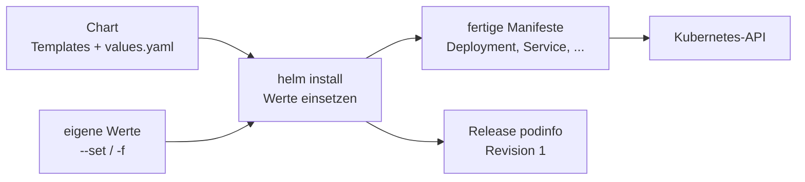

# Lab 9.1: Helm-Grundlagen

**Leitfragen:**

<details>
<summary>Wie installiert man auf einem Laptop eine Software mit allen Abhängigkeiten in einem Schritt?</summary>

Mit einem Paketmanager: `brew install`, `winget install` oder `apt install` holen ein fertiges Paket aus einer Quelle, legen alle Teile an und merken sich die installierte Version. Helm macht dasselbe für Anwendungen im Kubernetes-Cluster.

</details>

<details>
<summary>Was unterscheidet die Hello-Manifeste für <code>dev</code> und <code>prod</code> wirklich?</summary>

Nur wenige Werte: Farbe, Anzahl Kopien, Image-Tag, Hostname. Der Rest der Dateien ist gleich und wird bisher je Umgebung kopiert (Lab 6.3). Eine Vorlage mit austauschbaren Werten spart die Kopien.

</details>

- Die Hello-App besteht inzwischen aus über zehn YAML-Dateien; je Umgebung eine Kopie davon ist mühsam und fehleranfällig.
- Helm bündelt Manifeste als Paket (Chart), füllt sie mit Werten und merkt sich jede Installation mit Versionsnummer.

## Begriffe

| Begriff | Bedeutung |
| --- | --- |
| Helm | Paketmanager für Kubernetes, ein Kommandozeilen-Werkzeug (`helm`) wie `brew` oder `winget`, nur für den Cluster |
| Chart | Helm-Paket: ein Ordner oder Archiv mit Vorlagen für Kubernetes-Manifeste und Standardwerten |
| Template | Vorlage eines Manifests mit Platzhaltern wie `{{ .Values.replicaCount }}`; Helm setzt die Werte ein |
| Values | Werte für die Platzhalter; Standard in `values.yaml` des Charts, eigene per `--set` oder `-f` |
| Release | eine installierte Kopie eines Charts im Cluster, mit eigenem Namen je Namespace (z. B. `podinfo`) |
| Revision | Versionsnummer eines Releases; jede Installation, jedes Upgrade und jeder Rollback zählt eins hoch |
| Repository | Ablage für Charts im Internet; klassisch eine Webadresse mit einer Inhaltsliste (`index.yaml`) |
| OCI-Registry | Ablage für Container-Images (z. B. Docker Hub, `ghcr.io`), die auch Charts speichert; Adresse beginnt mit `oci://` |
| Artifact Hub | Suchseite für Charts aus vielen Quellen: [artifacthub.io](https://artifacthub.io) |
| Lieferkette | alle Stellen, von denen fremder Code bis in den eigenen Cluster kommt: Chart-Autor, Registry, Images |
| Server-Side Apply | der API-Server führt Änderungen zusammen und merkt sich, welches Werkzeug welches Feld verwaltet (vorher machte das `kubectl` bzw. Helm selbst) |

## Helm auf einen Blick

Helm ist für Kubernetes, was `apt` für Linux oder `winget` für Windows ist: ein Paket finden, mit eigenen Einstellungen installieren, später aktualisieren oder entfernen.



| Datum | Ereignis |
| --- | --- |
| 11/2015 | erste Helm-Version auf der ersten KubeCon (Firma Deis) |
| 06/2018 | Helm wird Projekt der Cloud Native Computing Foundation (CNCF) |
| 13.11.2019 | Helm 3: kein Server-Teil (Tiller) mehr im Cluster, Rechte kommen aus der kubeconfig |
| 30.04.2020 | Helm erreicht den höchsten CNCF-Reifegrad („graduated") |
| 12.11.2025 | Helm 4.0 auf der KubeCon Nordamerika, zehn Jahre nach dem Start |

Quellen: [Helm 3.0.0 has been released](https://helm.sh/blog/helm-3-released), [Celebrating Helm's CNCF Graduation](https://helm.sh/blog/celebrating-helms-cncf-graduation), [Helm 4 Released](https://helm.sh/blog/helm-4-released), abgerufen am 17.11.2026.

Typische Charts im Alltag: Monitoring (`kube-prometheus-stack`), Zertifikate (`cert-manager`), GitOps (`argo-cd`), Gateway-Controller (Envoy Gateway bietet neben dem Manifest aus Lab 5.3 auch ein Chart). Die meisten Kubernetes-Werkzeuge nennen Helm als ersten Installationsweg.

## Helm 4 seit November 2025

| Was | Helm 4 (aktuell 4.3, Stand: 11/2026) | Helm 3 |
| --- | --- | --- |
| Änderungen an Objekten | Server-Side Apply bei neuen Releases | Client-Side Apply |
| Warten auf bereite Pods | `--wait` nutzt kstatus (Status jedes Objekts) | `--wait` mit eigener Prüflogik |
| Zurückrollen bei Fehler | `--rollback-on-failure` | `--atomic` (in Helm 4 noch erlaubt, mit Warnung) |
| Ersetzen erzwingen | `--force-replace` | `--force` |
| Charts | Chart-API v2 unverändert, v3 experimentell | Chart-API v2 |
| Unterstützung | aktuelle Version | nur Sicherheitsfixes bis 10.02.2027 |

Quellen: [Helm 4 Overview](https://helm.sh/docs/overview), [Helm 3 End of Life](https://helm.sh/blog/helm-v3-end-of-life), abgerufen am 17.11.2026. Charts für Helm 3 laufen unverändert mit Helm 4.

## Chart-Quellen: Artifact Hub, Repository, OCI-Registry


_Quelle: Artifact Hub, Screenshots im README (https://github.com/artifacthub/hub), Apache-2.0, abgerufen am 17.11.2026._

| Quelle | Beispiel | Befehl |
| --- | --- | --- |
| Artifact Hub (Suche) | [artifacthub.io/packages/helm/podinfo/podinfo](https://artifacthub.io/packages/helm/podinfo/podinfo) | im Browser suchen; die Seite zeigt Installationsbefehl, Werte, Versionen |
| klassisches Repository | `https://stefanprodan.github.io/podinfo` | `helm repo add podinfo <url>`, dann `helm install podinfo podinfo/podinfo` |
| OCI-Registry | `oci://ghcr.io/stefanprodan/charts/podinfo` | `helm install podinfo oci://ghcr.io/stefanprodan/charts/podinfo --version 6.17.0` |

OCI-Charts brauchen kein `helm repo add`: die Adresse steht direkt im Befehl, wie ein Image-Name bei `docker pull`. Beide Wege sind gleichwertig; viele Projekte bieten beide an.

Suchen geht auch im Terminal:

| Befehl | sucht in |
| --- | --- |
| `helm search hub podinfo` | Artifact Hub, wie die Suche im Browser; zeigt Adresse, Chart- und App-Version |
| `helm repo add podinfo https://stefanprodan.github.io/podinfo` | trägt ein klassisches Repository unter dem Kurznamen `podinfo` ein |
| `helm repo update` | lädt die Inhaltslisten (`index.yaml`) aller eingetragenen Repositories neu |
| `helm search repo podinfo` | nur in den eingetragenen Repositories, mit `--versions` auch ältere Versionen |

OCI-Registries haben keine Inhaltsliste; ihre Charts findet `helm search` nicht, sondern nur Artifact Hub oder die Projektseite.

## Bitnami 2025: Lieferketten-Risiko an einem echten Beispiel

Bitnami (heute Broadcom) war jahrelang die bekannteste Quelle für Charts (`bitnami/mysql`, `bitnami/nginx`).

- Ab 28.08.2025 keine neuen Bitnami-Images und -Charts mehr auf Docker Hub; versionierte Images liegen nur noch ohne Updates unter `docker.io/bitnamilegacy`.
- Gepflegte, gehärtete Images gibt es seitdem kostenpflichtig (Bitnami Secure Images).
- Folge: Viele Firmen-Cluster zogen über Nacht Images, die keine Sicherheitsupdates mehr bekommen.

Quelle: [bitnami/charts Issue #35164](https://github.com/bitnami/charts/issues/35164), abgerufen am 17.11.2026.


_Quelle: Artifact Hub, Screenshots im README (https://github.com/artifacthub/hub), Apache-2.0, abgerufen am 17.11.2026._

Prüfliste vor dem Einsatz eines fremden Charts:

| Frage | Wo nachsehen |
| --- | --- |
| Wer gibt das Chart heraus? Projekt selbst oder Dritte? | Artifact Hub: Kennzeichen „Official", „Verified publisher" |
| Wann kam die letzte Version? | Artifact Hub: „Chart versions", Datum |
| Welche Images zieht es, und aus welcher Registry? | `helm show values <chart>`, Felder `image.repository` |
| Bekannte Schwachstellen? | Artifact Hub: „Security report" |
| Version fest angegeben? | immer `--version` setzen, nie „die neueste" |

## Das Beispiel-Chart podinfo

podinfo ist eine kleine Web-App mit Helm-Chart, die Stefan Prodan (Mitentwickler von Flux) für Tests und Schulungen pflegt (Chart 6.17.0, Stand: 11/2026). Die App zeigt eine Seite mit Pod-Name, Version und einer frei wählbaren Nachricht.


_Quelle: podinfo README (https://github.com/stefanprodan/podinfo), Apache-2.0, abgerufen am 17.11.2026. Abgebildet ist eine ältere Version; der Text „greetings from podinfo" lässt sich mit `ui.message` ersetzen._

| Wert | Standard | Wirkung |
| --- | --- | --- |
| `replicaCount` | `1` | Anzahl Pods |
| `ui.message` | leer | Text statt „greetings from podinfo" |
| `ui.color` | `#34577c` | Hintergrundfarbe der Seite |
| `service.externalPort` | `9898` | Port des Service `podinfo` |

Werte setzen, zwei Wege:

```bash
# einzelne Werte auf der Kommandozeile (Punkte trennen die Ebenen)
helm install podinfo oci://ghcr.io/stefanprodan/charts/podinfo --version 6.17.0 \
  -n podinfo --create-namespace --set ui.message="Hallo aus Helm"

# viele Werte in einer Datei
helm upgrade podinfo oci://ghcr.io/stefanprodan/charts/podinfo --version 6.17.0 \
  -n podinfo -f playground/podinfo-values.yaml
```

```yaml
# playground/podinfo-values.yaml
replicaCount: 2
ui:
  message: "Hallo aus der Werte-Datei"
  color: "#2e7d32"
```

Reihenfolge: Standardwerte des Charts → `-f`-Dateien → `--set`; das Letzte gewinnt. `helm upgrade` startet wieder bei den Standardwerten: Werte aus früheren Aufrufen gelten nur, wenn sie erneut angegeben werden oder `--reuse-values` sie übernimmt.

## Wichtige Helm-Befehle

| Befehl | Wirkung |
| --- | --- |
| `helm version` | zeigt die Helm-Version (`v4.x`) |
| `helm show chart <chart> --version <v>` | Steckbrief: Name, Version, App-Version |
| `helm show values <chart> --version <v>` | alle Standardwerte mit Kommentaren |
| `helm install <release> <chart> -n <ns>` | installiert ein Release (Revision 1) |
| `helm upgrade <release> <chart> -n <ns>` | ändert ein Release (neue Revision) |
| `helm list -n <ns>` | Releases im Namespace mit Revision, Status, Chart- und App-Version |
| `helm get values <release> -n <ns>` | die selbst gesetzten Werte des Releases |
| `helm uninstall <release> -n <ns>` | entfernt alle Objekte des Releases |

Helm speichert jede Revision als Secret im Namespace des Releases (`sh.helm.release.v1.podinfo.v1`, `…v2`). Daraus liest `helm list` den Stand; das Secret nie von Hand ändern.

## Typische Fehler

| Symptom | Ursache | Lösung |
| --- | --- | --- |
| `helm: command not found` oder `v3.x` | Helm fehlt oder ist alt | Helm 4 installieren (`brew install helm`, `winget install Helm.Helm`), Terminal neu öffnen |
| `Error: INSTALLATION FAILED: cannot re-use a name that is still in use` | Release `podinfo` existiert schon | `helm upgrade` statt `install`, oder vorher `helm uninstall` |
| Nachricht verschwindet nach dem zweiten Upgrade | `helm upgrade` ohne den früheren `--set` | alle Werte erneut angeben, am besten in einer Datei mit `-f` |
| `Error: ... failed to do request ... ghcr.io` | kein Internet oder Proxy blockiert die Registry | Fallback der Übung |
| Seite im Browser lädt nicht mehr | `port-forward` hing an einem Pod, der beim Upgrade ersetzt wurde | `port-forward` mit Strg+C beenden und neu starten |
| Release fehlt in `helm list` | anderer Namespace | `helm list -n podinfo` oder `helm list -A` (alle Namespaces) |

## Fazit

- Helm installiert Anwendungen als Pakete (Charts); eine Installation heißt Release und zählt Revisionen.
- Werte steuern das Chart: Standard in `values.yaml`, eigene per `--set` oder `-f`.
- Charts kommen aus Artifact Hub, klassischen Repositories oder OCI-Registries; Herausgeber, Version und Images vorher prüfen.
- Helm 4 ist seit 12.11.2025 der Standard; Helm 3 bekommt nur noch Sicherheitsfixes bis 10.02.2027.

In der Übung wird podinfo aus einer OCI-Registry installiert, über Werte geändert und wieder entfernt.
