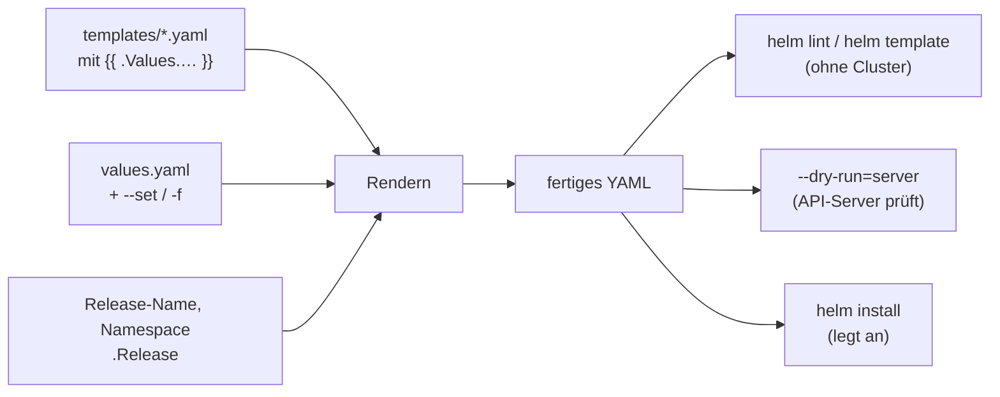

# Lab 9.2: Eigenes Chart für die Hello-App

**Leitfragen:**

<details>
<summary>Welche Werte in den Hello-Manifesten ändern sich zwischen Umgebungen?</summary>

Image-Tag, Anzahl Kopien, Hintergrundfarbe und Hostname. Namen, Labels, Probes und Ports bleiben gleich. Genau diese wechselnden Stellen werden im Chart zu Platzhaltern.

</details>

<details>
<summary>Wie prüft man eine Vorlage, bevor sie im Cluster landet?</summary>

Erst die Form prüfen (Syntax, Pflichtfelder), dann das Ergebnis ansehen: die Vorlage mit Werten füllen und das fertige YAML lesen, ohne etwas anzulegen. Helm hat dafür `helm lint` und `helm template`.

</details>

- Ein eigenes Chart macht aus den Manifesten in `playground/k8s/` ein Paket mit Platzhaltern.
- Ziel: die Hello-App mit einem Befehl installieren, `helm install hello playground/hello -n hello`, und Farbe, Tag oder Kopien nur noch über Werte ändern.

## Begriffe

| Begriff | Bedeutung |
| --- | --- |
| `Chart.yaml` | Steckbrief des Charts: Name, Chart-Version, App-Version |
| `values.yaml` | Standardwerte für alle Platzhalter; gleichzeitig die Bedienungsanleitung des Charts |
| `templates/` | Ordner mit den Vorlagen; jede Datei wird zu einem oder mehreren Manifesten |
| `_helpers.tpl` | Datei mit wiederverwendbaren Textbausteinen; Dateien mit `_` am Anfang erzeugen keine Objekte |
| `NOTES.txt` | Text, den Helm nach der Installation ausgibt, z. B. die Adresse der App |
| `charts/` | Ordner für Subcharts: fremde Charts, die das eigene Chart mitinstalliert (siehe Vertiefung) |
| `helm create` | erzeugt ein neues Chart-Grundgerüst mit Beispiel-Templates |
| `{{ … }}` | Template-Ausdruck: Helm ersetzt ihn beim Rendern durch einen Wert (Sprache: Go-Templates) |
| Rendern | Vorlagen mit Werten füllen; heraus kommt normales Kubernetes-YAML |
| Pipe `\|` | reicht einen Wert an eine Funktion weiter, wie `\|` in der Shell: `{{ .Values.color \| quote }}` |
| `helm lint` | prüft ein Chart auf Fehler, ohne Cluster |
| `helm template` | rendert ein Chart und gibt das YAML aus, ohne Cluster |
| `--dry-run=server` | `helm install` mit Prüfung durch den API-Server, ohne etwas anzulegen |

## Aufbau des Charts hello

```text
playground/hello/
├── Chart.yaml                  # Steckbrief
├── values.yaml                 # Standardwerte
└── templates/
    ├── _helpers.tpl            # Labels als Baustein
    ├── NOTES.txt               # Text nach der Installation
    ├── backend-deployment.yaml
    ├── backend-service.yaml
    ├── frontend-deployment.yaml
    ├── frontend-service.yaml
    ├── configmap.yaml          # BACKEND_URL, APP_COLOR (Lab 6.1)
    ├── pvc.yaml                # access.log auf PVC (Lab 7.2)
    └── httproute.yaml          # Route am Gateway aus Lab 5.3
```

```yaml
# Chart.yaml
apiVersion: v2          # Chart-API v2, gilt für Helm 3 und 4
name: hello
description: Hello-App (Frontend und Backend) aus dem Kurs Kubernetes Einführung
type: application       # installierbar
version: 0.1.0          # Version des Charts
appVersion: "v2"        # Version der App; Standard-Tag des Frontends
```

Ein neues Chart beginnt meist mit `helm create <name>`. Das Grundgerüst enthält `Chart.yaml`, `values.yaml`, einen leeren Ordner `charts/` und Beispiel-Templates für ein nginx-Image: Deployment, Service, ServiceAccount, HPA, Ingress, HTTPRoute, `NOTES.txt`, `_helpers.tpl` und einen Test unter `templates/tests/` (Helm 4.3). Für die Hello-App ist das zu viel und passt nicht zu den eigenen Manifesten; der Starter der Übung enthält deshalb nur die Dateien oben.

Nicht im Chart: das Secret `hello-secret` (Passwörter gehören nicht in Chart-Dateien, Lab 6.2), das Gateway (gehört dem Cluster, nicht der App) sowie CronJob und HPA (Erweiterung der Übung).

## Vom Manifest zur Vorlage



Aus dem Deployment `frontend` aus Lab 8.2 wird so eine Vorlage (Ausschnitt):

```yaml
metadata:
  name: {{ .Release.Name }}-frontend               # vorher: frontend
spec:
  replicas: {{ .Values.frontend.replicas }}        # vorher: 2
  template:
    spec:
      containers:
        - name: frontend
          image: "{{ .Values.frontend.image.repository }}:{{ .Values.frontend.image.tag | default .Chart.AppVersion }}"
          resources:
            {{- toYaml .Values.frontend.resources | nindent 12 }}
```

```yaml
# passender Ausschnitt aus values.yaml
frontend:
  replicas: 2
  image:
    repository: hello-frontend
    tag: ""            # leer -> appVersion "v2"
  resources:
    requests: { cpu: 100m, memory: 64Mi }
    limits:   { cpu: 500m, memory: 128Mi }
```

Mit dem Release-Namen `hello` entstehen die Namen `hello-frontend`, `hello-backend`, `hello-config` und `hello-data`. Ein zweites Release mit anderem Namen bekäme eigene Namen.

## Template-Syntax der Hello-App

| Ausdruck | Ergebnis bei `helm install hello …` | Wozu |
| --- | --- | --- |
| `{{ .Values.backend.replicas }}` | `2` | Wert aus `values.yaml`, Punkte = Ebenen |
| `{{ .Release.Name }}-backend` | `hello-backend` | Namen je Release eindeutig |
| `{{ .Release.Namespace }}` | `hello` | Namespace aus `-n` |
| `{{ .Chart.AppVersion }}` | `v2` | Feld aus `Chart.yaml` |
| `{{ .Values.color \| quote }}` | `"lightyellow"` | Anführungszeichen setzen |
| `{{ .Values.frontend.image.tag \| default .Chart.AppVersion }}` | `v2` | Ersatzwert, wenn der Wert leer ist |
| `{{- toYaml .Values.frontend.resources \| nindent 12 }}` | eingerückter YAML-Block | ganze Abschnitte aus den Werten übernehmen |
| `{{- include "hello.labels" . \| nindent 4 }}` | Labels aus `_helpers.tpl` | gleiche Labels in allen Dateien |
| `{{- if .Values.persistence.enabled }} … {{- else }} … {{- end }}` | PVC oder `emptyDir` | Teile ein- und ausschalten |

- `nindent 12` beginnt eine neue Zeile und rückt um 12 Leerzeichen ein; die Zahl muss zur Stelle im YAML passen.
- `{{-` entfernt Leerzeichen und Zeilenumbruch links vom Ausdruck, damit keine Leerzeilen entstehen.
- Der Punkt `.` steht für „alles, was Helm kennt" (Values, Release, Chart) und wird an `include` weitergereicht.

## Labels als Baustein in `_helpers.tpl`

```yaml
{{- define "hello.labels" -}}
app: hello
app.kubernetes.io/instance: {{ .Release.Name }}     # Name des Releases
app.kubernetes.io/managed-by: {{ .Release.Service }} # "Helm"
helm.sh/chart: {{ .Chart.Name }}-{{ .Chart.Version }}
{{- end }}

{{- define "hello.selectorLabels" -}}
app: hello
app.kubernetes.io/instance: {{ .Release.Name }}
{{- end }}
```

Die Selektoren nutzen `app: hello`, `app.kubernetes.io/instance` und `tier` (Lab 3.3), nie `version`. Das Label `app.kubernetes.io/instance` hält zwei Releases im selben Namespace auseinander; `app.kubernetes.io/managed-by: Helm` zeigt in `kubectl get … --show-labels`, wer das Objekt verwaltet.

## Werte dokumentieren


_Quelle: Artifact Hub, Screenshots im README (https://github.com/artifacthub/hub), Apache-2.0, abgerufen am 17.11.2026._

`values.yaml` ist die Bedienungsanleitung eines Charts: Artifact Hub und `helm show values` zeigen sie samt Kommentaren. Jeder Wert im Chart `hello` hat deshalb einen kurzen Kommentar.

## Prüfen vor dem Installieren

| Befehl | braucht Cluster | prüft |
| --- | --- | --- |
| `helm lint playground/hello` | nein | Aufbau, `Chart.yaml`, Template-Syntax, YAML |
| `helm template hello playground/hello -n hello` | nein | zeigt das fertige YAML; Fehler in Ausdrücken fallen sofort auf |
| `helm template … --set color=pink \| grep APP_COLOR` | nein | wirkt ein Wert an der richtigen Stelle? |
| `helm install hello playground/hello -n hello --dry-run=server` | ja | API-Server prüft Felder und Namenskonflikte, legt nichts an |
| `helm install hello playground/hello -n hello` | ja | legt an, Revision 1 |

`helm lint` meldet `[INFO] Chart.yaml: icon is recommended`; das ist ein Hinweis, kein Fehler.

## Umzug von `kubectl apply` zu Helm

Helm verwaltet nur Objekte, die es selbst angelegt hat. Objekte gleichen Namens aus `kubectl apply` blockieren die Installation. Deshalb vorher die App aus `playground/k8s/` löschen, Namespace `hello`, Secret `hello-secret` und Gateway behalten:

```bash
kubectl delete -n hello deployment/backend deployment/frontend service/backend service/frontend \
  configmap/hello-config pvc/hello-data cronjob/hello-backup hpa/frontend httproute/hello \
  --ignore-not-found
kubectl delete pod load -n hello --ignore-not-found     # Lastgenerator aus Lab 8.3, falls noch da
```

Die PVC `hello-data` wird dabei gelöscht; das `access.log` beginnt danach neu. Die Dateien in `playground/k8s/` bleiben als Nachschlagewerk liegen.

## Typische Fehler

| Symptom | Ursache | Lösung |
| --- | --- | --- |
| `nil pointer evaluating interface {}.tag` | Pfad in `.Values.…` falsch geschrieben oder Wert fehlt in `values.yaml` | Pfad mit `values.yaml` vergleichen (Groß-/Kleinschreibung) |
| `error converting YAML to JSON: yaml: line 23: did not find expected key` | Einrückung falsch, meist bei `nindent` | `helm template … --debug` zeigt das kaputte YAML; Zahl bei `nindent` anpassen |
| `… exists and cannot be imported into the current release` | Objekt aus `kubectl apply` noch da | Aufräum-Befehl oben ausführen |
| `APP_COLOR` im YAML ohne Anführungszeichen, Farbe `#…` geht verloren | `#` beginnt in YAML einen Kommentar | `\| quote` verwenden |
| Pods `ErrImageNeverPull` | Image lokal nicht vorhanden, z. B. nach Cluster-Reset | `bash build-images.sh` |
| Seite zeigt „Backend nicht erreichbar (http://backend)" | ConfigMap noch mit festem Wert `http://backend` | `BACKEND_URL: "http://{{ .Release.Name }}-backend"` |

## Fazit

- Ein Chart besteht aus `Chart.yaml`, `values.yaml` und `templates/`; wiederkehrende Teile stehen in `_helpers.tpl`.
- Nur was sich je Umgebung ändert, wird zum Wert: Tag, Kopien, Farbe, Host, Speicher.
- `helm lint` und `helm template` prüfen ohne Cluster, `--dry-run=server` mit Cluster; erst danach `helm install`.

In der Übung wird der Starter zum Chart `hello` vervollständigt, geprüft und anstelle der einzelnen Manifeste installiert.

## Vertiefung

### Abhängigkeiten als Subcharts

Braucht eine App eine fertige Komponente, etwa einen Cache oder eine Datenbank, verweist `Chart.yaml` auf deren Chart, statt die Manifeste zu kopieren. Beispiel mit podinfo aus Lab 9.1:

```yaml
# Chart.yaml (Ausschnitt)
dependencies:
  - name: podinfo
    version: 6.17.0                                 # feste Version, wie bei helm install
    repository: oci://ghcr.io/stefanprodan/charts   # oder https://… eines klassischen Repositorys
    condition: podinfo.enabled                      # Subchart per Wert ein- und ausschalten
```

```yaml
# values.yaml des eigenen Charts: Werte für das Subchart stehen unter seinem Namen
podinfo:
  enabled: true
  replicaCount: 2
```

`helm dependency update <chart-ordner>` lädt das Subchart als `podinfo-6.17.0.tgz` nach `charts/` und schreibt `Chart.lock` mit den genauen Versionen. Danach installiert `helm install` beide Charts als ein Release. Das Chart `hello` braucht keine Abhängigkeit; der Weg ist hier nur zum Lesen fremder Charts wichtig.
