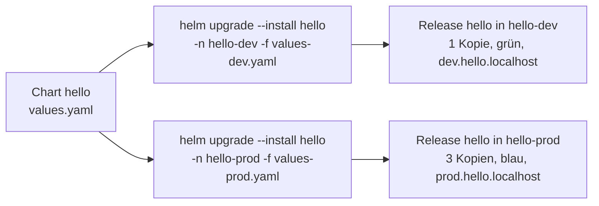
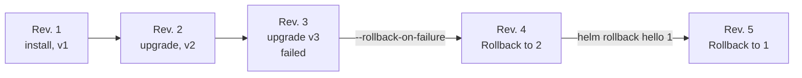

# Lab 9.3: Releases verwalten

**Leitfragen:**

<details>
<summary>Wie sieht man nach drei Monaten, welche Version in Produktion läuft und wer sie wann geändert hat?</summary>

Mit einem Protokoll je Installation: Version, Zeitpunkt, Werte, Ergebnis. Helm führt dieses Protokoll als Revisionen (`helm history`); wer geändert hat, steht erst fest, wenn Änderungen nur über eine Pipeline mit eigenem Protokoll laufen.

</details>

<details>
<summary>Was soll ein Rollback genau zurücksetzen?</summary>

Die Konfiguration der App auf einen bekannten guten Stand: Images, Werte, Manifeste. Daten in Datenbanken oder Volumes bleiben, wie sie sind; eine Datenbank-Änderung macht ein Rollback nicht rückgängig.

</details>

- Ein Chart, mehrere Umgebungen: je Umgebung eine kleine Werte-Datei und ein eigenes Release.
- Jede Änderung ist eine Revision; `helm rollback` springt auf eine frühere Revision zurück, `--rollback-on-failure` tut das bei einem Fehler automatisch.

## Begriffe

| Begriff | Bedeutung |
| --- | --- |
| `helm upgrade --install` | aktualisiert ein Release oder installiert es, falls es fehlt; derselbe Befehl für den ersten und jeden weiteren Lauf |
| Revision | fortlaufende Nummer je Release; jede Installation, jedes Upgrade, jeder Rollback bekommt eine neue |
| `helm history` | Liste aller Revisionen eines Releases mit Zeit, Status, Chart, App-Version, Beschreibung |
| `helm rollback` | erzeugt eine neue Revision mit Manifesten und Werten einer alten Revision |
| `--wait` | Helm wartet, bis die Objekte bereit sind (bei Deployments: Pods bereit laut Readiness-Probe, Lab 8.1) |
| `--rollback-on-failure` | bei Fehler oder Zeitüberschreitung automatisch zur letzten erfolgreichen Revision zurück; schaltet `--wait` ein (früher `--atomic`) |
| `--timeout` | wie lange Helm höchstens wartet, Standard 5 Minuten |
| Werte-Datei je Umgebung | `values-dev.yaml`, `values-prod.yaml`: nur die Abweichungen von `values.yaml` |
| Chart-Version | Version des Pakets (`version` in `Chart.yaml`), steigt bei jeder Änderung am Chart |
| App-Version | Version der Anwendung im Chart (`appVersion`), rein informativ |
| SemVer | Versionsschema `MAJOR.MINOR.PATCH`, z. B. `0.1.0`; Pflicht für Chart-Versionen |
| `helm package` / `helm push` | Chart als Archiv `hello-0.1.0.tgz` verpacken / in eine OCI-Registry hochladen |
| CI/CD | automatische Pipeline (z. B. GitHub Actions, GitLab CI), die bei jeder Änderung testet und ausrollt |

## Ein Chart, zwei Umgebungen



```yaml
# playground/values-prod.yaml – nur, was von values.yaml abweicht
host: prod.hello.localhost
color: lightblue
frontend:
  replicas: 3
  image:
    tag: v1
backend:
  replicas: 3
```

Release-Namen gelten je Namespace: `hello` in `hello-dev` und `hello` in `hello-prod` sind zwei getrennte Releases mit eigener Historie. Beide Routen hängen am selben Gateway aus Lab 5.3 und unterscheiden sich nur im Hostnamen.

Reihenfolge der Werte bei jedem Aufruf: `values.yaml` des Charts → `-f values-prod.yaml` → `--set …`. Ohne `-f values-prod.yaml` fällt `helm upgrade` auf die Standardwerte zurück: aus 3 Kopien werden 2, aus Blau wird Gelb.

## Upgrade, Historie, Rollback

```bash
# Upgrade auf v2, bei Fehler automatisch zurück
helm upgrade --install hello playground/hello -n hello-prod \
  -f playground/values-prod.yaml --set frontend.image.tag=v2 \
  --rollback-on-failure --timeout 90s

helm history hello -n hello-prod
helm rollback hello 1 -n hello-prod          # auf Revision 1 zurück
```



Ein Rollback löscht keine Revision, sondern schreibt eine neue: die Historie bleibt vollständig. Helm behält standardmäßig die letzten 10 Revisionen (`--history-max`).

| Was setzt `helm rollback` zurück? | |
| --- | --- |
| Manifeste des Charts (Deployments, Services, ConfigMap, Route) | ja |
| Werte (`-f`, `--set`) der Ziel-Revision | ja |
| Image-Tag in den Pods | ja, über ein neues Rollout des Deployments (Lab 4.3) |
| Daten im Volume (`access.log` auf der PVC) | nein |
| Objekte außerhalb des Charts (Secret `hello-secret`, Gateway) | nein |
| Dateien auf dem Rechner (`values-prod.yaml`) | nein |

## Chart-Version und App-Version


_Quelle: Artifact Hub, Screenshots im README (https://github.com/artifacthub/hub), Apache-2.0, abgerufen am 17.11.2026._

Im Bild: App-Version `v0.63.0`, aber Chart-Version `45.5.0`. Beide Nummern zählen unabhängig.

| | Chart-Version | App-Version |
| --- | --- | --- |
| Feld in `Chart.yaml` | `version: 0.1.0` | `appVersion: "v2"` |
| beschreibt | das Paket: Templates, Standardwerte | die Software im Paket |
| steigt, wenn | sich am Chart etwas ändert (auch nur ein Template) | eine neue App-Version Standard wird |
| Format | SemVer, Pflicht | frei |
| sichtbar in | `helm list` Spalte CHART (`hello-0.1.0`) | `helm list` Spalte APP VERSION |

Im Kurs-Chart bestimmt `appVersion` auch den Standard-Tag des Frontends (`default .Chart.AppVersion`, Lab 9.2). Ein Upgrade mit `--set frontend.image.tag=v2` ändert die laufende Version, nicht die Spalte APP VERSION.

## Charts weitergeben: OCI-Registry

```bash
helm package playground/hello                       # -> hello-0.1.0.tgz
helm registry login ghcr.io -u <benutzer>           # nur der Domainname, ohne https:// (Helm 4)
helm push hello-0.1.0.tgz oci://ghcr.io/<benutzer>/charts
helm install hello oci://ghcr.io/<benutzer>/charts/hello --version 0.1.0 -n hello-prod
```

```text
Pushed: ghcr.io/<benutzer>/charts/hello:0.1.0
Digest: sha256:3f1c…
```

Die Chart-Version wird zum Tag in der Registry. Helm 4 kann zusätzlich über den Digest installieren (`oci://…/hello@sha256:…`): Helm lehnt ein Chart ab, dessen Inhalt nicht zum Digest passt. In der Übung bleibt dieser Teil Theorie, weil er ein Registry-Konto braucht.

Ohne Registry geht der klassische Weg aus Lab 9.1: Jeder Webserver, der Dateien ausliefert (GitHub Pages, ein S3-Bucket, ein interner Webserver), wird zum Repository. `helm repo index <ordner> --url https://…` schreibt dazu die Inhaltsliste `index.yaml` für alle `.tgz` im Ordner; beides wird hochgeladen, danach funktionieren `helm repo add` und `helm search repo`.

## Helm in CI/CD

Eine Pipeline führt bei jeder Änderung dieselben Schritte aus wie die Übung, nur ohne Handarbeit:

1. `helm lint` und `helm template` (Lab 9.2),
2. Image bauen und mit eindeutigem Tag in die Registry laden,
3. `helm upgrade --install hello ./hello -n hello-prod -f values-prod.yaml --set frontend.image.tag=<tag> --rollback-on-failure`.

Das Protokoll der Pipeline beantwortet „wer hat wann geändert". Weil `helm` ein einzelnes Programm ist, läuft es in jedem CI/CD-Werkzeug:

| Werkzeug | So kommt Helm in die Pipeline |
| --- | --- |
| GitLab CI/CD | Job in `.gitlab-ci.yml` mit einem Image, das `helm` enthält (z. B. `alpine/helm`), Beispiel in der Vertiefung |
| GitHub Actions | Schritt `azure/setup-helm` installiert Helm, danach `run: helm upgrade --install …` |
| Jenkins | Pipeline-Schritt `sh 'helm upgrade --install …'` auf einem Agenten mit Helm |

Die Pipeline braucht Zugang zum Cluster: eine kubeconfig als geschützte Variable des CI-Werkzeugs, mit einem eigenen Konto und begrenzten Rechten (Lab 10.1 und 10.2). Werkzeuge, die den Cluster laufend mit einem Git-Repository abgleichen (Argo CD, Flux), sind Thema in Lab 11.3.

## Typische Fehler

| Symptom | Ursache | Lösung |
| --- | --- | --- |
| prod hat nach dem Upgrade nur 2 Kopien und gelbe Farbe | `-f values-prod.yaml` vergessen | jedes Upgrade mit `-f` der Umgebung |
| `Error: UPGRADE FAILED: … context deadline exceeded` bzw. Meldung, dass Ressourcen nicht bereit sind | Pods werden in `--timeout` nicht bereit (z. B. Image fehlt) | `kubectl get pods`, `kubectl describe pod`; mit `--rollback-on-failure` ist der alte Stand schon zurück |
| `Error: UPGRADE FAILED: another operation (install/upgrade/rollback) is in progress` | ein vorheriger Aufruf wurde abgebrochen, Status `pending-upgrade` | `helm history`, dann `helm rollback hello <letzte gute Revision>` |
| `… exists and cannot be imported into the current release` | Objekte aus Lab 6.3 noch im Namespace | Aufräumen wie in der Übung |
| `exceeded quota` in den Events | ResourceQuota aus Lab 6.3 zu klein für 3 Kopien | Quota erhöhen oder `kubectl delete resourcequota --all -n hello-prod` |
| `dev.hello.localhost` zeigt 404 | Route fehlt oder Hostname falsch | `kubectl get httproute -A` |

## Fazit

- `helm upgrade --install` mit `-f values-<umgebung>.yaml` ist der eine Befehl für jede Umgebung und jeden Lauf.
- Jede Änderung ist eine Revision; `helm history` zeigt sie, `helm rollback` erzeugt eine neue Revision mit altem Stand.
- `--rollback-on-failure` macht ein fehlgeschlagenes Upgrade automatisch rückgängig; Daten in Volumes setzt kein Rollback zurück.
- Chart-Version und App-Version zählen getrennt; verpackte Charts reisen über OCI-Registries.

In der Übung läuft das Chart `hello` in `hello-dev` und `hello-prod`, prod wird auf `v2` gehoben, scheitert einmal absichtlich und wird zurückgerollt.

## Vertiefung

### Pipeline mit Helm in GitLab CI/CD

Die Pipeline liegt als Datei im Git-Repository der App (Ablage für Quellcode mit Versionsgeschichte, Lab 11.3) und läuft bei jeder Änderung. Zwei Stufen: Erst prüfen, dann ausrollen. Scheitert das Ausrollen, setzt `--rollback-on-failure` den letzten guten Stand zurück, und der Job endet rot.

```yaml
# .gitlab-ci.yml im Git-Repository neben dem Ordner hello/ und values-prod.yaml
stages: [test, deploy]

default:
  image:
    name: alpine/helm:4.3.2   # Image mit Helm 4, Version fest
    entrypoint: [""]          # das Image startet sonst direkt helm

chart-pruefen:
  stage: test
  script:
    - helm lint ./hello
    - helm template hello ./hello -f values-prod.yaml > /dev/null

prod-ausrollen:
  stage: deploy
  script:                     # KUBECONFIG ist als geschützte Datei-Variable in GitLab hinterlegt
    - helm upgrade --install hello ./hello -n hello-prod -f values-prod.yaml
      --set frontend.image.tag=$CI_COMMIT_SHORT_SHA
      --rollback-on-failure --timeout 5m
  rules:
    - if: $CI_COMMIT_BRANCH == $CI_DEFAULT_BRANCH   # nur Änderungen am Hauptzweig
  environment: production
```

`$CI_COMMIT_SHORT_SHA` ist die Kurzkennung der Änderung im Git-Repository; ein vorheriger Job baut das Image mit genau diesem Tag (hier weggelassen). So passt jede Revision in `helm history` zu genau einer Änderung im Git-Repository. Tag `alpine/helm:4.3.2` vom 13.11.2026, Stand: 11/2026 ([Docker Hub](https://hub.docker.com/r/alpine/helm/tags)).
