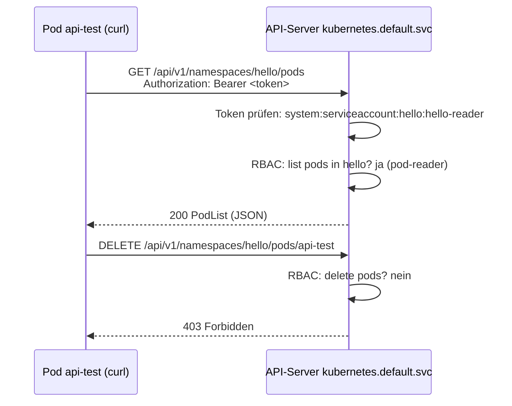

# Lab 10.2: ServiceAccounts

**Leitfragen:**

<details>
<summary>Ein Programm soll andere Programme im Cluster überwachen: mit welchem Konto meldet es sich an?</summary>

Nicht mit dem Konto einer Person, die das Team irgendwann verlässt, sondern mit einem eigenen technischen Konto, das nur die nötigen Leserechte hat. In Kubernetes heißt so ein Konto ServiceAccount.

</details>

<details>
<summary>Was passiert, wenn ein angegriffener Container automatisch Cluster-Rechte hat?</summary>

Der Angreifer nutzt diese Rechte weiter: Pods auflisten, Secrets lesen, eigene Container starten. Je weniger Rechte ein Container mitbringt, desto kleiner der Schaden; am besten bekommt eine App, die nie mit dem Cluster spricht, gar kein Token.

</details>

- Menschen melden sich über Zertifikat oder Login an (Lab 10.1); Programme im Cluster über einen ServiceAccount.
- Jeder Pod bekommt einen ServiceAccount und, solange nichts anderes gesagt ist, ein Token dafür als Datei.

## Begriffe

| Begriff | Bedeutung |
| --- | --- |
| ServiceAccount | Kubernetes-Objekt: Identität für Programme in Pods, gehört zu einem Namespace |
| `default` | ServiceAccount, den Kubernetes in jedem Namespace anlegt und jedem Pod ohne eigene Angabe gibt |
| Token | Zeichenkette, mit der sich ein Programm beim API-Server ausweist, wie ein Dienstausweis |
| JWT | JSON Web Token: Token-Format aus drei Base64-Teilen, enthält u. a. Namen und Ablaufzeit, vom API-Server signiert |
| projiziertes Token | Token, das der Kubelet für genau einen Pod anfordert und als Datei einhängt; läuft ab und wird automatisch erneuert |
| `automountServiceAccountToken` | Feld in Pod oder ServiceAccount: `false` hängt kein Token ein |
| Bearer-Token | Art, ein Token mitzuschicken: HTTP-Header `Authorization: Bearer <token>` |
| `kubernetes.default.svc` | DNS-Name des API-Servers im Cluster (Service `kubernetes` im Namespace `default`, Lab 5.1) |
| `ca.crt` | Zertifikat, mit dem der Pod prüft, dass er wirklich mit dem API-Server spricht |
| `system:serviceaccount:hello:hello-reader` | Benutzername, unter dem der API-Server einen ServiceAccount führt |

## Identitäten für Menschen und Programme


_Quelle: Kubernetes-Dokumentation, „Controlling Access to the Kubernetes API" (https://kubernetes.io/docs/concepts/security/controlling-access/), CC BY 4.0, The Kubernetes Authors, abgerufen am 17.11.2026._

Das Bild aus Lab 10.1, diesmal mit Blick auf den unteren Pfeil: Ein Pod schickt Anfragen mit seinem ServiceAccount-Token. Danach gelten dieselben Schritte wie für Menschen, RBAC inklusive.

| | Benutzer (Lab 10.1) | ServiceAccount |
| --- | --- | --- |
| für | Menschen | Programme in Pods |
| Objekt in Kubernetes | nein | ja, `kubectl get serviceaccounts` |
| Gültigkeit | ganzer Cluster | ein Namespace |
| Anmeldung über | Zertifikat oder Login beim Identitätsanbieter | Token, das der Pod als Datei bekommt |
| Subject im RoleBinding | `kind: User` | `kind: ServiceAccount` mit `namespace` |

Typische Programme mit eigenem ServiceAccount:

| Einsatz | Beispiel | typische Rechte |
| --- | --- | --- |
| Monitoring und Logging | Prometheus, Grafana Alloy (Lab 11.3) | Pods, Nodes, Services lesen (`get`, `list`, `watch`) |
| CI/CD und Deployment | Pipeline mit `helm upgrade` (Lab 9.3), Argo CD, Flux | Deployments, Services, ConfigMaps in einem Namespace ändern |
| Pods verwalten oder skalieren | Operatoren (Lab 7.3), Gateway-Controller wie Envoy Gateway (Lab 5.3), Autoscaler | eigene Objektarten und Pods anlegen, ändern, löschen |
| App fragt den Cluster | Test-Pod `api-test` in dieser Übung | nur das, was die App wirklich braucht |

Eine Pipeline außerhalb des Clusters nutzt ebenfalls einen ServiceAccount: Die kubeconfig der Pipeline enthält ein Token dieses Kontos (Befehl `kubectl create token` weiter unten), oder die Anmeldung läuft über einen Identitätsanbieter.

## Was im Pod ankommt

```text
/var/run/secrets/kubernetes.io/serviceaccount/
├── token        # projiziertes Token (JWT), läuft ab, wird erneuert
├── ca.crt       # Zertifikat des Clusters
└── namespace    # Namespace des Pods, z. B. hello
```

- Das Token ist an den Pod gebunden: Wird der Pod gelöscht, wird das Token ungültig.
- Der Kubelet fordert es mit etwa einer Stunde Laufzeit an und erneuert es rechtzeitig; Programme lesen die Datei deshalb bei Bedarf neu.
- Seit Kubernetes 1.24 entstehen keine dauerhaften Token-Secrets mehr automatisch. Für einen Test von außen erzeugt `kubectl create token hello-reader -n hello --duration=10m` ein kurzlebiges Token.

## ServiceAccount mit Leserecht auf Pods

```yaml
apiVersion: v1
kind: ServiceAccount
metadata:
  name: hello-reader
  namespace: hello
---
apiVersion: rbac.authorization.k8s.io/v1
kind: Role
metadata:
  name: pod-reader
  namespace: hello
rules:
  - apiGroups: [""]
    resources: ["pods"]
    verbs: ["get", "list", "watch"]
---
apiVersion: rbac.authorization.k8s.io/v1
kind: RoleBinding
metadata:
  name: hello-reader-pod-reader
  namespace: hello
subjects:
  - kind: ServiceAccount        # statt User
    name: hello-reader
    namespace: hello
roleRef:
  kind: Role
  name: pod-reader
  apiGroup: rbac.authorization.k8s.io
---
apiVersion: v1
kind: Pod
metadata:
  name: api-test
  namespace: hello
spec:
  serviceAccountName: hello-reader   # ohne diese Zeile: default
  containers:
    - name: curl
      image: curlimages/curl:8.23.0
      command: ["sleep", "3600"]
```

## Den API-Server aus dem Pod fragen



```bash
SA=/var/run/secrets/kubernetes.io/serviceaccount
TOKEN=$(cat $SA/token)
curl -s --cacert $SA/ca.crt -H "Authorization: Bearer $TOKEN" \
  https://kubernetes.default.svc/api/v1/namespaces/hello/pods
```

`kubectl` macht intern genau das: HTTP-Anfragen an die API mit Zertifikat oder Token. Der Pfad `/api/v1/namespaces/<ns>/pods` entspricht `kubectl get pods -n <ns>`.

## Kein Token für die Hello-App

Frontend und Backend sprechen nie mit der Kubernetes-API. Ein eingehängtes Token wäre nur ein Geschenk für einen Angreifer. Im Chart `hello` (Lab 9.2) bekommen beide Deployments deshalb:

```yaml
spec:
  template:
    spec:
      automountServiceAccountToken: false   # kein Ordner /var/run/secrets/kubernetes.io/serviceaccount
      containers:
        - name: frontend
```

Der ServiceAccount `default` hat ohne eigene Bindungen kaum Rechte; das Token weglassen ist trotzdem besser, weil spätere Bindungen an `default` sonst sofort in jedem Pod wirken.

## Typische Fehler

| Symptom | Ursache | Lösung |
| --- | --- | --- |
| `403` mit `User "system:serviceaccount:hello:default"` | `serviceAccountName` fehlt, Pod läuft als `default` | Feld setzen; es ist nach dem Start nicht änderbar, Pod löschen und neu anlegen |
| `403` beim Auflisten trotz Role | RoleBinding nennt den ServiceAccount ohne `namespace` oder mit falschem Namen | Subject prüfen: `kind`, `name`, `namespace` |
| `curl: (60) SSL certificate problem` | `--cacert` fehlt oder Pfad falsch | `--cacert /var/run/secrets/kubernetes.io/serviceaccount/ca.crt` |
| `401 Unauthorized` | Token-Variable leer oder abgeschnitten | `echo ${#TOKEN}` zeigt die Länge; Datei neu lesen |
| `cat: can't open '/var/run/secrets/…/token'` | `automountServiceAccountToken: false` gesetzt | gewollt bei der Hello-App; beim Test-Pod nicht setzen |

## Fazit

- ServiceAccounts sind Identitäten für Programme; jeder Pod hat einen, ohne Angabe `default`.
- Das Token kommt als kurzlebige, an den Pod gebundene Datei; Rechte vergibt wie bei Menschen RBAC (Subject `kind: ServiceAccount`).
- Apps, die nicht mit der Kubernetes-API sprechen, bekommen `automountServiceAccountToken: false`.

In der Übung fragt ein Test-Pod mit dem ServiceAccount `hello-reader` die API: Auflisten klappt, Löschen wird verboten; danach verlieren die Hello-Pods ihr Token.
