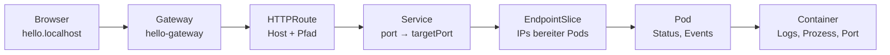

# Lab 11.1: Fehlersuche mit System

**Leitfragen:**

<details>
<summary>Die Seite ist weiß: wo fängt man an zu suchen?</summary>

Dort, wo die Anfrage zuerst ankommt, und dann Station für Station nach innen: Route, Service, Endpunkte, Pod, Container. Wer gleich im Code sucht, übersieht oft einen falschen Port im Service.

</details>

<details>
<summary>Welche Informationen braucht ein Kollege, um einen Fehler nachzuvollziehen?</summary>

Namespace und Objekt, das Symptom mit dem genauen Befehl und seiner Ausgabe, die Warnungen des Clusters (Events), den Zeitpunkt und die letzte Änderung davor. „Geht nicht" reicht nicht.

</details>

- Eine Anfrage an die Hello-App läuft durch eine feste Kette von Objekten; jeder Fehler sitzt an genau einer Station dieser Kette.
- Fehlersuche heißt: die Kette von außen nach innen prüfen, pro Station mit einem passenden Befehl, bis die erste Station nicht mehr stimmt.

## Begriffe

| Begriff | Bedeutung |
| --- | --- |
| Outside-in | Suche von außen nach innen: erst prüfen, was der Browser sieht, dann jede Station dahinter |
| Event | Meldung des Clusters zu einem Objekt (z. B. „Image nicht gefunden"); bleibt etwa eine Stunde gespeichert (aus Lab 3.4) |
| `kubectl events` | listet Events, gefiltert nach Objekt (`--for`) oder Art (`--types=Warning`) |
| `kubectl logs --previous` | Ausgabe des letzten, bereits beendeten Containers eines Pods, z. B. vor einem Neustart (aus Lab 3.4) |
| Ephemerer Container | Debug-Container, der nachträglich in einen laufenden Pod gesetzt wird und nur zur Untersuchung dient; „ephemer" = vorübergehend |
| `kubectl debug` | startet einen ephemeren Container mit einem eigenen Image, z. B. `busybox:1.37` mit Shell und Netzwerk-Werkzeugen |
| `--target` | Option von `kubectl debug`: der Debug-Container sieht die Prozesse dieses Containers |
| `configMapKeyRef` | holt einen einzelnen Schlüssel einer ConfigMap in eine Umgebungsvariable; Variante zu `envFrom` aus Lab 6.1, die alle Schlüssel übernimmt |
| `CreateContainerConfigError` | Pod-Status: der Container kann nicht angelegt werden, weil seine Konfiguration nicht vollständig ist (z. B. fehlender Schlüssel in ConfigMap oder Secret) |

## Weg einer Anfrage durch die Hello-App

Jede Station hängt an der vorherigen. Fällt eine aus, sieht der Browser dasselbe Symptom: keine oder eine leere Seite.



| Station | Frage | Befehl | Typische Ursache |
| --- | --- | --- | --- |
| Route | Ist die Route angenommen, stimmt der Host? | `kubectl describe httproute <name>` | falscher `hostnames`-Eintrag, Service-Name falsch geschrieben |
| Service | Zeigt der Service auf den richtigen Port? | `kubectl describe svc <name>` | `targetPort` passt nicht zum Port im Container |
| EndpointSlice | Hat der Service Pods hinter sich? | `kubectl get endpointslices -l kubernetes.io/service-name=<name>` | Selector passt nicht zu den Labels, Pod nicht bereit |
| Pod | Läuft der Pod und ist er bereit? | `kubectl get pods`, `kubectl describe pod <name>`, `kubectl events --for pod/<name>` | Image fehlt, Konfiguration fehlt, Probe schlägt fehl |
| Container | Was sagt das Programm selbst? | `kubectl logs <pod>`, `kubectl logs <pod> --previous`, `kubectl debug` | Absturz, falsche Variable, Programm lauscht auf anderem Port |

Zwei Abkürzungen grenzen den Fehler schnell ein:

- `kubectl port-forward pod/<pod> 8084:80` umgeht Route und Service. Antwortet der Pod direkt, liegt der Fehler davor.
- `kubectl port-forward svc/<service> 8083:80` nutzt den `targetPort` des Service, aber nicht die EndpointSlices: der Befehl wählt selbst einen laufenden Pod, auch einen, der nicht bereit ist.

## Befehle der Fehlersuche

Alle Befehle aus Lab 3.4 und Modul 5, hier in der Reihenfolge der Kette. Im Namespace `hello-debug` dieser Übung jeweils `-n hello-debug` anhängen.

```bash
kubectl get pods -o wide                         # Status, READY, Neustarts, IP
kubectl describe pod <pod>                       # Container, Ports, Variablen, Events unten
kubectl events --for pod/<pod>                   # nur Events dieses Pods
kubectl events --types=Warning                   # alle Warnungen im Namespace
kubectl logs <pod> -c frontend                   # Ausgabe des laufenden Containers
kubectl logs <pod> -c frontend --previous        # Ausgabe vor dem letzten Neustart
kubectl get endpointslices -l kubernetes.io/service-name=frontend
```

Die EndpointSlice zeigt, ob und wohin ein Service weiterleitet: `PORTS` ist der `targetPort`, `ENDPOINTS` sind die IPs der bereiten Pods. Ein Service, dessen Selector zu keinem Pod passt (Lab 5.1), hat keine Endpunkte:

```text
NAME            ADDRESSTYPE   PORTS     ENDPOINTS   AGE
backend-m4c8w   IPv4          <unset>   <unset>     3m     # kein Pod passt zum Selector
```

Ein Pod, dem ein Secret fehlt (Lab 6.2), zeigt die Ursache in den Events:

```text
$ kubectl get pods
NAME                       READY   STATUS                       RESTARTS   AGE
frontend-6d9f7c8b5-qk4tz   0/1     CreateContainerConfigError   0          40s

$ kubectl events --for pod/frontend-6d9f7c8b5-qk4tz
LAST SEEN   TYPE      REASON   OBJECT                         MESSAGE
5s          Warning   Failed   Pod/frontend-6d9f7c8b5-qk4tz   Error: secret "hello-secret" not found
```

## Pod-Status als Wegweiser

| Status in `kubectl get pods` | Bedeutung | Erster Befehl |
| --- | --- | --- |
| `Pending` | kein Node gefunden oder Volume fehlt | `kubectl describe pod`, Events |
| `ErrImageNeverPull`, `ImagePullBackOff` | Image fehlt lokal oder in der Registry | `docker images`, Image-Name im Manifest |
| `CreateContainerConfigError` | ConfigMap, Secret oder Schlüssel fehlt | Events des Pods |
| `CrashLoopBackOff` | Programm startet und stürzt wieder ab | `kubectl logs --previous` |
| `OOMKilled` (in `describe`) | Speicherlimit überschritten (Lab 8.2) | Limits im Manifest |
| `Running`, READY `0/1` | Readiness-Probe schlägt fehl (Lab 8.1) | Events: `Readiness probe failed` |
| `Running`, READY `1/1`, Seite trotzdem leer | Fehler vor dem Pod: Service, Route | EndpointSlice, `describe svc` |

## Ephemerer Debug-Container mit `kubectl debug`

Images sollen klein sein und oft ohne Shell auskommen; die Nicht-root-Images aus Lab 10.3 enthalten nur das Nötigste. `kubectl exec` hilft dann nicht weiter. `kubectl debug` setzt einen zusätzlichen Container mit Werkzeugen in den laufenden Pod, ohne ihn neu zu starten.

```bash
kubectl debug -it <pod> -n hello-debug --image=busybox:1.37 --target=frontend
```

```text
Targeting container "frontend". If you don't see processes from this container it may be because the container runtime doesn't support this feature.
Defaulting debug container name to debugger-k7d2p.
If you don't see a command prompt, try pressing enter.
/ # ps                                # Prozesse des Containers "frontend" (wegen --target)
PID   USER     TIME  COMMAND
    1 root      0:01 python app.py
   14 root      0:00 sh
/ # netstat -tln                      # auf welchem Port lauscht das Programm?
Active Internet connections (only servers)
Proto Recv-Q Send-Q Local Address           Foreign Address         State
tcp        0      0 0.0.0.0:80              0.0.0.0:*               LISTEN
/ # wget -qO- http://localhost:80/healthz
ok
/ # exit
```

- Der Debug-Container teilt das Netzwerk des Pods: `localhost` ist der Pod selbst.
- Er bleibt in der Pod-Beschreibung stehen, bis der Pod ersetzt wird; entfernen lässt er sich nicht.
- In Namespaces mit Pod Security `restricted` (Lab 10.3) wird `busybox` als root abgewiesen; dort hilft `--profile=restricted` plus ein Image ohne root.

## Dieselbe Suche in Headlamp

Headlamp (Lab 2.3) zeigt dieselben Informationen ohne Befehle: **Workloads → Pods** listet Status und Neustarts, die Pod-Seite zeigt Container, Bedingungen und Events, die Symbole oben öffnen Logs und ein Terminal im Container (Stand: 11/2026, Headlamp v0.46).


_Quelle: Headlamp README (https://github.com/kubernetes-sigs/headlamp), Apache-2.0, abgerufen am 17.11.2026._

Der Schalter **Show previous** entspricht `kubectl logs --previous`.


_Quelle: Headlamp README (https://github.com/kubernetes-sigs/headlamp), Apache-2.0, abgerufen am 17.11.2026._

## Fehlerbericht für Kolleginnen und Kollegen

Ein guter Bericht lässt sich ohne Rückfrage nachvollziehen:

```text
Namespace/Objekt:  hello-dev / Deployment hello-frontend
Symptom:           http://dev.hello.localhost zeigt die alte Version, neuer Pod startet nicht
Geprüft:           kubectl get pods -n hello-dev -> neuer Pod ErrImageNeverPull
                   kubectl events -n hello-dev --for pod/<pod> -> image "hello-frontend:v3" not present
Ursache:           Image-Tag v3 existiert lokal nicht (docker images hello-frontend)
Letzte Änderung:   helm upgrade ... --set frontend.image.tag=v3 um 14:20
Behebung:          helm rollback hello -n hello-dev um 14:32
```

## Typische Fehler

| Symptom | Ursache | Lösung |
| --- | --- | --- |
| `No resources found in hello namespace.` | Befehl im Standard-Namespace `hello` statt in `hello-debug` | `-n hello-debug` anhängen |
| `error: unable to forward port because pod is not running` | Pod hängt in `Pending` oder `CreateContainerConfigError` | `kubectl get pods`, Events des Pods lesen |
| `previous terminated container "frontend" ... not found` | Container wurde noch nie neu gestartet | `kubectl logs` ohne `--previous` |
| `kubectl events` zeigt nichts | Events sind nach etwa einer Stunde gelöscht | Fehler erneut auslösen, sofort nachsehen |
| `kubectl debug` wird abgewiesen: `violates PodSecurity "restricted"` | Namespace mit Pod Security `restricted` | `--profile=restricted`, Image ohne root |
| Änderung in der Datei wirkt nicht | Datei gespeichert, aber nicht angewendet | `kubectl apply -f <ordner>/` erneut ausführen |

## Fazit

- Fehlersuche folgt der Kette Route → Service → EndpointSlice → Pod → Container; die erste Station, die nicht stimmt, ist die Ursache.
- Der Pod-Status zeigt den Weg: Events bei Konfigurationsfehlern, `logs --previous` bei Abstürzen, EndpointSlice und `describe svc`, wenn der Pod gesund ist.
- `kubectl debug` bringt Werkzeuge in einen laufenden Pod, ohne ihn zu verändern; Headlamp zeigt dieselben Informationen grafisch.

In der Übung laufen zwei kaputte Varianten der Hello-App im Namespace `hello-debug`; die Ursache ist jeweils mit der Kette zu finden und zu beheben.
