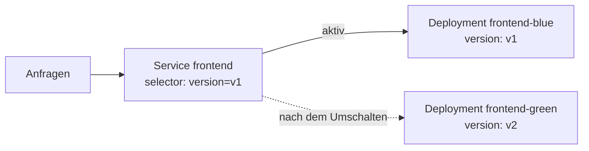
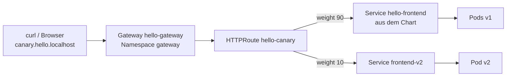

# Lab 11.2: Canary und Blue/Green

**Leitfragen:**

<details>
<summary>Wie testet man eine neue Version mit echten Nutzern, ohne alle zu gefährden?</summary>

Nur einen kleinen Teil der Anfragen auf die neue Version schicken, beobachten und den Anteil schrittweise erhöhen. Geht etwas schief, ist nur dieser Teil betroffen, und der Anteil geht sofort auf null zurück.

</details>

<details>
<summary>Was kostet es, zwei vollständige Versionen gleichzeitig zu betreiben?</summary>

Doppelte Ressourcen für die Dauer des Umstiegs: CPU, Speicher, bei Datenbanken auch Datenstände, die zu beiden Versionen passen müssen. Dafür ist der Rückweg ein einziger Schalter.

</details>

- Eine Release-Strategie legt fest, wie Anfragen von der alten auf die neue Version wandern: alle auf einmal, Pod für Pod, per Schalter oder nach Anteil.
- Kubernetes bringt zwei Strategien im Deployment mit (Lab 4.3); Blue/Green und Canary entstehen aus Services, Labels und Gewichten in der HTTPRoute.

## Begriffe

| Begriff | Bedeutung |
| --- | --- |
| Release-Strategie | Plan, wie eine neue Version die alte ablöst und wie der Rückweg aussieht |
| Rolling Update | Pods werden schrittweise ersetzt, alt und neu laufen kurz gemeinsam; Standard im Deployment (Lab 4.3) |
| Recreate | alle alten Pods stoppen, dann alle neuen starten; kurze Ausfallzeit |
| Blue/Green | zwei vollständige Umgebungen (blau = alt, grün = neu); ein Schalter lenkt den ganzen Verkehr um |
| Canary | neue Version bekommt zuerst einen kleinen Anteil der Anfragen; benannt nach dem Kanarienvogel, der Bergleute früh vor Gas warnte |
| A/B-Test | zwei Versionen für unterschiedliche Nutzergruppen, gesteuert nach Merkmalen wie Header oder Cookie, um sie zu vergleichen |
| Gewicht (`weight`) | Zahl je Ziel in einer HTTPRoute; Anteil = eigenes Gewicht / Summe aller Gewichte |
| `backendRefs` | Liste der Services, an die eine HTTPRoute-Regel weiterleitet (Lab 5.3) |
| Progressive Delivery | automatisierter Canary: Werkzeug erhöht den Anteil Schritt für Schritt und prüft dabei Fehlerraten |

## Fünf Release-Strategien

| Strategie | Ablauf | Ausfallzeit | Zusätzliche Kosten | Risiko für Nutzer | Rückweg | Mittel in Kubernetes |
| --- | --- | --- | --- | --- | --- | --- |
| Recreate | alt aus, neu an | ja, kurz | keine | alle sehen den Fehler | neu ausrollen | `strategy.type: Recreate` |
| Rolling Update | Pod für Pod | nein | wenige Pods extra (`maxSurge`) | wächst mit dem Fortschritt | `kubectl rollout undo` (Lab 4.3) | Standard im Deployment |
| Blue/Green | zweite Umgebung, dann Umschalten | nein | doppelte Pods während des Umstiegs | alle auf einmal nach dem Schalter | Schalter zurück | Service-Selector oder Route |
| Canary | kleiner Anteil zuerst, dann mehr | nein | ein bis wenige Pods extra | nur der Anteil | Gewicht auf 0 | Gewichte in der HTTPRoute |
| A/B-Test | Gruppe nach Merkmal | nein | ein bis wenige Pods extra | nur die Gruppe | Regel entfernen | Header-Regel in der HTTPRoute |

Rolling und Recreate tauschen die Version eines Deployments aus. Blue/Green, Canary und A/B lassen zwei Deployments nebeneinander laufen und steuern davor, wer welche Version sieht.

| Strategie | Vorteil | Nachteil | passt für |
| --- | --- | --- | --- |
| Blue/Green | Rückweg in Sekunden, neue Version vorab vollständig testbar | doppelte Ressourcen; Datenbank muss zu beiden Versionen passen | Anwendungen, bei denen Ausfallzeit teuer ist |
| Canary | Fehler treffen nur einen kleinen Teil der Nutzer | braucht Messwerte je Version und Geduld; eine Person kann bei jedem Klick eine andere Version sehen | große Anwendungen mit vielen Nutzern und kritischen Funktionen |
| A/B-Test | direkte Rückmeldung, welche Variante besser ankommt | uneinheitliches Erlebnis zwischen Gruppen; Auswertung braucht genug Nutzer | neue Funktionen und Oberflächen vergleichen |

Die Wahl ist eine Abwägung aus Risiko, Kosten und Nutzererlebnis: Je weniger Nutzer ein Fehler treffen soll, desto mehr Parallelbetrieb und Beobachtung ist nötig.

## Blue/Green über den Service-Selector

Zwei Deployments mit gleichen Labels bis auf `version`. Der Service wählt mit `version` genau eine Seite; Umschalten heißt, einen Wert im Selector zu ändern.



```yaml
apiVersion: v1
kind: Service
metadata:
  name: frontend
spec:
  selector:
    app: hello
    tier: frontend
    version: v1          # Schalter: v1 = blau aktiv, v2 = grün aktiv
  ports:
    - port: 80
      targetPort: 80
```

```bash
kubectl patch service frontend -p '{"spec":{"selector":{"version":"v2"}}}'   # auf grün umschalten
kubectl patch service frontend -p '{"spec":{"selector":{"version":"v1"}}}'   # zurück auf blau
```

- Sonst gehört `version` nie in einen Selector (Lab 3.3), weil ein Rolling Update die Version wechselt; Blue/Green nutzt genau das als Schalter.
- Grün wird vor dem Umschalten vollständig gestartet und getestet, z. B. per `kubectl port-forward deploy/frontend-green 8085:80`.
- Nach dem Umschalten bleibt blau eine Weile stehen, damit der Rückweg sofort funktioniert; danach wird es gelöscht.

## Canary mit Gewichten in der HTTPRoute

Eine HTTPRoute-Regel darf mehrere `backendRefs` haben. Das Gateway verteilt jede Anfrage zufällig nach Gewicht: 90 und 10 ergeben etwa 90 % zu v1 und 10 % zu v2.


_Quelle: Gateway API, „HTTP traffic splitting" (https://gateway-api.sigs.k8s.io/guides/traffic-splitting/), Kubernetes SIG Network, Apache-2.0, abgerufen am 17.11.2026._

In der Übung entsteht derselbe Aufbau neben dem Helm-Release `hello` im Namespace `hello`:



```yaml
apiVersion: gateway.networking.k8s.io/v1
kind: HTTPRoute
metadata:
  name: hello-canary
  namespace: hello
spec:
  parentRefs:
    - name: hello-gateway
      namespace: gateway
  hostnames:
    - canary.hello.localhost
  rules:
    - backendRefs:
        - name: hello-frontend   # v1
          port: 80
          weight: 90
        - name: frontend-v2      # v2
          port: 80
          weight: 10
```

Drei Entscheidungen im Aufbau der Übung:

- **Eigener Host `canary.hello.localhost`:** Die Route für `hello.localhost` gehört dem Helm-Chart; eine Handänderung daran überschreibt das nächste `helm upgrade`. Im echten Betrieb stehen die Gewichte deshalb als Values im Chart oder werden von einem Werkzeug gesetzt.
- **Labels `app: hello-canary` für v2:** Der Service `hello-frontend` nimmt jeden Pod, dessen Labels zu seinem Selector passen (Lab 5.1). Hätte der v2-Pod `app: hello` und `tier: frontend`, landete er auch hinter `hello-frontend`, und die Gewichte stimmten nicht mehr.
- **Gemeinsame ConfigMap `hello-config`:** v2 spricht mit demselben Backend wie v1. Ein eigener `env`-Eintrag `APP_COLOR: lightgreen` hat Vorrang vor dem Wert aus `envFrom` und macht v2 im Browser sofort erkennbar.

Der Umstieg ist eine Folge von Gewichten, je mit `kubectl apply`: 90/10 → 50/50 → 0/100. Gemessen wird mit einer Schleife, die 50 Anfragen schickt und die Versionen zählt:

```bash
for i in $(seq 1 50); do curl -s http://canary.hello.localhost/ | grep -m1 -o 'Hello-App v[0-9]'; done | sort | uniq -c
```

```text
  45 Hello-App v1
   5 Hello-App v2
```

`grep -m1` nimmt je Seite nur den ersten Treffer, weil „Hello-App v1" im Titel und in der Überschrift steht. Die Zählung schwankt von Lauf zu Lauf, weil jede Anfrage einzeln ausgelost wird.


_Quelle: Gateway API, „HTTP traffic splitting" (https://gateway-api.sigs.k8s.io/guides/traffic-splitting/), Kubernetes SIG Network, Apache-2.0, abgerufen am 17.11.2026._

Ohne Gateway geht ein grober Canary auch über Replikazahlen: v1 mit 9 Pods und v2 mit 1 Pod hinter einem gemeinsamen Service ergeben etwa 10 %. Der Anteil hängt dann an der Zahl der Pods.

**Neu 2025/2026:** Canary-Annotationen von ingress-nginx fallen weg, das Projekt ist seit 24.03.2026 eingestellt ([kubernetes.io](https://kubernetes.io/blog/2025/11/11/ingress-nginx-retirement/)); Gewichte in der HTTPRoute sind der herstellerneutrale Weg und funktionieren mit jeder konformen Implementierung (Envoy Gateway, Istio, NGINX Gateway Fabric u. a., [Liste](https://gateway-api.sigs.k8s.io/implementations/)).

## A/B-Test mit einer Header-Regel

Eine Regel mit `matches` schickt nur Anfragen mit einem bestimmten Header an v2; alle anderen nehmen die Regel ohne Bedingung.

```yaml
  rules:
    - matches:
        - headers:
            - name: x-version      # nur Anfragen mit "x-version: v2"
              value: v2
      backendRefs:
        - name: frontend-v2
          port: 80
    - backendRefs:                 # alle anderen
        - name: hello-frontend
          port: 80
```

```bash
curl -s -H "x-version: v2" http://canary.hello.localhost/ | grep -m1 -o 'Hello-App v[0-9]'   # Hello-App v2
```

## Werkzeuge für automatische Rollouts

Von Hand ist ein Canary eine Folge von `kubectl apply`. Werkzeuge erhöhen die Gewichte automatisch, messen dabei Fehlerraten und rollen bei Problemen selbst zurück (Stand: 11/2026).

| Werkzeug | Was es macht | Steuert den Verkehr über | Aktuell |
| --- | --- | --- | --- |
| [Gateway API](https://gateway-api.sigs.k8s.io/guides/traffic-splitting/) | Gewichte und Header-Regeln, keine Automatik | HTTPRoute | v1.7.0 (29.10.2026) |
| [Argo Rollouts](https://argoproj.github.io/rollouts/) | ersetzt das Deployment durch ein `Rollout` mit Schritten (z. B. 10 %, Pause, 50 %), Analyse über Metriken | Gateway API (Plugin), Service Mesh, Ingress | [v1.10.2](https://github.com/argoproj/argo-rollouts/releases) (04.11.2026) |
| [Flagger](https://flagger.app/) | Operator, der Canary, A/B und Blue/Green automatisch fährt und an Metriken prüft | Gateway API, Service Mesh | [v1.45.0](https://github.com/fluxcd/flagger/releases) (01.09.2026) |
| Service Mesh ([Istio](https://istio.io/), [Linkerd](https://linkerd.io/)) | Proxys zwischen allen Diensten: Gewichte, Wiederholungen, Verschlüsselung, Messwerte je Anfrage | eigene Ressourcen oder Gateway API | Ausblick in Lab 11.3 |

## Typische Fehler

| Symptom | Ursache | Lösung |
| --- | --- | --- |
| Zählung zeigt doppelt so viele Treffer wie Anfragen | `grep -o` ohne `-m1` zählt Titel und Überschrift | `grep -m1 -o` |
| Schleife zeigt nur v1 oder nur v2 | beide Images melden dieselbe Version; Release läuft schon auf v2 | Image des Releases prüfen, auf `v1` setzen (Übung, Vorbereitung) |
| `curl` meldet nichts, Browser „Seite nicht erreichbar" | Route nicht angenommen oder Host falsch | `kubectl describe httproute hello-canary`, Bedingung `Accepted` und `ResolvedRefs` |
| `ResolvedRefs: False`, `BackendNotFound` | Service-Name oder Port in `backendRefs` falsch | `kubectl get svc -n hello` |
| Hauptseite `hello.localhost` zeigt plötzlich auch v2 | v2-Pods tragen die Labels des Service `hello-frontend` | Labels `app: hello-canary` verwenden |
| `ErrImageNeverPull` beim Pod `frontend-v2` | Image `hello-frontend:v2` fehlt lokal | `bash build-images.sh` |
| Safari öffnet `canary.hello.localhost` nicht | Safari löst `*.localhost` nicht auf | anderen Browser oder `curl -H "Host: canary.hello.localhost" http://localhost/` |

## Fazit

- Rolling und Recreate tauschen ein Deployment aus; Blue/Green, Canary und A/B lassen zwei Versionen nebeneinander laufen und steuern davor.
- Blue/Green schaltet mit dem Service-Selector `version` um; Canary verteilt mit Gewichten in der HTTPRoute, A/B mit Header-Regeln.
- Je kleiner das Risiko für Nutzer, desto mehr kostet der Parallelbetrieb; Argo Rollouts und Flagger automatisieren die Schritte.

In der Übung läuft `v2` als Canary neben dem Helm-Release `hello` und übernimmt über die Gewichte 90/10, 50/50 und 0/100 den ganzen Verkehr auf `canary.hello.localhost`.
